# mod-ui: architecture guide

An investigation of the application itself: the Python server in `mod/` and `modtools/`, the C++ library in `utils/`, and the classic browser UI in `html/`.
It explains how the pieces fit, which decisions shaped them, what the code is tied to, which devices it serves, what it offers, where it is limited and what could be improved.

The TypeScript packages have their own guides: [`modui-client.md`](modui-client.md) and [`modui-plugin-view.md`](modui-plugin-view.md). The HTTP and WebSocket contract is
[`openapi.yml`](openapi.yml). This guide is about what is *behind* that contract.

**How it was made.** Everything below was read from the working tree at commit `73964caf` (2026-10-15); sections 13 to 17 were added the same day and answer follow-up questions. Numbers are counted by
[`diagrams/src/measure.py`](mod-ui/diagrams/src/measure.py) and redrawn each time the diagrams are built (section 18). Where a statement is a reading of the code that was
not run on a device, it says *reading of the code*; where it is a judgement, it says *estimate*. No design document of the original authors exists in the repository,
so the reasons given for a decision are inferred from the code, its comments and `CONTRIBUTING.md`.

## Contents

1. [What mod-ui is](#1-what-mod-ui-is)
2. [Ten findings](#2-ten-findings)
3. [Architecture at a glance](#3-architecture-at-a-glance)
4. [The layers](#4-the-layers)
5. [How it runs](#5-how-it-runs)
6. [Features and the parts they touch](#6-features-and-the-parts-they-touch)
7. [Devices and run modes](#7-devices-and-run-modes)
8. [What the code is tied to](#8-what-the-code-is-tied-to)
9. [External dependencies](#9-external-dependencies)
10. [The browser side](#10-the-browser-side)
11. [Limits, risks and defects](#11-limits-risks-and-defects)
12. [What to improve](#12-what-to-improve)
13. [The architecture in detail](#13-the-architecture-in-detail)
14. [Host and Session: who holds what](#14-host-and-session-who-holds-what)
15. [The layers, top down](#15-the-layers-top-down)
16. [Where things are stored, and who persists them](#16-where-things-are-stored-and-who-persists-them)
17. [The cloud: identity, plugin licenses and sharing](#17-the-cloud-identity-plugin-licenses-and-sharing)
18. [Method, tests and how to extend](#18-method-tests-and-how-to-extend)

---

## 1. What mod-ui is

mod-ui is the **control plane** of a MOD audio device. It does not process audio. It serves an HTML5 interface, keeps the state of the running pedalboard, and tells
other programs what to do: `mod-host` (which hosts the LV2 plugins and moves audio through JACK), the **HMI** (the microcontroller behind the knobs, footswitches and screens),
and **Control Chain** (external pedals). It reads and writes pedalboards, banks, presets and settings on disk, and it asks the C++ library `libmod_utils` to scan LV2 plugins.

One code base serves two products ([`CONTRIBUTING.md`](../CONTRIBUTING.md)): **MOD OS** on the MOD Duo, Duo X and Dwarf, and **MOD Desktop** on Linux, macOS and Windows.
It "does not depend on the hardware to run" ([`README.rst`](../README.rst)): with `MOD_DEV_HOST=1` it fakes mod-host and the HMI, so a pedalboard can be edited without audio.

| Part | Path | What it is | Size |
|---|---|---|---|
| Server | [`mod/`](../mod), [`server.py`](../server.py) | Tornado 4.3 webserver, session, the Host (the running pedalboard), HMI and Control Chain drivers | 16,980 lines of Python in 22 files |
| Native bridge | [`modtools/`](../modtools), [`utils/`](../utils) | `ctypes` wrapper and the C++ library (lilv, JACK, ALSA), plus the pedalboard thumbnail renderer | 1,052 lines of Python, 7,388 of C++ |
| Browser UI | [`html/`](../html) | Server-rendered page, 28 jQuery scripts, Mustache templates, CSS | 17,247 lines of JavaScript, 4,064 of HTML |
| Contract | [`docs/openapi.yml`](openapi.yml) | 93 documented operations, the three sockets, the pages | 3,233 lines |
| Typed client | [`modui-client/`](../modui-client), [`modui-plugin-view/`](../modui-plugin-view) | TypeScript packages on top of the contract; loaded by `index.html` but used by no classic script (section 10) | 11,053 lines of TypeScript |
| Tests | [`test/`](../test) | A few Python `unittest` modules, a jsdom suite for the Desktop seam, a hardware integration test | 1,863 lines |
| Legacy | `bluetooth.py`, `hmi_debug.py`, `host_debug.py`, [`mod/old/`](../mod/old) | A Python 2 script, debugging scripts, and three modules nothing imports | about 800 lines |

Which program talks to which, and who starts each conversation:


Two things in this picture are easy to miss. **The server never calls the cloud**: there is no HTTP client in `mod/` (no `AsyncHTTPClient`, `urllib.request` or `requests`);
the browser fetches the plugin store and pedalboards from `api.mod.audio` and hands the results to the device. And **the cloud can push to the device**: pages of `mod.audio`
open the sockets `/rplsocket` and `/rpbsocket` to install a plugin or load a pedalboard, guarded only by an origin check (section 11).

---

## 2. Ten findings

| # | Finding | Evidence | Section |
|---|---|---|---|
| 1 | The **Host** is the centre of gravity: 7,039 lines (17% of all code), 201 methods in one class; 73 of them handle the HMI. | [`host.py`](../mod/host.py), [layers](mod-ui/diagrams/layers.svg), [code map](mod-ui/diagrams/code-map.svg) | 4 |
| 2 | The stack holds **in the imports** (50 imports, no upward import, no cycle) and is **crossed at run time**: the handlers call `SESSION.host.*` 51 times, against 47 calls through the Session. | [imports](mod-ui/diagrams/imports.svg), `measure.webserver_reach()` | 4 |
| 3 | **One thread, one shared state.** A single Tornado IOLoop serves browsers, mod-host, the HMI and Control Chain; 247 callback-style sites and 24 `os.system` calls that stop the loop. | [event loop](mod-ui/diagrams/event-loop.svg) | 5 |
| 4 | The Host keeps a **shadow copy** of the pedalboard and replays it: to every browser that connects, and to mod-host after a crash. | [`host.py:2027`](../mod/host.py#L2027) | 5 |
| 5 | The replay after a crash **only runs when a browser connects**; with none open, the sockets come back but every command is dropped (*reading of the code*). | [host link](mod-ui/diagrams/host-link.svg) | 5, 11 |
| 6 | **Device knowledge lives in three places** (C++ `#ifdef`s, the HMI schema, the soundcard profile) and in a JSON descriptor outside the repository; the same device has **five spellings**. | [devices](mod-ui/diagrams/devices.svg) | 7 |
| 7 | The code is tied to the **MOD OS image** far more than to any device: 97 fixed paths, 68 fixed JACK names, 56 shell-outs, against 22 device names. | [coupling](mod-ui/diagrams/coupling.svg) | 8 |
| 8 | There is **no authentication, session or CSRF check** on the local API; 49 of 89 routes accept `GET`, many of them state-changing. The trust model is the local network. | [`webserver.py:2511`](../mod/webserver.py#L2511) | 11 |
| 9 | Python 3.4 on the device image fixes the **toolchain**: no `async`/`await`, Tornado 4.3, callbacks everywhere. | [`tools/check_py34.py`](../tools/check_py34.py), [dependency age](mod-ui/diagrams/dependency-age.svg) | 9 |
| 10 | The browser side is **28 global scripts on jQuery 1.9.1**, with 3.5 MB of libraries nothing loads; the typed client is loaded and unused. | [frontend](mod-ui/diagrams/frontend.svg) | 10 |

---

## 3. Architecture at a glance

### 3.1 Decisions that shape the code

Each row is a decision visible in the code, with what it costs. The *why* is inferred.

| Decision | Where | Probable reason | Consequence |
|---|---|---|---|
| **A control plane in Python, audio elsewhere.** Plugins and audio live in `mod-host` + JACK; mod-ui sends text commands. | [`host.py`](../mod/host.py) (`send_modified`, `process_write_queue`) | A glitch in the UI must never reach the audio thread; plugins can crash without taking the UI down. | mod-ui must **mirror** what mod-host holds (decision 4) and can lose sync when mod-host restarts. |
| **One process, one thread, callbacks.** Tornado `IOLoop`, `gen.Task`, `@web.asynchronous`. | all of `mod/` | Python 3.4 on the image rules out `async`/`await`; one thread needs no locks. | 247 callback sites; any blocking call freezes everything ([event loop](mod-ui/diagrams/event-loop.svg)). |
| **Text protocols everywhere.** NUL-terminated commands to mod-host and the HMI, JSON to Control Chain, space-separated frames on the WebSocket. | [`protocol.py`](../mod/protocol.py), [`mod_protocol.py`](../mod/mod_protocol.py), [`host.py`](../mod/host.py) | Easy to debug with `nc` and a serial terminal. | No versioning and no schema; arguments are split on spaces, so values with spaces need care. |
| **The Host mirrors the running pedalboard** (`plugins`, `connections`, ports, addressings) and replays it on demand. | [`host.py:2027`](../mod/host.py#L2027) (`report_current_state`) | Browsers come and go; mod-host has no "describe yourself" command. | Multi-browser consistency and crash recovery for free; but the Host also writes the pedalboard files, drives the HMI and keeps the transport, so it grows. |
| **The filesystem is the database.** Pedalboards are LV2 bundles (TTL + JSON + PNG), banks and preferences are JSON, settings are *marker files* (`/data/enable-mod-sdk` exists or not). | [`settings.py`](../mod/settings.py), [`bank.py`](../mod/bank.py) | A read-only root with a writable `/data`; pedalboards must be valid LV2 for mod-host to load them. | No transactions; an atomic-rename helper (`TextFileFlusher`) protects most writes; settings cannot hold a value other than present/absent or one line. |
| **A C++ library behind `ctypes`.** lilv scanning, pedalboard TTL parsing, JACK and ALSA are in `libmod_utils.so`. | [`utils/`](../utils), [`modtools/utils.py`](../modtools/utils.py) | lilv is a C library and scanning is heavy; JACK and ALSA have C APIs. | The C structs are **repeated by hand** as `ctypes.Structure` (and cached in module globals); a field added in `utils.h` and forgotten in Python corrupts memory silently. |
| **A hardware descriptor, not a device class.** A JSON file in `/etc` lists capabilities (`hmi_set_pb_name`, `addressing_pages`, `actuators`, ...). | [`mod/__init__.py:203`](../mod/__init__.py#L203) | One image per device family; the descriptor is installed with the OS image. | The only declarative seam (25 keys, 56 reads). It is **outside the repository**, so a reader cannot see what each device allows. |
| **Fakes instead of mocks.** `FakeHost` and `FakeHMI` stand in when `MOD_DEV_HOST` / `MOD_DEV_HMI` are set or the serial port does not open. | [`development.py`](../mod/development.py), [`session.py:21`](../mod/session.py#L21) | Develop on a laptop with no JACK. | A fake is a *subclass* of the real class, so the real `Host` is imported even in development. |
| **Singletons by import.** `SESSION = Session()` runs when `mod.session` is imported; `Protocol` keeps its registry in class attributes; `modtools.utils` keeps caches and callbacks in module globals. | [`session.py:482`](../mod/session.py#L482), [`protocol.py:92`](../mod/protocol.py#L92) | Simplest way to share state in a one-thread program. | Importing a module has side effects (it opens the serial port); no two sessions in one process; tests must work around import order. |
| **The browser brokers the cloud.** The server signs a nonce with the device key and decrypts the token; the browser does the HTTP. | [`webserver.py:2183`](../mod/webserver.py#L2183), [`communication/`](../mod/communication) | The device may be offline or behind a captive network; the browser is the one that has Internet. | The device needs no outbound networking code; the price is that nothing works without a browser (section 11). |
| **One code base, a flag for Desktop.** `MOD_DESKTOP=1`, `desktop_app` in templates, `DesktopApp` in JS. | [`CONTRIBUTING.md`](../CONTRIBUTING.md), [`desktop-app.js`](../html/js/desktop-app.js) | One commit ships to devices and to Desktop (the OS build and Desktop pin the same commit). | Every device-only feature needs a Desktop hide-or-replace; a test checks the device page has no Desktop token. |
| **The page is rendered by the server, then driven by globals.** `index.html` is a Tornado template that writes `PLATFORM`, `HARDWARE_PROFILE`, `PREFERENCES` as JavaScript globals. | [`webserver.py:1783`](../mod/webserver.py#L1783), [`index.html`](../html/index.html) | No build step, no API call before first paint. | The UI cannot be loaded without the server's template; the hardware is known to the UI only through globals. |
| **Aggressive caching, versioned URLs.** Static files are served with a one-year `max-age` and no ETag; pages redirect to `?v=<image version>`. | [`webserver.py:223`](../mod/webserver.py#L223) | A slow device with a slow flash must not revalidate 100 files per load. | On Desktop and in development the version is the current time, so **every page load busts the cache**. |

### 3.2 The seven layers


| Layer | Files | Lines | Role |
|---|---|---|---|
| 7 Browser | `html/js/*.js`, `html/*.html` | 17,247 JS + 4,064 HTML | Pedalboard editor, plugin GUIs, panels, WebSocket router |
| 6 Transport | `webserver.py` | 2,754 | 89 routes, 3 WebSockets, page rendering, uploads, OS commands |
| 5 Session | `session.py`, `recorder.py`, `screenshot.py` | 697 | Browser registry, preferences, recording, thumbnail queue |
| 4 Host | `host.py`, `addressings.py`, `bank.py`, `profile.py`, `tuner.py`, `tempo.py` | 9,557 | The running pedalboard, snapshots, presets, banks, addressing, profiles |
| 3 Device links | `hmi.py`, `protocol.py`, `mod_protocol.py`, `control_chain.py` | 1,654 | Serial and socket protocols of the pedals |
| 2 Native bridge | `modtools/utils.py`, `utils/*.cpp` | 1,052 + 7,388 | LV2 scan, pedalboard files, JACK ports, ALSA mixer |
| 1 Platform | mod-host, JACK, ALSA, LV2 bundles, systemd | outside the repository | Audio and the OS image |

The Tornado handlers skip two layers, probably for convenience, and the numbers show it: of the calls they make to the running state, 51 go to `SESSION.host.*` and 7 to `SESSION.hmi.*`,
against 47 to the Session; and they import 24 names directly from `modtools.utils`.
The Session is therefore **not the façade** its position suggests; it is one of three doors.

---

## 4. The layers

### 4.1 Transport: `webserver.py` (2,754 lines)

One file holds **81 handler classes**, 89 routes (49 accept only `GET`, 29 handlers also implement `POST`), the three WebSockets, the page rendering, the file receivers and the signal
handlers. The groups, with the OpenAPI tag that documents them:

| Group | Routes (examples) | Reaches |
|---|---|---|
| Pages and assets | `/`, `/settings`, `/js/templates.js`, `/load_template/…`, `/(.*)` static | `TemplateHandler` renders with Tornado templates; `BulkTemplateLoader` concatenates `html/include/*.html` into one script |
| Plugins | `/effect/add|remove|get|bulk|list`, `/effect/install`, `/sdk/*`, `/package/uninstall` | Session → Host → mod-host; `modtools.utils` for catalogue data |
| Pedalboard graph | `/effect/connect|disconnect`, `/effect/parameter/set|address`, `/effect/preset/*` | Session / Host |
| Pedalboards | `/pedalboard/list|save|load_bundle|load_web|pack_bundle|info|current|image/*`, `/reset` | Session, Host, `ScreenshotGenerator` |
| Snapshots and banks | `/snapshot/*`, `/banks`, `/banks/save` | Host, `bank.py` |
| System | `/system/info|prefs|exechange|cleanup`, `/update/*`, `/controlchain/*`, `/truebypass`, `/set_buffersize`, `/switch_cpu_freq` | OS commands, `libmod_utils`, marker files |
| MIDI and files | `/jack/*_midi_devices`, `/files/*`, `/effect/t3k/select` | Host, filesystem |
| Recording | `/recording/*` | `Recorder`, `Player` (external `jack_capture`, `sndfile-jackplay`) |
| Cloud helpers | `/auth/nonce`, `/auth/token`, `/tokens/*`, `/hello`, `/pedalboard/load_remote/…` | `mod.communication`, token file |
| Sockets | `/websocket`, `/rpbsocket`, `/rplsocket` | `Session`, `Host`; the latter two for `mod.audio` pages |

Three base classes carry the conventions: `TimelessRequestHandler` (no `Date`, no ETag), `JsonRequestHandler` (a bare `true`/`false` is a valid answer, and `false` is a *failure*, not an
HTTP error), and `CachedJsonRequestHandler` (one-year cache for data that only changes on install). `SimpleFileReceiver` and `MultiPartFileReceiver` receive uploads.

### 4.2 Session: `session.py` (482 lines)

The `Session` is created at import time (`SESSION = Session()`) and owns: the `UserPreferences` file, the `Host`, the HMI (real or fake), the `Recorder`/`Player`, the
`ScreenshotGenerator`, and the list of open WebSockets. It has three jobs: the **first browser starts a UI session** on the Host and the last one ends it (`websocket_opened`,
`websocket_closed`: they tell the HMI that a GUI is connected, `ui_con` / `ui_dis`); the `web_*` methods are the entry points the handlers call; and `msg_callback` /
`msg_callback_broadcast` fan frames out to every socket. A comment in the file says "everything after this line is yet to be documented", and the HMI re-initialisation
(`hmi_reinit_cb`) is introduced as "very nasty, sorry".

### 4.3 Host: `host.py` (7,039 lines, 201 methods)

The Host holds the running pedalboard and talks to mod-host. What its methods are about (counted by name, `measure.host_methods()`):

| About | Methods | Examples |
|---|---|---|
| HMI handlers and display | 73 | `hmi_load_bank_pedalboard`, `hmi_parameter_set`, `hmi_menu_set_*`, `hmi_tuner_*` |
| Plugin graph, session, stats | 42 | `add_plugin`, `remove_plugin`, `connect`, `param_set`, `statstimer_callback` |
| Addressing | 27 | `addr_task_*`, `address`, `cv_addressing_plugin_port_add` |
| Pedalboard files, snapshots, presets | 24 | `load`, `load_pb_plugins`, `save_state_*`, `snapshot_*`, `preset_*` |
| JACK, MIDI, transport | 21 | `set_midi_devices`, `set_transport_bpm`, `mute`, `unmute` |
| Socket to mod-host | 14 | `open_connection_if_needed`, `send_modified`, `process_write_queue` |

Its state: `plugins` (by numeric instance id, kept in an `InstanceIdMapper` because mod-host knows integers and the browser knows paths such as `/graph/reverb`), `connections`,
the audio and CV ports, `midiports`, the snapshots, `current_pedalboard_snapshot_id`, the transport, the tuner, the banks, plus the pending HMI messages. **Reserved ids**
([`settings.py:105`](../mod/settings.py#L105)): `9993` the MIDI beat-clock sender, `9994` the tuner, `9995` the pedalboard itself. HMI snapshot slots reuse the snapshot
code with reserved negative numbers (`HMI_SNAPSHOTS_OFFSET = 100`).

`addressings.py` (1,686 lines) maps plugin parameters to *actuators*: HMI knobs (`ADDRESSING_TYPE_HMI`), Control Chain devices (`CC`), MIDI controllers (`MIDI`), the tempo
(`BPM`) and CV inputs (`CV`). It is the second largest module and the most device-dependent: it reads five descriptor keys (`actuators`, `addressing_pages`, `hmi_subpages`,
`hmi_show_empty_pages`, `hmi_actuator_group_prefix`) to decide what a pedal can show.

### 4.4 Device links: `hmi.py`, `protocol.py`, `mod_protocol.py`, `control_chain.py`

- **HMI.** A serial port (`/dev/ttyUSB0`, 10 Mbaud by default) carrying NUL-terminated text commands in both directions. `mod_protocol.py` holds the schema: **87 shared
  commands** plus 6 for the Duo, 7 for the Duo X and 2 for the Dwarf, each with the argument types. `Protocol.register_cmd_callback(model, cmd, func)` binds a command to a Host
  method; `HMI` keeps a FIFO of requests with one in flight. A `FakeHMI` answers `True`/`0` to everything.
- **Control Chain.** A daemon outside mod-ui that discovers external pedals. mod-ui connects to `/tmp/control-chain.sock` and sends three JSON requests (`device_list`,
  `device_status`, `device_descriptor`); the actual values travel through mod-host (`cc_map`, `cc_value_set`). If the socket does not exist the listener marks itself initialised and
  the feature is simply absent.
- **mod-host.** Not a module but the socket logic inside `Host`: a *write* socket on `:5555` (one request in flight, the reply pops the next) and a *read* socket on `:5556`
  where mod-host pushes `param_set`, `output_set`, `patch_set`, `midi_mapped`, `midi_program_change`, `transport`, `log` and `data_finish`. About 35 distinct commands are sent (`add`, `remove`, `connect`, `param_set`,
  `bypass`, `preset_*`, `state_*`, `midi_*`, `cc_*`, `cv_*`, `hmi_*`, `transport*`, `feature_enable`, `bundle_*`, ...).

### 4.5 Native bridge: `modtools/utils.py` and `utils/`

`libmod_utils.so` (6,062 lines in `utils_lilv.cpp`, 846 in `utils_jack.cpp`) is built by `make -C utils` and loaded by `ctypes` from three candidate paths. It exposes 50-odd functions: plugin
information and GUI files, pedalboard listing and info, the LV2 bundle set (`add_bundle_to_lilv_world`), preset scanning, JACK ports and aliases, true-bypass and master-volume
through the ALSA mixer, the JACK buffer size and xrun counters, and a few callbacks into Python. Device selection happens here **at build time** with `-D_MOD_DEVICE_*` macros
(section 7). `modtools/pedalboard.py` is a separate command (`python3 -m modtools.pedalboard take_screenshot …`) that renders pedalboard thumbnails with Pillow and `aggdraw`; the
`ScreenshotGenerator` runs it as a subprocess at nice level +34.

### 4.6 The imports

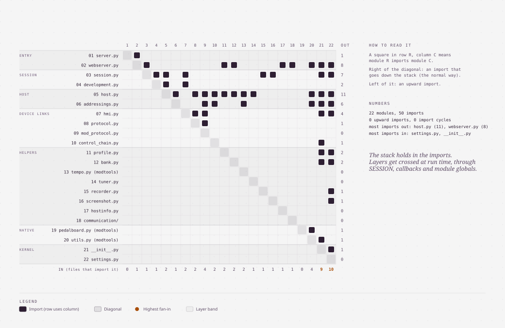

Read the matrix as a layering test. **Every import points down the stack and there is no cycle**, which is better than most programs of this age. The fan-in sits where it should
(`settings.py`, `__init__.py`). What the matrix cannot show is the coupling that is *not* an import: the shared `SESSION` object, the callbacks the Host receives
(`msg_callback`, `hmi_initialized_cb`), the module globals of `modtools.utils`, and the class-level `Protocol` registry. That is where the layers meet (section 5).

For a drawing within the nine-node budget, `tuner.py`, `tempo.py` and the leaf modules are shown as rows of a matrix instead of nodes, which keeps all 50 imports.

---

## 5. How it runs

### 5.1 One thread, four peers

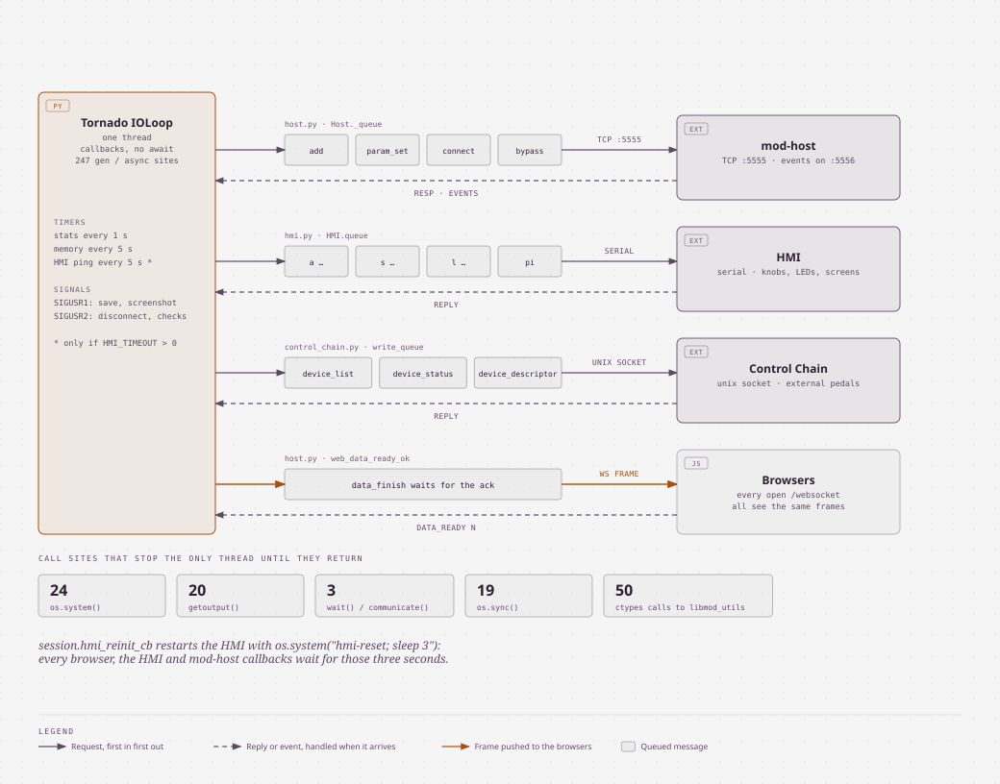

- **Three copies of the same queue.** `Host._queue`, `HMI.queue` and `ControlChainDeviceListener.write_queue` are each a FIFO of `(message, callback, datatype)` with an *idle* flag: write one
  message, wait for the reply, pop the next. The mechanism is written three times, with small differences (only the HMI has a flush timeout).
- **Back-pressure towards the browsers.** mod-host reports a finished audio cycle with `data_finish`. While a browser is connected the Host does not forward it until the browser answers
  `data_ready <counter>` (debounced 50 ms in `host.js`), so a slow browser slows the *meters*, not the engine.
- **What blocks the thread.** 24 `os.system` calls (`mod-amixer`, `hmi-reset`), 20 `getoutput` calls (`mod-amixer`, `tar`), 3 `wait`/`communicate`, 19 `os.sync()`, and 50 calls into the C++ library.
  The worst is [`hmi_reinit_cb`](../mod/session.py#L140): `os.system("/usr/bin/hmi-reset; /usr/bin/sleep 3")` freezes every browser, the HMI and mod-host callbacks for three seconds. The code
  knows the problem: the helper `run_command` ([`webserver.py:162`](../mod/webserver.py#L162)) waits for a child on a thread and posts the result back to the loop, with a comment
  explaining that the older epoll-based version never fired on macOS and Windows.
- **Timers and signals.** `statstimer` every second (CPU load, xruns), `memtimer` every five (RAM, CPU frequency, temperature), an HMI ping every five seconds *if* `HMI_TIMEOUT > 0`.
  `SIGUSR1` and `SIGUSR2` are **overloaded by marker files**: the handler looks at which file exists under `/root` or `/tmp` to decide whether it means "save the pedalboard",
  "take an HMI screenshot", "firmware updated", "boot check", "upgrade check" or "disconnect" ([`webserver.py:2677`](../mod/webserver.py#L2677)).

### 5.2 One pedalboard load

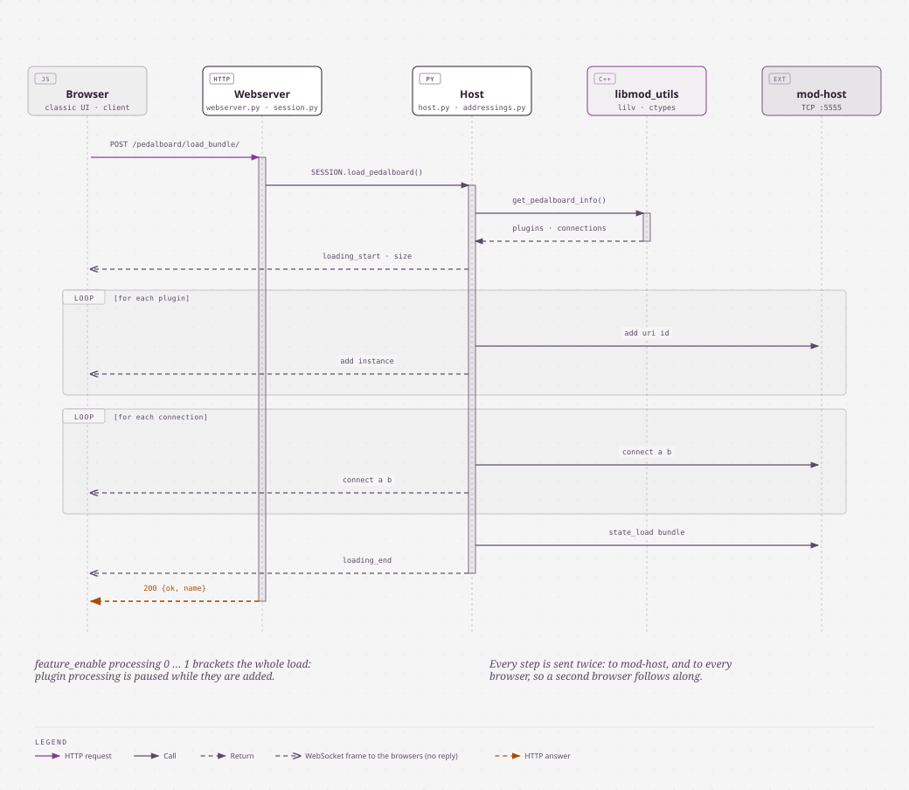

The classic UI first calls `GET /reset` and then `POST /pedalboard/load_bundle/`. `Session.load_pedalboard` pauses plugin processing (`feature_enable processing 0`), `Host.load` does the work, and processing resumes.
`Host.load` reads the bundle through `get_pedalboard_info`, announces `loading_start` and `size`, maps MIDI hardware ports by *name* (a USB device can come back with another port name),
adds each plugin to mod-host and tells the browsers, connects, restores plugin state (`state_load`), loads the addressings (which also programs the HMI and Control Chain), and ends with `loading_end`.
The figure leaves out the snapshots, the MIDI mapping and the transport, to stay within five lifelines and twelve messages.

The consequence worth knowing: **every state change is sent twice**, once to mod-host and once to the browsers, by the Host itself. The browser never infers a change; it only renders frames.
That is why `modui-client` has to rebuild the graph from the replay (`/websocket` sends `loading_start … loading_end` to a new socket).

### 5.3 The Host and mod-host

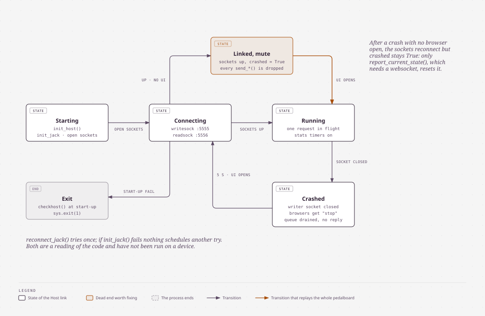

When the write socket to mod-host closes ([`host.py:1278`](../mod/host.py#L1278)) the Host sets `crashed`, stops its timers, sends `stop` to every browser, drains the queue with failed
callbacks, and calls `reconnect_jack` after five seconds. The **replay** (the same `report_current_state` that brings a new browser up to date) re-adds every plugin, reloads their state,
and restores parameters, MIDI maps, CV maps and connections in mod-host. Reading the code, two paths do not heal:

1. **No browser open.** `report_current_state(None)` returns at once ([`host.py:2028`](../mod/host.py#L2028)), and `crashed` is only reset *after* that check
   ([`host.py:2049`](../mod/host.py#L2049)). While `crashed` is `True`, `send_modified` and `send_notmodified` return a default answer without sending
   ([`host.py:1973`](../mod/host.py#L1973), [`1984`](../mod/host.py#L1984)). A device used only through its HMI would therefore stay silent until someone opens the web page.
2. **JACK not back after five seconds.** `reconnect_jack` returns when `init_jack()` fails and schedules nothing else ([`host.py:1379`](../mod/host.py#L1379)); the next try is a browser connecting.

Neither was run on hardware. They are the first thing to check on a device by killing `mod-host` while no browser is open (section 12, item 2). The `TODO` at the end of the replay
("restore HMI and CC addressings if crashed") shows the authors knew the replay is incomplete.

### 5.4 The channels

| Channel | Direction | Format | Size of the vocabulary | Where defined |
|---|---|---|---|---|
| HTTP | browser → server | query/form/JSON; most handlers answer a bare `true`/`false` | 89 routes (93 documented operations) | [`webserver.py:2511`](../mod/webserver.py#L2511), [`openapi.yml`](openapi.yml) |
| `/websocket` | browser → server | space-separated text | 14 commands (`param_set`, `plugin_pos`, `patch_set`, `transport-*`, `data_ready`, ...) | [`webserver.py:1246`](../mod/webserver.py#L1246) |
| `/websocket` | server → browser | space-separated text | about 40 frame names (`add`, `remove`, `connect`, `param_set`, `output_set`, `loading_start`, `loading_end`, `stats`, `hw_add`, ...) | `msg_callback` in `host.py`, `session.py`, `addressings.py` |
| `/rpbsocket`, `/rplsocket` | `mod.audio` page → server | one message, then close or reply | pedalboard id; a base64 plugin tarball | [`webserver.py:1178`](../mod/webserver.py#L1178), [`1199`](../mod/webserver.py#L1199) |
| mod-host | server → mod-host `:5555`, events on `:5556` | NUL-terminated text, `resp N` | about 35 commands | [`host.py`](../mod/host.py) |
| HMI | both | NUL-terminated text | 87 shared + 15 model-specific commands | [`mod_protocol.py`](../mod/mod_protocol.py) |
| Control Chain | server → daemon | NUL-terminated JSON | 3 requests | [`control_chain.py`](../mod/control_chain.py) |
| libmod_utils | Python → C++ | `ctypes` | about 50 functions | [`utils.h`](../utils/utils.h), [`modtools/utils.py`](../modtools/utils.py) |

### 5.5 What is stored where

| What | Where | Written by | Format |
|---|---|---|---|
| Pedalboards | `~/.pedalboards/<name>.pedalboard/` (`LV2_PEDALBOARDS_DIR`), factory ones in `/usr/share/mod/pedalboards` | `Host.save_state_*` | LV2 bundle: `manifest.ttl`, `<name>.ttl`, `addressings.json`, `snapshots.json`, `screenshot.png`, `thumbnail.png` |
| Plugins | `~/.lv2` (`LV2_PLUGIN_DIR`) | install handlers | LV2 bundles, scanned by lilv |
| Banks | `<DATA_DIR>/banks.json`, factory `/usr/share/mod/banks.json` | `bank.py` | JSON, written through an atomic rename |
| Last bank and pedalboard | `<DATA_DIR>/last.json` | `bank.py` | JSON |
| Preferences, favourites, user id | `prefs.json`, `favorites.json`, `user-id.json` | `UserPreferences`, handlers | JSON |
| Profiles (4 user + 1 intermediate) | `profile1..5.json` | `profile.py` | JSON; also applied to the ALSA mixer on the device |
| Cloud tokens and keys | `tokens.conf`, `keys/`, `mod_api_key.pub`, `rsa`, `tag`, `uid` | `TokensSave`, `server.py` (dev credentials) | JSON, PEM |
| User files (NAM, IR, audio) | `/data/user-files` | `FilesUpload` | files by type and folder, plus a metadata sidecar for TONE3000 |
| Device settings | `/data/*` marker files (`jack-buffer-size`, `jack-mono-copy`, `enable-mod-sdk`, `autorestart-hmi`, `bluetooth/name`, ...) | `SystemExeChange` | existence or one line of text |
| Plugin state during a session | `<DATA_DIR>/pedalboard-tmp-data` | mod-host (`state_tmpdir`) | emptied at start |
| Signals between services | `/root/hmi-screenshot-mode`, `/root/boot-system-check`, `/root/check-upgrade-system`, `/tmp/cc-firmware.bin` | the OS image | marker files read by the signal handlers |

---

## 6. Features and the parts they touch

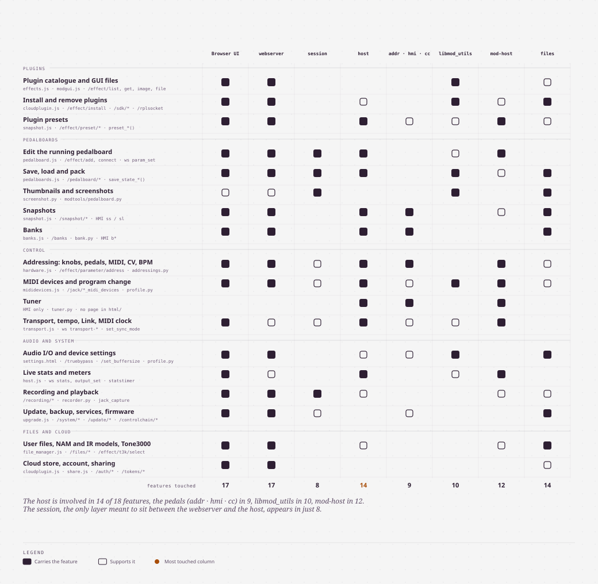

● carries the feature, ○ supports it. The table is generated from [`diagrams/src/data.py`](mod-ui/diagrams/src/data.py), the same data that draws the figure.

| Group | Feature | Entry points | Browser UI | webserver | session | host | addr · hmi · cc | libmod_utils | mod-host | files |
|---|---|---|---|---|---|---|---|---|---|---|
| Plugins | Plugin catalogue and GUI files | `effects.js · modgui.js · /effect/list, get, image, file` | ● | ● |  |  |  | ● |  | ○ |
| Plugins | Install and remove plugins | `cloudplugin.js · /effect/install · /sdk/* · /rplsocket` | ● | ● |  | ○ |  | ● | ○ | ● |
| Plugins | Plugin presets | `snapshot.js · /effect/preset/* · preset_*()` | ● | ● |  | ● | ○ | ○ | ● | ○ |
| Pedalboards | Edit the running pedalboard | `pedalboard.js · /effect/add, connect · ws param_set` | ● | ● | ● | ● |  | ○ | ● |  |
| Pedalboards | Save, load and pack | `pedalboards.js · /pedalboard/* · save_state_*()` | ● | ● | ● | ● |  | ● | ○ | ● |
| Pedalboards | Thumbnails and screenshots | `screenshot.py · modtools/pedalboard.py` | ○ | ○ | ● |  |  | ● |  | ● |
| Pedalboards | Snapshots | `snapshot.js · /snapshot/* · HMI ss / sl` | ● | ● |  | ● | ● |  | ○ | ● |
| Pedalboards | Banks | `banks.js · /banks · bank.py · HMI b*` | ● | ● |  | ● | ● |  |  | ● |
| Control | Addressing: knobs, pedals, MIDI, CV, BPM | `hardware.js · /effect/parameter/address · addressings.py` | ● | ● | ○ | ● | ● |  | ● | ○ |
| Control | MIDI devices and program change | `mididevices.js · /jack/*_midi_devices · profile.py` | ● | ● | ○ | ● | ○ | ● | ● | ○ |
| Control | Tuner | `HMI only · tuner.py · no page in html/` |  |  |  | ● | ● |  | ● |  |
| Control | Transport, tempo, Link, MIDI clock | `transport.js · ws transport-* · set_sync_mode` | ● | ○ | ○ | ● | ○ | ○ | ● |  |
| Audio and system | Audio I/O and device settings | `settings.html · /truebypass · /set_buffersize · profile.py` | ● | ● |  | ○ | ○ | ● |  | ● |
| Audio and system | Live stats and meters | `host.js · ws stats, output_set · statstimer` | ● | ○ |  | ● |  | ○ | ● |  |
| Audio and system | Recording and playback | `/recording/* · recorder.py · jack_capture` | ● | ● | ● | ○ |  |  | ○ | ○ |
| Audio and system | Update, backup, services, firmware | `upgrade.js · /system/* · /update/* · /controlchain/*` | ● | ● | ○ |  | ○ |  |  | ● |
| Files and cloud | User files, NAM and IR models, Tone3000 | `file_manager.js · /files/* · /effect/t3k/select` | ● | ● |  | ○ |  |  | ○ | ● |
| Files and cloud | Cloud store, account, sharing | `cloudplugin.js · share.js · /auth/* · /tokens/*` | ● | ● |  |  |  |  |  | ○ |

How to read it:

- **The Host is on the path of 14 of 18 features** and the Session on only 8: features either go through the Host with the Session in between (editing, saving, recording), or go around it.
- **Features with no browser page.** The *tuner* is driven only by the HMI (`CMD_TUNER_*`, `tuner.py`, a tuner plugin `gxtuner` or `tuna` loaded as instance `9994`); no file under `html/` mentions it.
- **Features that only exist on a device.** Addressing to knobs and pedals, banks navigation, snapshots from the HMI, Control Chain, the Plugin Store, the file manager: MOD Desktop shows these greyed out
  or replaced by one overlay ([`desktop-app.js`](../html/js/desktop-app.js)).
- **Features that live mostly in the OS image.** Update, backup/restore, services, reboot, buffer size and CPU governor are *shell-outs* behind two handlers (`SystemExeChange`, `SystemCleanup`).
- **Plugin GUIs** (`modgui`) run the plugin's own JavaScript and CSS inside the UI page, served from the plugin bundle by `/effect/file` and `/resources`; a plugin is therefore trusted with the page (section 11).

---

## 7. Devices and run modes

### 7.1 Who is served

| Product | Evidence | How the code recognises it |
|---|---|---|
| **MOD Duo** | `_MOD_DEVICE_DUO`, `MOD_SOUNDCARD=MODDUO`, HMI model `DUO`, hostname `modduo.local` | HMI schema `DUO` (6 commands: `fn`, `bc`, `n`, `si`, `ncp`, `boot`), foot-switch navigation, headphone bypass |
| **MOD Duo X** | `_MOD_DEVICE_DUOX`, `DUOX`, `modduox.local`, `aarch64-a53` | HMI schema `DUOX` (7: `ss`, `sl`, `sc`, `pa` for pages, `s_contrast`, `exp_overcurrent`, `boot`), CV/expression modes, split S/PDIF (`has_duox_split_spdif`), the `separate-spdif-outs` setting |
| **MOD Dwarf** | `_MOD_DEVICE_DWARF`, `DWARF`, `moddwarf.local`, `platform == "dwarf"` | HMI schema `DWARF` (2: `cs` for control sub-pages, `pa` for pages, with another argument list than the Duo X), `hmi_subpages` |
| **MOD Desktop** | `MOD_DESKTOP=1`, `_MOD_DESKTOP`, Windows/macOS paths | no HMI, no Control Chain, no descriptor; listens on `127.0.0.1`; the Desktop seam in `desktop-app.js` |
| **x86-64 / development** | `_MOD_DEVICE_X86_64`, `MOD_DEV_*`, `default_x64` | a Linux PC with JACK, or no JACK with `FakeHost` |
| **Control Chain devices** | `control_chain.py`, `hw_add` frames | external pedals discovered at run time through `/tmp/control-chain.sock` |

The Duo X shows a detail worth knowing: [`settings.html:162`](../html/settings.html#L162) shows the "separate S/PDIF outputs" preference only when `platform == "duox"` **and**
`model != "duox:aarch64-a53"`, so at least two Duo X hardware models exist and the page tells them apart by a string.

### 7.2 Run modes

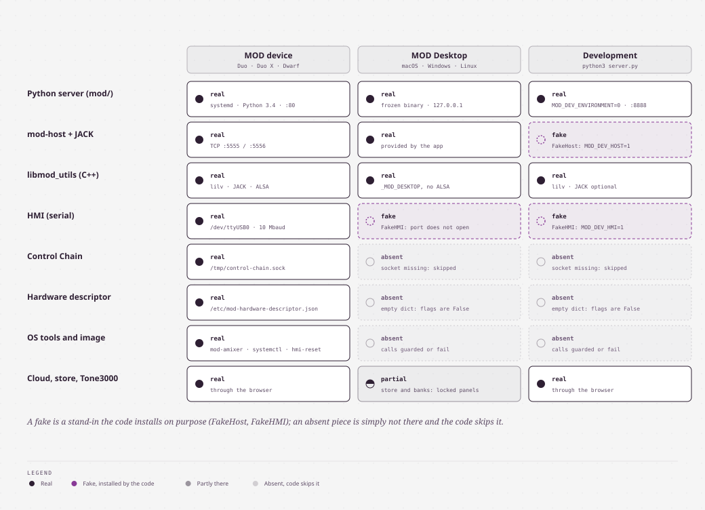

The environment decides the mode, in [`settings.py`](../mod/settings.py): `MOD_DEV_ENVIRONMENT` sets the defaults of `MOD_DEV_HMI` and `MOD_DEV_HOST`; `MOD_DESKTOP` selects the Desktop build;
`MOD_DEV_API` points the cloud addresses at the development servers. The HMI falls back to `FakeHMI` by itself when the serial port does not open
([`session.py:82`](../mod/session.py#L82)), which is how the Desktop gets a fake HMI without a flag.

### 7.3 Where the code names a device

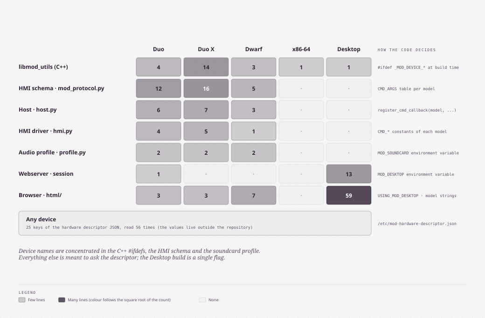

Device knowledge is concentrated in **three places** and scattered through one:

1. **C++ build macros** (`utils/utils_jack.cpp`, `utils_lilv.cpp`): the Duo X mixer controls and S/PDIF mirroring (`#ifdef _MOD_DEVICE_DUOX`, six blocks), the plugin default parameter set
   (`mod:default_duo`, `default_duox`, `default_dwarf`, `default_x64`), and **no external plugin UIs on embedded targets** (`WITH_EXTERNAL_UI_SUPPORT` is undefined for Duo, Duo X and Dwarf).
2. **The HMI schema** ([`mod_protocol.py:95`](../mod/mod_protocol.py#L95)) and the registration of model-specific callbacks in the Host constructor
   ([`host.py:526`](../mod/host.py#L526) to [`549`](../mod/host.py#L549)). The one conditional on a real device is `platform != "dwarf"`: only then is `ncp` registered under the `DUO` schema.
3. **The soundcard profile** ([`profile.py:33`](../mod/profile.py#L33)): the volumes and modes are applied by calling `mod-amixer` with different controls per `MOD_SOUNDCARD`.
4. **Everything else is delegated to the hardware descriptor** (below), plus the Desktop flag (13 mentions in the server, 59 in the browser).

#### The five spellings of a device

| Where | Spelling of "Duo X" | Of "Dwarf" |
|---|---|---|
| Hardware descriptor (`platform`, `model`, `bin-compat`) | `duox`, `duox:aarch64-a53`, `aarch64-a53` | `dwarf` |
| HMI protocol model (`mod_protocol.py`) | `DUOX` | `DWARF` |
| Soundcard (`MOD_SOUNDCARD`, `profile.py`) | `DUOX` | `DWARF` |
| C++ macro | `_MOD_DEVICE_DUOX` | `_MOD_DEVICE_DWARF` |
| Default parameter of an LV2 plugin | `mod:default_duox` | `mod:default_dwarf` |

The Duo is spelled `DUO` in the protocol, `MODDUO` for the soundcard, `_MOD_DEVICE_DUO` in C++, and the OS update file is still named `modduo.tar`.
A new device means touching all of them (section 18.3).

#### The hardware descriptor

`/etc/mod-hardware-descriptor.json` (`HARDWARE_DESC_FILE`) is read by 25 keys, 56 times. It is the only declarative description of a device, and it is **not in this repository**.

| Keys | Read by | Meaning |
|---|---|---|
| `name`, `model`, `platform`, `architecture`, `cpu`, `bin-compat` | `webserver.py` | Identity shown in `/system/info`; `bin-compat` selects which plugin binaries the store sends |
| `actuators` | `addressings.py`, `hmi.py`, `host.py`, `__init__.py` | The list of knobs, footswitches and pedals the UI can address |
| `addressing_pages`, `hmi_subpages`, `hmi_show_empty_pages`, `hmi_actuator_group_prefix` | `addressings.py`, `host.py`, `webserver.py` | How the HMI pages the controls it shows |
| `hmi_bank_navigation` | `host.py`, `session.py` | Footswitches change the pedalboard |
| `hmi_set_pb_name`, `hmi_set_ss_name`, `hmi_set_master_vol`, `hmi_set_tuner_input`, `hmi_set_tuner_ref_freq`, `hmi_set_index` | `host.py`, `session.py`, `hmi.py` | What the Host pushes to the HMI after boot and after a load |
| `factory_pedalboards` | `host.py`, `webserver.py` | Whether factory banks exist; shifts the bank-index arithmetic (`userbanks_offset`, `pedalboard_index_offset`, `first_user_bank`) |
| `hmi_eeprom` | `webserver.py` | Whether "clean up HMI settings" is offered |
| `tuner_resolution`, `tuner_input_save` | `host.py` | Tuner display and memory |
| `swapped_audio_channels`, `has_noisegate`, `codec_truebypass` | `host.py`, `webserver.py` | Audio routing details of the board |

Two of these decide arithmetic that is easy to get wrong: with `factory_pedalboards` the HMI bank list gets two divider entries and an "all factory pedalboards" bank, and `Host.initialize_hmi`
works out indices with offsets such as `numUserBanks + 3` ([`host.py:1404`](../mod/host.py#L1404) onward).

---

## 8. What the code is tied to

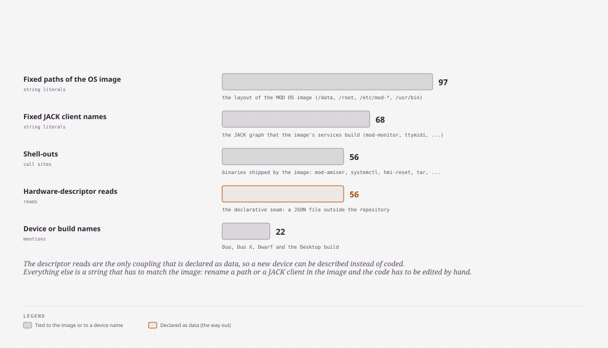

| Tie | Count | What it assumes | Examples |
|---|---|---|---|
| Fixed paths | 97 | The layout of the MOD OS image | `/data/…` marker files, `/root/…` signals, `/etc/mod-release/*`, `/usr/bin/mod-amixer`, `/usr/share/mod/*`, `/sys/class/thermal`, `/proc/meminfo` |
| Fixed JACK client names | 68 | The JACK graph the image's services build | `mod-monitor:out_1`, `system:playback_1`, `mod-peakmeter:in_3`, `mod-midi-merger:out`, `ttymidi:MIDI_in`, `mod-spi2jack`, `nooice*` |
| Shell-outs | 56 | Programs shipped by the image | `mod-amixer` (43 uses), `systemctl`, `hmi-reset`, `mod-backup`, `tar`, `jack_capture`, `sndfile-jackplay` |
| Descriptor reads | 56 | A JSON file that the image writes | section 7.3 |
| Device or build names | 22 | Duo, Duo X, Dwarf, Desktop | section 7.3 |

Other fixed points that matter when moving the code:

- **Ports and sockets.** mod-host on `localhost:5555` and `:5556` (`MOD_DEVICE_HOST_PORT` moves both), the HMI on `/dev/ttyUSB0` (`MOD_HMI_SERIAL_PORT`), the web server on port 80 (`MOD_DEVICE_WEBSERVER_PORT`; `server.py` sets 8888). The Control Chain socket path, `/tmp/control-chain.sock`, is a class attribute and cannot be overridden.
- **Instance ids.** `9993`, `9994` and `9995` are reserved; the `MIDI_BEAT_CLOCK_SENDER_URI`, the tuner plugin (`gxtuner` by default, `tuna` with `MOD_TUNER_PLUGIN`) and the `urn:mod:pedalboard` pseudo-plugin must exist in the image.
- **Cloud addresses** (`api.mod.audio`, `pedalboards.mod.audio`, `download.mod.audio`) are settings, overridable by environment variables, and baked into the page as globals.
- **Plugin binary compatibility.** The store sends a bundle only if its `bin_compat` equals the device's; `html/store.html` is a static copy that hard-codes `BIN_COMPAT = 'aarch64-a53'` and `VERSION = '1.13.0'`.
- **Python version.** The code must byte-compile on **Python 3.4**; `tools/check_py34.py` rejects f-strings, `async`, annotations and the walrus operator in CI (section 9).
- **The deploy script** ([`mod-deploy.sh`](../mod-deploy.sh)) shows the on-device layout: Python under `/usr/lib/python3.*/site-packages/mod`, the UI under `/usr/share/mod/html`, reached as `root@modduo.local`,
  `modduox.local`, `moddwarf.local` or `192.168.51.1` (the USB address).

The tie that is *declared as data* (the descriptor) is the only one a new device can use without editing code; every other row needs a patch.

---

## 9. External dependencies

### 9.1 Programs and services

| Dependency | How mod-ui reaches it | Required? | Notes |
|---|---|---|---|
| **mod-host** | TCP `:5555` (commands) and `:5556` (events) | yes (faked in development) | The plugin host; protocol in the `mod-host` repository |
| **JACK** (jack2) | through `libmod_utils` and mod-host; `systemctl restart jack2` | yes (optional in development) | Ports, aliases, buffer size, xruns, transport |
| **ALSA** | `libmod_utils` (`HAVE_ALSA`), `mod-amixer` | device only | True bypass, master volume, loopback, S/PDIF |
| **lilv / LV2** | `libmod_utils` | yes | Plugin and pedalboard parsing; `LILV_NS_MOD` for the MOD vocabulary |
| **HMI firmware** | serial | device only | Speaks the commands of `mod_protocol.py` |
| **Control Chain daemon** | unix socket | optional | External pedals |
| **systemd and the OS image** | `systemctl`, `hmi-reset`, `reboot`, `mod-backup`, marker files | device only | Services `jack2`, `mod-ui`, `mod-sdk`, `jack-netmanager`, `mod-peakmeter` |
| **jack_capture, sndfile-jackplay** | subprocess | for recording | Recording and playback of the monitor ports |
| **mod.audio cloud** | the browser (HTTPS) | optional | Store, pedalboards, accounts; `RemoteRequestHandler` allows CORS only from `mod.audio` and `moddevices.com` |
| **TONE3000** | the browser, a popup and a callback route | optional | NAM model search; the API key comes from preferences, a key file or the build |

### 9.2 Libraries

| Library | Version | Where used | Age and reach |
|---|---|---|---|
| Python | 3.4 on the device | everything | released March 2014, end of life 2019 |
| Tornado | `4.3` (pinned) | 11 modules | released November 2015; `@web.asynchronous`, `gen.engine`, `gen.Task` (removed in Tornado 6) |
| pyserial | `3.0` (pinned) | `hmi.py` | 2015 |
| Pillow, aggdraw | `>=8.2.0`, `1.3.11` | thumbnails, HMI screenshots | image rendering |
| pycryptodomex | `3.18.0` | `communication/crypto.py` | device keys, token encryption |
| jQuery, jQuery UI | `1.9.1`, `1.10.1` (2013) | 32 and 5 browser files | the whole UI |
| Mustache, Lunr, slick, crypto-js, sprintf | `0.5.0-dev`, `0.7`, ... | templates, search, carousel | |

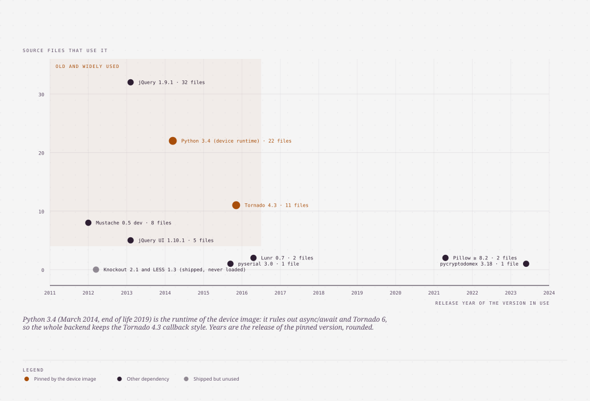

Two consequences. First, the **Python 3.4 constraint** is the reason the backend cannot use `async`/`await`, type annotations or a current Tornado; it comes from the OS image, not from taste,
and the project guards it in CI (`pycompat.yml`, `tools/check_py34.py`, with the history of the day f-strings took the device UI down). Second, **`requirements.txt` needs a patch on a modern
Python** (`sed … collections.MutableMapping` in Tornado 4.3, noted in the file itself), so a development machine runs software that the project cannot install unchanged.

Unused weight: `html/js/lib` holds **3.5 MB** that no page or script loads (`knockout.js` 2.1.0, `less-1.3.0.min.js`, `n3-browser.min.js`, `json2.js`, `jquery.mCustomScrollbar.js`,
`jquery-datatables-editable/`, `development-bundle/`). The deploy script still copies `html/js/lib/*.js` to the device.

---

## 10. The browser side


- **One controller object.** `Desktop` ([`desktop.js`](../html/js/desktop.js), 2,193 lines) is created in `index.html` and assigned to the global `desktop`; it builds `WindowManager`, `InstallationQueue`,
  `HardwareManager` (addressing dialogs), `SnapshotsManager`, `MidiPortsWindow`, `ControlChainDeviceManager`, `TransportControls`, `NetworkStatus`, and every panel widget. Despite the name it runs on the hardware too: *desktop* is
  the workspace metaphor, older than MOD Desktop.
- **No modules.** The 28 scripts share globals (`desktop`, `PLATFORM`, `BIN_COMPAT`, `HARDWARE_PROFILE`, `PREFERENCES`, `TEMPLATES`) and jQuery plugins (`JqueryClass('effectBox', …)`). `test/js/harness.js` loads the **real** files into jsdom with `window.eval` for that reason.
- **Two JavaScript code bases in one file.** `modgui.js` (3,114 lines) renders a plugin's icon, settings and widgets and runs the plugin's own script; `modui-plugin-view` is its port, so a change to the template data or the widgets must be checked in both.
- **The WebSocket router.** [`host.js:11`](../html/js/host.js#L11) opens `new WebSocket("ws://" + window.location.host + "/websocket")` — the scheme is hard-coded, so the page cannot work behind HTTPS.
  It answers `ping` with `pong`, acknowledges `data_ready`, and turns about 40 frame names into method calls on `desktop`.
- **Templates and cache.** The page loads `js/templates.js`, which concatenates every `html/include/*.html` into `TEMPLATES[...]`; with `MOD_DESKTOP=1` the same endpoint also returns the Desktop partials, and an extra query parameter only changes the cache key.
- **The typed client is not used yet.** `index.html` loads `html/js/lib/modui-client.js` (generated, not committed), but no classic script calls `ModUiClient`; `modui-plugin-view` is not loaded.
- **Tests.** 18 jsdom tests cover only the Desktop seam and the TONE3000 scan; the pedalboard canvas, the plugin GUIs and the panels (about 17,000 lines) have none.

---

## 11. Limits, risks and defects

### 11.1 Constraints that shape what can be built

| Limit | Why | Effect |
|---|---|---|
| **One session.** The first browser starts the UI session and the last one ends it; every browser sees the same pedalboard. | `Session` and `Host` are singletons | No per-user state; two people editing the same pedalboard overwrite each other |
| **One thread.** Any blocking call freezes the whole device UI, the HMI and the engine callbacks. | Tornado 4.3 callbacks | Keep `os.system`, `getoutput`, large `ctypes` calls and `os.sync()` away from request paths |
| **No browser, no cloud.** The device never calls the cloud itself. | The browser is the broker | Store, accounts and updates need a browser on a network |
| **Python 3.4.** | The OS image | No `async`/`await`, annotations, f-strings; Tornado stays at 4.3 |
| **Text protocols without versions.** | History | Any new frame is a breaking change for old browsers; `modui-client` rebuilds state from the replay |
| **Pedalboards are LV2 bundles.** | mod-host loads them | Anything written to a pedalboard touches the shared LV2 vocabulary and needs agreement (`CONTRIBUTING.md`) |
| **Only HTTP, never HTTPS or WSS.** | `ws://` in `host.js`, no TLS in `server.py` | A reverse proxy needs to rewrite more than headers |
| **Settings are files.** | The image reads them | A setting is a flag or one line; there is no validation beyond a whitelist of names |

### 11.2 Trust model

There is no login, session, token or CSRF check on the local routes. The `/auth/*` routes are the *device-to-cloud* handshake, not protection of the local API.
Checks that do exist: `check_origin` on `/rpbsocket` and `/rplsocket` (origin must be `mod.audio` or `moddevices.com`, plus `localhost:8010` for plugin development), a CORS allow-list on `/hello`
and `/pedalboard/load_remote`, and Tornado's default same-origin check on `/websocket`. The implications (*reading of the code*):

- Any page that can reach the device can call state-changing routes. 49 of 89 routes accept only `GET`, including `/reset` and `/effect/add`; `POST /system/exechange` runs `reboot`, `restore`, `backup-export`,
  `backup-import` and writes the marker files; `POST /system/cleanup` deletes pedalboards, plugins, banks, favourites and license keys with `rm -rf`.
- A page of `mod.audio` can install a native plugin through `/rplsocket` (`install_package` runs `tar zxf` on a base64 body). The origin header is the only gate; plugins are shared objects loaded into the audio process.
- Plugin GUIs execute the plugin's JavaScript inside the UI page, with the page's permissions.
- `TimelessStaticFileHandler` serves files from `HTML_DIR`; `EffectFile` and `EffectResource` serve plugin bundle files. Path handling relies on Tornado's `StaticFileHandler` root check.

The device is designed for a trusted USB or local network; the project does not claim otherwise, and the trust model is worth writing down before the API is exposed through anything else.

### 11.3 Defects found while reading

None of these was changed; this guide records them. Evidence links point to the lines.

| # | Where | What | Effect |
|---|---|---|---|
| 1 | [`profile.py:73`](../mod/profile.py#L73), [`82`](../mod/profile.py#L82), [`93`](../mod/profile.py#L93) | `fill_in_mixer_values` assigns `data['output1volume']` **twice** (reading `out 1` then `out 2`), in all three soundcard branches | The value of output 2 overwrites output 1, and `output2volume` is never read back, so a saved profile restores the wrong output volume |
| 2 | [`host.py:2028`](../mod/host.py#L2028), [`2049`](../mod/host.py#L2049) | Crash recovery needs a websocket (section 5.3) | HMI-only use after a mod-host crash may stay mute (*reading of the code*) |
| 3 | [`host.py:1379`](../mod/host.py#L1379) | `reconnect_jack` tries once | If JACK is slow to return, nothing retries |
| 4 | [`recorder.py:54`](../mod/recorder.py#L54), [`webserver.py:1463`](../mod/webserver.py#L1463), [`1469`](../mod/webserver.py#L1469) | `add_handler(fd, cb, 16)` uses a raw epoll mask; the comment in `run_command` ([`webserver.py:162`](../mod/webserver.py#L162)) says that mask never fires on macOS and Windows | Playback end and "pack bundle" may hang on MOD Desktop (not run there) |
| 5 | [`session.py:147`](../mod/session.py#L147) | `os.system("hmi-reset; sleep 3")` on the event loop | Three seconds of frozen UI per HMI restart |
| 6 | [`webserver.py:2193`](../mod/webserver.py#L2193) | `AuthToken` calls `token.decode_and_decrypt` when `token` is `None` (the import is wrapped in `try/except`) | An `AttributeError` and a 500 instead of an empty answer when the crypto module is missing |
| 7 | [`setup.py`](../setup.py) | Version `0.99.8` (the `CHANGELOG` stops there), license `GPLv3` while `LICENSE` and every header say AGPL-3.0, and `from distutils…` (removed in Python 3.12) | The packaging metadata is stale and does not run on current Python |
| 8 | [`bluetooth.py`](../bluetooth.py), [`mod/old/`](../mod/old) | Python 2 `print` statements; three modules nothing imports (`host_carla`, `monitor`, `sysmond`) | Dead code that still shows up in searches; `tools/check_py34.py` already excludes `mod/old/` |
| 9 | [`hmi.py:424`](../mod/hmi.py#L424), [`webserver.py:1522`](../mod/webserver.py#L1522) | `FIXME`s: a hard-coded assignment limit that should come from `max_assigns`; "don't use external tools" for `tar` | Known debts, not defects |
| 10 | [`html/store.html`](../html/store.html) | Static copy of a page with `VERSION = '1.13.0'`, `BIN_COMPAT = 'aarch64-a53'` | Easy to forget when the image version moves |
| 11 | [`desktop.js:1200`](../html/js/desktop.js#L1200) | `share` returns without calling its callback when the cloud terms are not accepted (after it already saved the name and email) | The share window would stay on "Uploading. Please wait…" (*reading of the code*) |
| 12 | [`desktop.js:1605`](../html/js/desktop.js#L1605) | `notifyDemoPluginLoaded` is defined but never called, and nothing sets the `demo` flag the plugin templates test | The trial-plugin warning of the UI cannot appear from this code |
| 13 | [`webserver.py:1777`](../mod/webserver.py#L1777), [`desktop.js:336`](../html/js/desktop.js#L336) | `BankSave` writes `banks.json` without telling the Host; the cloud branch of the pedalboard search carries the comment "this part is never called"; `/tokens/*` has no caller | Stale in-memory banks until the last browser leaves; dead code and unused routes |

---

## 12. What to improve

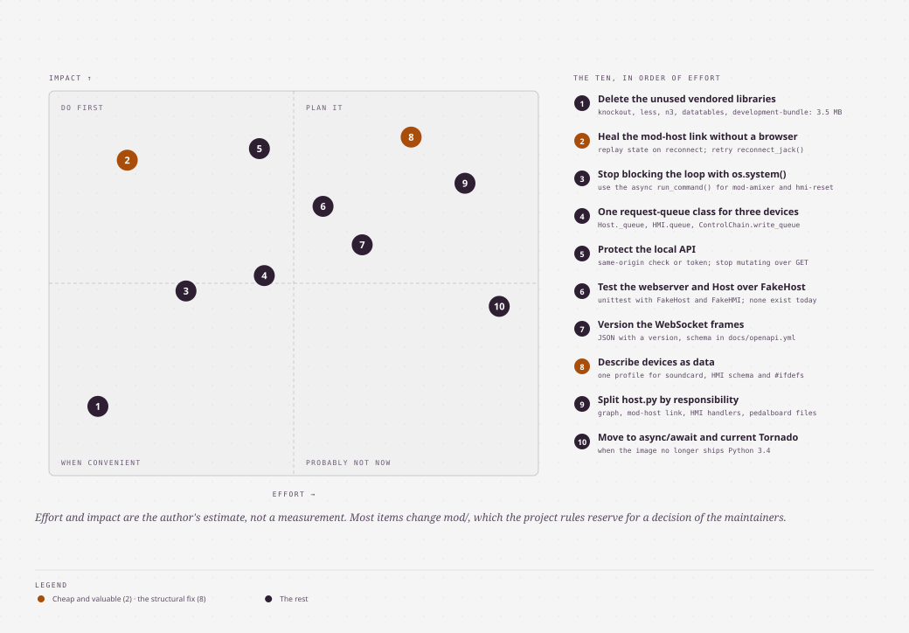

Effort and impact are **estimates**. The project rules ([`CLAUDE.md`](../CLAUDE.md)) reserve changes to `mod/`, `modtools/` and `utils/` for an explicit decision of the maintainers, so nothing here has been done.

| # | Improvement | Evidence | Sketch | Needs a backend change |
|---|---|---|---|---|
| 1 | Delete the unused vendored libraries | 3.5 MB under `html/js/lib` that no page loads (section 9) | Remove them; keep `slick`, `lunr`, `mustache`, `jquery*`, `crypto-js`, `arrive` | no (frontend) |
| 2 | Heal the mod-host link without a browser | Section 5.3 | Replay the Host state on reconnect regardless of websockets; retry `reconnect_jack` with back-off; first confirm on a device | yes |
| 3 | Stop blocking the loop | 24 `os.system`, 20 `getoutput` (section 5.1) | Use the async `run_command` already in `webserver.py` for `mod-amixer` and `hmi-reset`; move it to `mod/` so `profile.py` can use it | yes |
| 4 | One request-queue class | Three copies of the FIFO with an idle flag | A small class with `send(msg, callback)`, an idle flag, an optional timeout; `Host`, `HMI` and `ControlChainDeviceListener` use it | yes |
| 5 | Protect the local API | 49 `GET` routes, no origin check (section 11.2) | Reject cross-origin requests by `Origin`/`Host` header; move mutations to `POST`; an optional token | yes |
| 6 | Test the server over `FakeHost` | No unit test of `host.py`, `webserver.py` or `addressings.py` | `unittest` with `FakeHost` and `FakeHMI` through Tornado's test client; start with load/save and addressing | no (tests) |
| 7 | Version the WebSocket frames | About 40 frames, no version | A `hello` frame with a protocol number, documented in `openapi.yml`; keeps `modui-client` honest | yes |
| 8 | Describe devices as data | Five spellings, three places (section 7.3) | One profile per device (soundcard commands, HMI schema, capabilities, plugin defaults) loaded from a file in the repository; `#ifdef` stays for what is really compile-time | yes |
| 9 | Split `host.py` | 201 methods, six kinds of work | By seam: mod-host link, plugin graph, pedalboard files, HMI handlers, addressing; keep `Host` as a thin coordinator | yes |
| 10 | `async`/`await` and a current Tornado | 247 callback sites | Only when the image drops Python 3.4; do items 3, 4 and 9 first, they make it cheaper | yes |

Small fixes that do not need a design: the `output1volume` duplication (defect 1), `setup.py` metadata (defect 7), the raw epoll masks (defect 4), `ws://` to follow `location.protocol` in `host.js`,
and removing `mod/old/` and `bluetooth.py`. A reasonable order is **2, 1, 3, 6, then 5 and 8**: the first three are cheap and remove failure modes, the tests make the later refactors safer.

---

## 13. The architecture in detail

Questions answered in sections 13 to 17, with the figure that answers each:

| Question | Short answer | Figure |
|---|---|---|
| What exactly runs and talks inside the device? | One Python process (webserver, Session, Host, HMI driver, Control Chain listener) with a C++ library inside it, plus four other programs: mod-host, JACK/ALSA, the HMI firmware and the Control Chain daemon. | [architecture-detail](mod-ui/diagrams/architecture-detail.svg) |
| Who stores the current pedalboard? | **The Host.** The Session keeps no pedalboard data. | [state-owners](mod-ui/diagrams/state-owners.svg), [inside-host](mod-ui/diagrams/inside-host.svg) |
| Who manages the tuner? | **The Host**, from the HMI's commands; the browser has no tuner. | [tuner-sequence](mod-ui/diagrams/tuner-sequence.svg) |
| How do the layers fit, top down? | A request goes down to mod-host through five hops and its answer comes back up as a callback, a WebSocket frame and an HTTP response. | [layers-topdown](mod-ui/diagrams/layers-topdown.svg) |
| Where is everything stored, and who persists it? | Files only. The Host writes pedalboards, banks, the last pedalboard and profiles; the Session owns the preferences; the webserver writes the rest; nothing in C++ writes. | [persistence](mod-ui/diagrams/persistence.svg) |
| How are paid plugins checked? | mod-ui only tests that a file named after the SHA-1 of the plugin URI exists; enforcement is elsewhere. | [license-flow](mod-ui/diagrams/license-flow.svg) |
| How are pedalboards shared? Are there users? | The device authenticates as a device; a share is a record plus an archive that the browser carries to the cloud. There is no user login here. | [cloud-auth](mod-ui/diagrams/cloud-auth.svg), [share-flow](mod-ui/diagrams/share-flow.svg), [remote-load](mod-ui/diagrams/remote-load.svg), [identity-data](mod-ui/diagrams/identity-data.svg) |

### 13.1 The device side, link by link


The picture has eleven nodes, above the usual budget of nine, because the question was about the device as a whole; the browser and the cloud are left out on purpose.

| Link | Protocol and port | Who starts the conversation | Notes |
|---|---|---|---|
| Webserver → Session / Host | Python calls | the handler | Handlers use `SESSION.web_*` and also reach `SESSION.host.*` directly (section 3.2) |
| Host → Session | `msg_callback(frame)` | the Host | The Session passes its own method to `Host(hmi, prefs, msg_callback)`: it is the Host's output to the browsers |
| Host → mod-host | TCP `:5555` commands, `:5556` events | both: the Host sends commands, mod-host pushes events | One request in flight on the write socket; events arrive on the read socket |
| Host → HMI firmware | serial, `/dev/ttyUSB0`, 10 Mbaud | both: the pedals send commands (`tn`, `s`, `pa`, ...), the Host sends display and control updates | NUL-terminated text, one request in flight |
| Addressings → Control Chain daemon | unix socket `/tmp/control-chain.sock`, JSON | the Host | Discovery and status only; control values travel through mod-host (`cc_map`, `cc_value_set`) |
| Host → libmod_utils | `ctypes`, synchronous | the Host and the webserver | Blocks the loop while it runs |
| libmod_utils → JACK and ALSA | JACK API, ALSA mixer | libmod_utils | It is a JACK client named `mod-ui` |
| mod-host → JACK | JACK API | mod-host | One JACK client per plugin instance |

Who creates what: `server.py` imports `mod.webserver`, which imports `mod.session`, which runs `SESSION = Session()`; the Session opens the HMI (or a `FakeHMI`) and creates the Host with it; the Host
creates the `Addressings` object, which creates the Control Chain listener; the Host also creates the `Profile` and registers every HMI command in the class-level `Protocol` registry.

**One thread on purpose.** The JACK callbacks of libmod_utils (a port appeared, the buffer size changed, an xrun) run on a JACK thread, but they only append to mutex-protected lists in C++; the
Python side picks them up when it calls `get_jack_data()` (the one-second `statstimer`), so every Python callback runs on the IOLoop thread.

### 13.2 The JACK graph

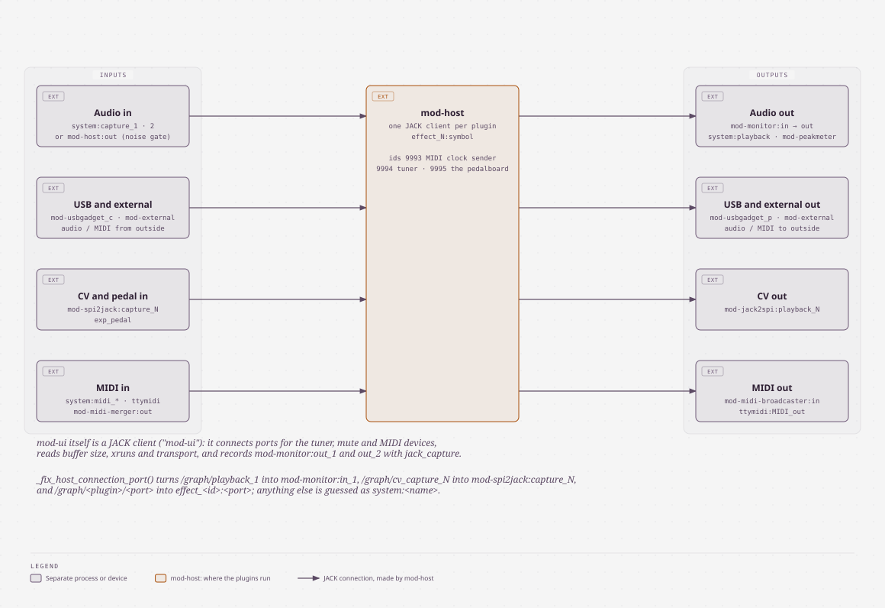

mod-ui never makes an audio connection itself: it asks mod-host (`connect`/`disconnect`) or, for hardware ports and the tuner and mute features, calls `jack_connect` through libmod_utils.
What it owns is the **name translation** (`_fix_host_connection_port`, [`host.py:3354`](../mod/host.py#L3354) onward):

| Pedalboard port | JACK port | Note |
|---|---|---|
| `/graph/capture_1`, `capture_2` | `system:capture_N`, or `mod-host:outN` when the descriptor says `has_noisegate` | |
| `/graph/playback_N` | `mod-monitor:in_N` (N up to 4 when the Duo X splits S/PDIF) | `mod-monitor:out_N` feeds `system:playback_N` and `mod-peakmeter:in_3/4` |
| `/graph/cv_capture_N`, `cv_playback_N`, `cv_exp_pedal` | `mod-spi2jack:capture_N`, `mod-jack2spi:playback_N`, `mod-spi2jack:exp_pedal` | Control-voltage ports of the devices that have the SPI bridge |
| `/graph/serial_midi_in`, `serial_midi_out` | `ttymidi:MIDI_in`, `ttymidi:MIDI_out` | DIN MIDI through a serial bridge |
| `/graph/midi_merger_out`, `midi_broadcaster_in` | `mod-midi-merger:out`, `mod-midi-broadcaster:in` | Aggregated MIDI mode |
| `/graph/audio_*_external_N`, `midi_*_external_N` | `mod-external:<name>` | |
| `/graph/USB_Audio_Capture_N`, `USB_Audio_Playback_N` | `mod-usbgadget_c:…`, `mod-usbgadget_p:…` | USB audio gadget |
| `/graph/nooice_capture_N`, `fake_capture_N` | `nooiceN:nooice_capture_N`, `fake-input:fake_capture_N` | |
| `/graph/<plugin>/<port>` | `effect_<id>:<port>` | the numeric instance id comes from `InstanceIdMapper` |
| anything else | `system:<name>` | a guess |

Hotplugged MIDI and external ports are announced to the browsers as `add_hw_port` / `remove_hw_port` frames; the recorder taps `mod-monitor:out_1` and `out_2`.

### 13.3 Start-up

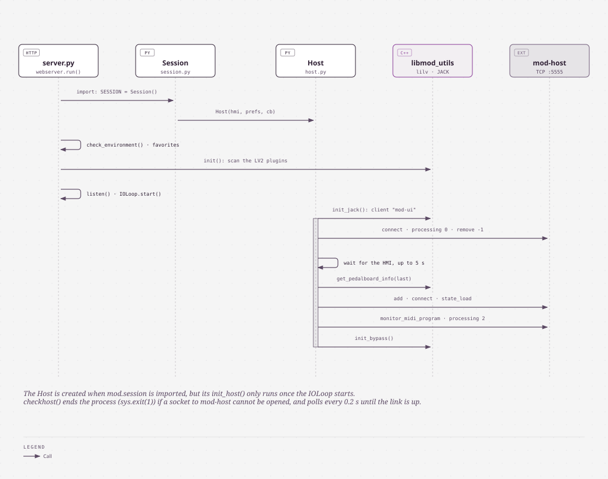

Two details of the order matter. The Host is created at **import time**, but its `init_host()` is a callback that runs only once the IOLoop starts. And the Host **reloads the last pedalboard on its own**
(`last.json`, or `default.pedalboard`), so a device with no browser attached has a loaded pedalboard and a connected HMI. Unsaved edits are not in `last.json`: after a restart they are gone.

---

## 14. Host and Session: who holds what

**The Host stores the current pedalboard, and the Host manages the tuner.** The Session does neither. The two classes look like a pair (a "web session" over a "host"), but they are not symmetrical:

| | **Session** (`session.py`, 482 lines) | **Host** (`host.py`, 7,039 lines) |
|---|---|---|
| Created by | `SESSION = Session()` at import | the Session, in its constructor |
| Is | the *web* side of the application | the *domain* side: the running pedalboard and the device |
| Holds | open WebSockets, `UserPreferences` (`prefs.json`), recorder and player, the thumbnail queue, the `screenshot_needed` flag, the HMI object, the `pedalboard_changed_callback` that MOD Desktop installs | the pedalboard (name, path, size, plugins, connections, snapshots, addressings), banks, tuner, transport, MIDI ports, profiles, the links to mod-host and the HMI, the timers |
| Does | starts and ends the UI session when the first and last browser come and go; offers `web_*` methods; fans frames out to every browser; restarts the HMI | adds and removes plugins, sets parameters, loads and saves pedalboards, snapshots and presets, addressing, talks to mod-host, handles every HMI command, replays the state |
| Reached by | the webserver (47 calls) | the webserver (51 calls), the Session, the HMI (through the `Protocol` registry, never through the Session) |


### 14.1 The current pedalboard

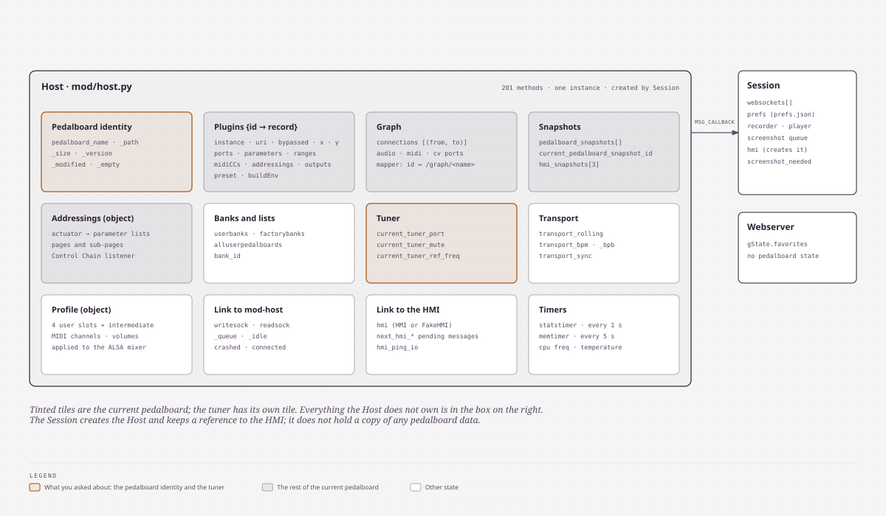

- **Identity.** `pedalboard_name`, `pedalboard_path` (the bundle on disk, or empty for an unsaved one), `pedalboard_size` (the canvas size reported by the browser), `pedalboard_version`, `pedalboard_modified` and
  `pedalboard_empty`. The index page and `GET /pedalboard/current` read them from `SESSION.host`.
- **Plugins.** `plugins` maps the numeric instance id to a record: `instance` (path such as `/graph/reverb`), `uri`, `bypassed`, `x`, `y`, the values of the control `ports`, the `parameters` (patch properties), `ranges`,
  `midiCCs`, `addressings`, `outputs` (last monitored values), `preset`, `buildEnv`. `InstanceIdMapper` translates between ids and paths because mod-host knows integers and the browser knows paths.
- **What is *not* in the browser or mod-host as source of truth.** The browser keeps a copy it rebuilds from the replay; mod-host keeps live instances, and after a crash the Host rebuilds them from this record (section 5.3).
- **Persistence.** Nothing is written until someone saves: `Host.save` (from the UI or from the HMI) writes the bundle; `last.json` only remembers *which* pedalboard was loaded or saved last.
- **The Session's part.** It remembers that the pedalboard changed (`screenshot_needed = True` on add, remove, connect, move) so that the next save schedules a new thumbnail, and it calls the MOD Desktop callback after a load or save.

### 14.2 The tuner

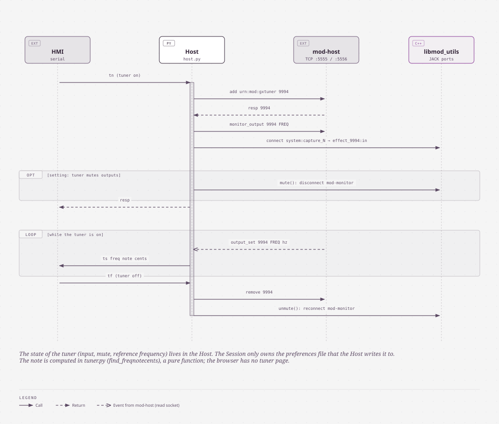

The tuner is **an LV2 plugin that the Host adds as instance `9994`** (`urn:mod:gxtuner` by default, `urn:mod:tuna` with `MOD_TUNER_PLUGIN=tuna`), not a feature of the audio engine:

1. The HMI sends `tn`. `Host.hmi_tuner_on` adds the plugin, asks mod-host to monitor its `FREQ` output (`monitor_output`), connects `system:capture_N` to it and, if the *tuner mutes outputs* setting is on, disconnects `mod-monitor` from the outputs.
2. Each time mod-host reports `output_set 9994 FREQ <hz>`, `Host.set_tuner_value` converts the frequency with `tuner.py` (`find_freqnotecents`: note name and cents from the reference frequency, scaled by the descriptor's `tuner_resolution`) and sends `ts <freq> <note> <cents>` to the HMI. Values at or below 24 Hz or at or above 999 Hz are shown as `?`.
3. The HMI changes input (`ti`), reference frequency (`tr`) or mute (a menu item), and finally `tf`, which removes the plugin and restores the outputs.

State: `current_tuner_port`, `current_tuner_mute` and `current_tuner_ref_freq` live in the Host. They are read from `prefs.json` at construction and written back through the Session's `UserPreferences` object that the Host
received in its constructor; the input port is only saved when the descriptor has `tuner_input_save`. The descriptor also decides whether the HMI is told the saved port and frequency at boot (`hmi_set_tuner_input`, `hmi_set_tuner_ref_freq`).
`hw_tuner_input_port` swaps channels when `swapped_audio_channels` is set. **No file under `html/` mentions the tuner**; it exists only on the HMI.

### 14.3 How the split came to look like this (inferred)

- The Session is where the **web lifecycle** lives; the Host was written first as the *mod-host client* and grew the pedalboard, the HMI and the addressing around it. The 73 HMI methods show it: the HMI talks to the Host through
  the `Protocol` registry and never sees the Session.
- The Session's `web_*` methods are mostly thin: set `screenshot_needed`, call the Host. That is why the handlers (51 calls to `SESSION.host.*`, 7 to `SESSION.hmi.*`) skip it.
- The Session is the Host's **only way to the browsers** (`msg_callback`), which makes the dependency circular at run time (Session creates Host, Host calls back into Session) although the imports are not.

---

## 15. The layers, top down

The seven-layer figure of section 3.2 lists the layers; this one follows **one real call** through them, so each layer is seen doing something. It is the same call whatever the feature: a browser asks, the Host decides and
tells mod-host, and the answer comes back as a frame.


A reading that avoids the seven names:

| Group | Layers | What it knows | What it must not know |
|---|---|---|---|
| **Outside** | 7 Browser | what to draw, which URL to call | which device it runs on, except through globals |
| **Web** | 6 Transport, 5 Session | HTTP, WebSockets, who is connected | mod-host's protocol |
| **Device logic** | 4 Host, 3 Device links | the pedalboard, the plugins, the protocols of mod-host, the HMI and Control Chain | HTTP |
| **Native and platform** | 2 Native bridge, 1 Platform | LV2, JACK, ALSA, the OS image | the pedalboard model |

The rules of the road, as the code applies them:

- **Down:** a layer calls the one below it by a Python call (L6 to L4) or a protocol (L4 to mod-host, HMI, Control Chain). The Host may also call L2 directly (`get_plugin_info_essentials`), and the handlers may call L4 and L2 directly (section 3.2).
- **Up:** nothing calls upward. The Host **pushes** with `msg_callback`; the Session turns that into `write_message` on every socket; `host.js` turns the frame into a call on `desktop`. HTTP answers are the second way up.
- **Sideways:** the HMI (L3) calls the Host (L4) when the user turns a knob. It is the only layer that starts a conversation upward, and it does so through the `Protocol` registry, not through the Session.

---

## 16. Where things are stored, and who persists them


**There is no persistence layer.** Each writer opens its own files, so the question "who persists?" has a different answer per store:

| Writer | Persists | How | Notes |
|---|---|---|---|
| **Host** | the pedalboard bundle (`manifest.ttl`, `<name>.ttl`, `addressings.json`, `snapshots.json`), `banks.json` for HMI edits, `last.json`, `profile*.json`, tuner and bank-navigation preferences | `TextFileFlusher` (write to `.tmp`, fsync, rename) | The only writer of the pedalboard model; `save_state_*` write TTL by hand with string formatting |
| **Session** | `prefs.json` (`UserPreferences`) | `setAndSave`: atomic by default, or `saveAsync` with a plain `open` | The Host and the webserver write through the Session's object |
| **Webserver** | `favorites.json`, `user-id.json`, `tokens.conf`, `banks.json` (UI edits), plugin bundles installed or removed, user files, pedalboard copies, deletions, the `/data` marker files | a mix of `TextFileFlusher`, plain `open`, `shutil` and `tar` | The widest writer: 9 of the 22 stores |
| **mod-host** | plugin state inside the bundle (`state_save`), preset bundles (`preset_save`), the temporary state directory | on the Host's command | The Host chooses the path; mod-host writes the files |
| **Subprocesses** | thumbnails and the port-column cache (`modtools.pedalboard`), recordings (`jack_capture`), extracted tarballs (`tar`) | external programs | |
| **OS image** | identity (tag, uid, RSA key, server key), the descriptor, release files, factory pedalboards and banks, the license keys | outside this repository | In development `server.py` invents a dummy identity |
| **libmod_utils** | nothing | read-only (lilv scans, `std::ifstream` for the key files) | |

Facts worth knowing:

- **Two writers of `banks.json`.** The HMI edits banks through the Host (`save_banks(self.userbanks)`), the browser saves them through `BankSave` directly. The Host refreshes its in-memory copy when the last browser leaves
  (`end_session`) or the HMI re-initialises; between those moments the Host's copy can be stale.
- **`prefs.json` has three writers** (Session, Host, webserver) and two save modes.
- **A pedalboard is a directory.** Saving writes the bundle in a fixed order (create the directory, write TTL, `last.json`, then ask mod-host to `state_save`), and `os.sync()` after the state is saved. A crash between steps leaves a bundle without
  plugin state.
- **The browser persists nothing** except TONE3000 tokens in `sessionStorage`; preferences are copied into the page as the `PREFERENCES` global at render time.
- **Lifetime.** Everything under `~/.pedalboards`, `~/.lv2`, `<DATA_DIR>` and `/data` survives a reboot; `/tmp`, `pedalboard-tmp-data` and the Host's memory do not (`check_environment` wipes the temporary directory and the capture files at start).

---

## 17. The cloud: identity, plugin licenses and sharing

### 17.1 Are there users?

**Not in this repository.** What exists:

- A **device identity**: `tag`, `uid`, an RSA private key and the server's public key (`MOD_DEVICE_TAG`, `MOD_DEVICE_UID`, `MOD_DEVICE_KEY`, `MOD_API_KEY`), plus the image version. The cloud sees *a device*.
- A **free-text author** in the share form: a name and an email typed by whoever uses the page. `POST /save_user_id/` stores them in `user-id.json`, and `index()` reads that file to **prefill the form** the next time. They are sent to the cloud
  as `author` and `email` with every share ([`desktop.js:1189`](../html/js/desktop.js#L1189), [`1225`](../html/js/desktop.js#L1225)). Nothing else in the repository reads them; there is no password, no login and no per-user data on the device.
- **Leftovers of a login model.** `/tokens/get`, `/tokens/save` and `/tokens/delete` store a `user_id`, an access token and a refresh token in `tokens.conf`, and `/auth/token` carries the comment "don't ever save this token locally";
  **no script in this repository calls the `/tokens/*` routes**. They may serve another client (MOD Desktop, the website) or an older design. Whether the cloud has accounts, and what the token's `user_id` would mean, cannot be told from here.

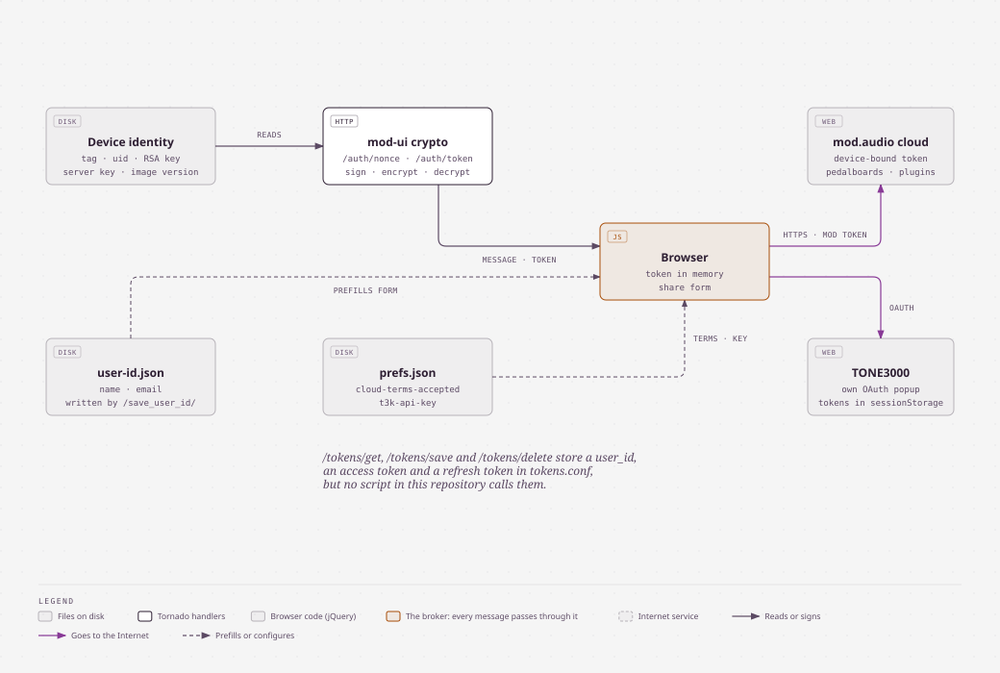

What crosses the Internet, and who sends it:

| Data | Sent by | To | When |
|---|---|---|---|
| nonce, device tag, uid, image version, a signature (encrypted for the cloud) | the browser, built by mod-ui | `api.mod.audio/devices/*` | device authentication, once per page (and again on `401`) |
| author name and email, title, description, `hidden` | the browser | `POST /pedalboards/` | sharing |
| the pedalboard bundle and, if recorded, a 3-minute audio demo | the browser, relaying what mod-ui packs | the `upload_href` of the record | sharing |
| plugin URIs | the browser | `POST /pedalboards/validate/` | validating a pedalboard |
| `Authorization: MOD <token>` | the browser | cloud downloads (plugins, pedalboards) | every authenticated request |
| the TONE3000 API key and OAuth code | the browser (popup) | `tone3000.com` | NAM model search; separate from the MOD token |

Sending anything to the cloud requires `cloud-terms-accepted` in `prefs.json`; on a device the terms dialog is shown once.

### 17.2 Authentication

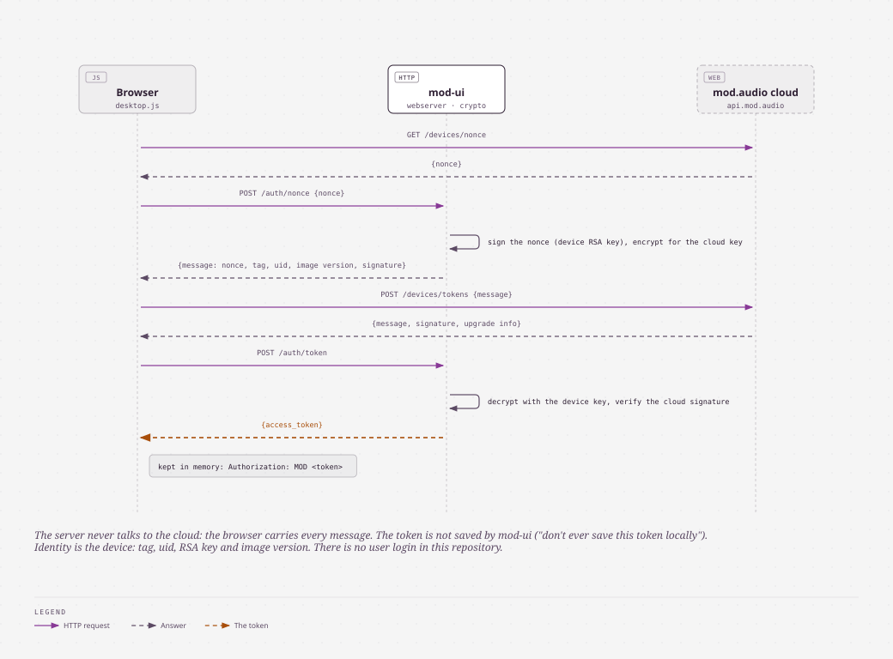

The two server routes are in [`webserver.py:2183`](../mod/webserver.py#L2183) and [`communication/token.py`](../mod/communication/token.py). The device signs the cloud's nonce (SHA-1, PKCS#1 v1.5) with its private key and
sends `{nonce, device_tag, device_uid, image_version, signature}` encrypted with the cloud's public key (RSA-OAEP for a random AES key, AES-EAX for the data). The cloud answers with a message encrypted for the device; for tokens whose
JWT `version` is 2.3.2 or newer, mod-ui also checks the cloud's signature. The result is the **access token**, which the browser holds in memory (`desktop.cloudAccessToken`) and sends as `Authorization: MOD <token>`.
Authentication runs when the page loads (once the cloud terms are accepted) and again, lazily, whenever an install, share or remote load finds no token; a share retries once on a `401`. The reply may also say an OS **upgrade** is available, which opens the upgrade window.

### 17.3 Sharing a pedalboard

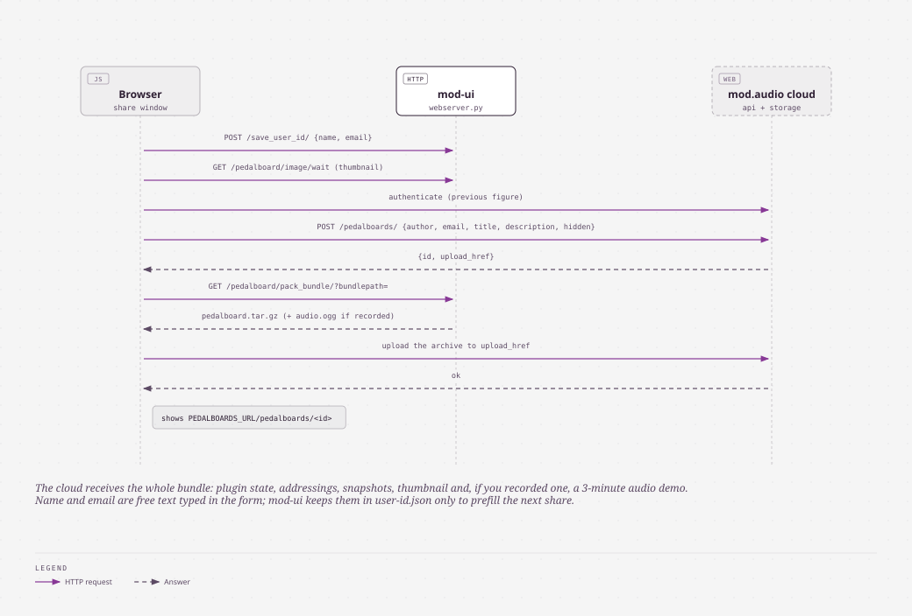

- **What is shared is the whole bundle**: the TTL, plugin state, addressings, snapshots and thumbnail, packed by `GET /pedalboard/pack_bundle/` with `tar chzf`, plus `audio.ogg` if the user recorded a demo (`Recorder`, up to 3 minutes of `mod-monitor`).
- **The browser relays the bytes.** `SimpleTransference` reads the archive from the device and uploads it to the cloud's `upload_href`, so the device never opens an outbound connection.
- **The thumbnail is required.** The share window waits for `ScreenshotGenerator` (up to three attempts) and warns if the pedalboard uses unstable (Labs) plugins.
- **Create only.** This code never updates or deletes a shared pedalboard. The cloud answers with an `id`, which the window turns into `PEDALBOARDS_URL/pedalboards/<id>` and Facebook and Twitter links; `hidden` is passed through (what the cloud does with it is not visible here).
- **Privacy.** The author and email are free text, sent as typed; the pedalboard may contain file paths of user files in its state.

### 17.4 Loading a shared pedalboard

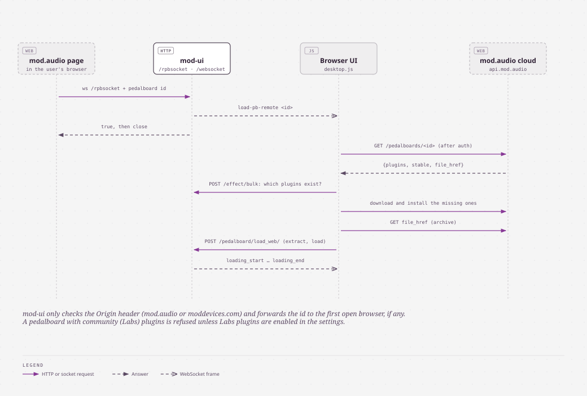

The website cannot talk to the cloud *for* the device, so it talks to the device: `RemotePedalboardWebSocket` accepts a pedalboard id from a page whose `Origin` is `mod.audio` or `moddevices.com` and forwards `load-pb-remote <id>` to the **first** open browser
(`websockets[0]`); if none is open it answers `false`. From there the UI does everything: authenticate, fetch the record (`{data: {plugins, stable}, file_href}`), refuse a Labs pedalboard unless Labs plugins are enabled, **install the missing
or outdated plugins** (`/effect/bulk` tells which exist), download the archive and `POST /pedalboard/load_web/`, which extracts it with `tar -xvf` and loads it (a `FIXME` asks for a Python implementation).

### 17.5 Paid plugins and licenses


**mod-ui does not verify licenses.** What the code does (`utils_lilv.cpp`, `get_plugin_info` and `get_plugin_info_mini`):

1. If the plugin's TTL declares the extension `http://moddevices.com/ns/ext/license#interface`, look for the file `<MOD_KEYS_PATH>/<sha1 of the plugin URI>`.
2. File present → `licensed = 1` (paid); absent → `licensed = -1` (trial). No extension → `licensed = 0` (free or non-commercial). **Only the existence of the file is tested**: its content is never read, hashed or validated.
3. A pedalboard whose plugins include a trial one (and which is not a factory pedalboard) gets `hasTrialPlugins`, which the Host turns into `FLAG_NAVIGATION_TRIAL_PLUGINS` for the HMI's pedalboard list.
4. The `licensed` number is sent to the browser with the plugin data, where the store templates draw a badge and a price.

What the repository does **not** contain, so cannot be explained from it:

- **Who writes the key file.** mod-ui never creates it; `check_environment` only creates the empty `keys/` directory and `SystemCleanup` can delete it (`licenseKeys`). Purchase happens in the store page (an embedded buy button with a `shopify_id`), and plugin
  downloads are authenticated with the device token, which would let the cloud bind a download to a device, but where the key lands is not visible here.
- **Enforcement.** The protocol table has `ERR_INSTANCE_UNLICENSED` (`-4`) among mod-host's errors, and the UI text says a trial plugin "will intentionally mute the audio at regular intervals". Both belong to mod-host and the plugin, not to mod-ui.

Observations (*reading of the code*, not tried in a browser):

- `desktop.js:1605` defines a warning for trial plugins (`notifyDemoPluginLoaded`), but **no code in this repository calls it**, and no script sets the `demo` flag that the plugin templates test.
- Mustache's `{{#licensed}}` is true for any non-zero number, so a record with `licensed = -1` (trial) would show the same badge as a paid one wherever a local record is rendered with those templates.
- Because the check is a file test, a user who can write to `<DATA_DIR>/keys` can turn trial into paid *in this UI*; whether the plugin accepts it is up to the plugin.

---

## 18. Method, tests and how to extend

### 18.1 How the numbers were obtained

`diagrams/src/measure.py` reads the working tree; nothing is typed by hand. The definitions:

| Figure | Method |
|---|---|
| Lines | `wc -l` of tracked files: Python in `mod/`, `modtools/`, `server.py`; C++ in `utils/` without `test.cpp`; JavaScript in `html/js/*.js`; HTML in `html/*.html` and `html/include/*.html` (libraries, generated code, tests and docs left out) |
| Imports | `ast` walk of every import in the Python modules; `from mod import hostinfo` is resolved to the module, `from mod import safe_json_load` to `mod/__init__` |
| Host methods | Methods of `class Host` bucketed by name prefix (`hmi_*`, `addr_*`, `snapshot*`/`preset*`/`load*`/`save*`, `send_*`/`process_*`, names containing `midi` or `jack`, the rest) |
| Reach of the handlers | Occurrences of `SESSION.host.`, `SESSION.hmi.` and other `SESSION.` calls in `webserver.py`; names imported from `modtools.utils` |
| Device mentions | Lines matching the device patterns in the listed files (case-insensitive for the device names, so comments count) |
| Descriptor keys | `.get('<key>')` on the descriptor in `mod/*.py` |
| Coupling | Call sites of `os.system`, `subprocess.*`, `getoutput`, `run_command`; string literals starting with the image paths or the JACK client names; descriptor reads; device macros and names |
| Blocking calls | Call sites of `os.system`, `getoutput`, `wait`/`communicate`, `os_sync` in `mod/*.py` and `utils.*(` calls in `modtools/utils.py` |
| Dependency reach | Python files that `import` the package; JavaScript and HTML files that mention it |

Counts are *occurrences in source text*, not executions; a `getoutput` in a rarely used branch counts as much as one in a hot path. Years of old libraries are the release year of the pinned version, rounded.

### 18.2 Tests and checks today

| What | Where | Covers |
|---|---|---|
| Python `unittest` | `test/test_hostinfo.py`, `test/test_desktop_app.py` (8 tests) | the Desktop host report, and that the device page contains no Desktop token |
| HMI integration test | `test/hmi-protocol-integrationtest.py` | needs JACK, mod-host, `socat` and mod-ui running; "probably easier to run by hand" |
| Frontend (jsdom, Node's runner) | `test/js/*.test.js` (18 tests, `jstest.yml`) | the Desktop seam and the TONE3000 scan |
| Python 3.4 syntax gate | `tools/check_py34.py` (`pycompat.yml`) | f-strings, `async`, annotations, walrus |
| pylint | `pylint -E mod/*.py` (`pylint.yml`) | errors only; `modtools/` is commented out |
| OpenAPI lint and docs | `openapi-docs.yml` | `docs/openapi.yml`, published as a Redoc page |
| TypeScript packages | `modui-packages.yml` | `modui-client` and `modui-plugin-view`: 19 test files in the client |

The core of the application, `host.py`, `webserver.py`, `addressings.py`, `hmi.py` and the C++ library, has **no automated unit test**; the Desktop seam is the best-tested part.

### 18.3 Where to start for common changes

| To… | Touch, in this order |
|---|---|
| Add an HTTP endpoint | handler in `webserver.py` → `Session.web_*` → `Host` method → mod-host command; then `docs/openapi.yml`, and `modui-client` if it covers the area (see the rules in `CLAUDE.md`) |
| Add a WebSocket frame | `msg_callback("…")` in `host.py` or `session.py` → a branch in `html/js/host.js` → the catalogue in `openapi.yml` → `modui-client` (`graph-state.ts`) |
| Add an HMI command | constant and `CMD_ARGS[model]` in `mod_protocol.py` → `Protocol.register_cmd_callback` in `Host.__init__` → the sender in `hmi.py` |
| Support a new device | the hardware descriptor (outside the repo) → a `CMD_ARGS` model → the soundcard branches in `profile.py` → a `_MOD_DEVICE_*` macro and a `mod:default_*` parameter in `utils_lilv.cpp` → `desktop-app.js` if Desktop should advertise it |
| Read a new LV2 property | `utils_lilv.cpp` and `utils.h` → the matching `ctypes.Structure` in `modtools/utils.py` (by hand) → the browser; needs discussion first because it touches the shared LV2 vocabulary |
| Add a persisted setting | a key in `prefs.json` through `UserPreferences.setAndSave`; a *marker file* only if the OS image reads it |

### 18.4 Regenerating this guide's diagrams

```sh
python3 docs/mod-ui/diagrams/src/build.py            # writes docs/mod-ui/diagrams/*.svg and index.html
python3 docs/mod-ui/diagrams/src/build.py --check    # geometry warnings only
python3 docs/mod-ui/diagrams/src/measure.py          # every number quoted above
python3 docs/mod-ui/diagrams/src/data.py             # the feature table of section 6
```

The sources, the rules and the list of diagrams are in [`mod-ui/diagrams/README.md`](mod-ui/diagrams/README.md); a gallery is in [`mod-ui/diagrams/index.html`](mod-ui/diagrams/index.html).
