# modui-client — developer guide

`modui-client` is a typed, class-based TypeScript client for the mod-ui backend. It talks to the server with
`fetch` (HTTP) and listens to the main WebSocket (`/websocket`), so callers can `await` operations until the
backend has *really* finished them (for example, until a pedalboard is fully loaded).

- **Source**: [`modui-client/src/`](../modui-client/src/)
- **Tests**: [`modui-client/test/`](../modui-client/test/)
- **Build output** (generated, not versioned): `html/js/lib/modui-client.js`
- **Wire contract**: [`docs/openapi.yml`](openapi.yml)
- **Diagrams**: [`docs/modui-client/diagrams/`](modui-client/diagrams/) (architecture and data model: one generated SVG each, defined in `diagrams/src/specs.py`; `index.html` shows them all)
- **API coverage** (what is implemented, how to use it, what is recommended next): [`docs/modui-client/implementation-progress.md`](modui-client/implementation-progress.md)
- **Plan / roadmap**: [`docs/plans/2026-10-modui-client-pedalboard.md`](plans/2026-10-modui-client-pedalboard.md);
  live editing (plugins, connections): [`docs/plans/2026-10-modui-client-pedalboard-graph.md`](plans/2026-10-modui-client-pedalboard-graph.md)

Current scope: **pedalboards** (list, info, copy, delete, images, load, load default, reset, get / save / save-as of the running pedalboard), **live editing of the running pedalboard** (installed plugins; list / add / remove its plugins; list / connect / disconnect its connections; its own ports), the pedalboard's **snapshots** (list, save, save-as, load, rename, remove) and the device's **banks** (list, create, rename, delete, reorder, add / remove / move pedalboards), the **presets** of a plugin instance (list, load, create, save, delete), the **GUI files of a plugin** (`plugin.gui`: thumbnail, screenshot and modgui URLs and texts) the user's **files** (`client.files.list`), the **system** (`client.system`: information, ping, system settings, and the dangerous operations behind `client.system.danger`), the **audio engine's** writes (`client.device.setBufferSize`, `setTrueBypass`, `resetXruns`, `switchCpuFrequency`) and the **preferences** (`client.config.mod` for mod-ui's, `client.config.app` for your application's), plus raw WebSocket access.
Plan of snapshots and banks: [`docs/plans/2026-10-modui-client-snapshots-banks.md`](plans/2026-10-modui-client-snapshots-banks.md); of the plugin GUI files: [`docs/plans/2026-10-modui-client-plugin-assets.md`](plans/2026-10-modui-client-plugin-assets.md); of the system and the preferences: [`docs/plans/2026-10-modui-client-system.md`](plans/2026-10-modui-client-system.md).

---

## 1. Quick start

One walk-through, from an empty device to a saved pedalboard. Each step builds on the previous one, so you can read
it top to bottom or paste it into the browser console of a mod-ui page.

> The snippets use `await`; run them inside an `async` function or in a console that allows top-level `await`.
> Every operation resolves only after the backend *confirmed* it on the WebSocket (see section 5).

### 1.1 Start mod-ui

```sh
# Development: fake audio host, no JACK needed
MOD_DEV_HOST=1 MOD_DEV_ENVIRONMENT=0 python3 ./server.py      # http://localhost:8888/
```

On a real device mod-ui and mod-host are already running.

### 1.2 Create the client

In a mod-ui page, `index.html` loads the build and exposes `window.ModUiClient` (and `window.ModUi` with the other
classes, such as `ModUi.ImageStatus`).

```js
const client = new ModUiClient();                  // same origin as the page
```

Other setups:

```js
// Another origin, or Node.js >= 22 (global fetch and WebSocket)
const remote = new ModUiClient({ baseUrl: 'http://modduo.local' });

// Inside the classic UI, sharing its socket (window.ws from host.js) instead of opening a second one
const shared = new ModUiClient({ webSocket: window.ws });
```

The WebSocket is opened by the operations that need it (loading, live editing); `await client.connect()` opens it
earlier and `client.close()` closes it.

### 1.3 Browse the pedalboard library

`client.pedalboards` is the library of saved pedalboards: lightweight `PedalboardReference` handles.

```js
const pedalboards = await client.pedalboards.list();    // PedalboardReference[]
const rock = pedalboards.find((pb) => pb.title === 'Rock');
console.log(rock.title, rock.factory, rock.isDefault);

const info = await rock.info();                         // PedalboardInfo: plugins, connections, hardware ... (+ bundlepath)
```

Screenshot and thumbnail of any pedalboard of the library:

```js
const images = rock.images;
img.src = images.getThumbnailUrl();                     // sync, no request
if ((await images.status()) === ModUi.ImageStatus.Missing) {   // or Generating / Available
  await images.generate();                              // waits until the images exist
  img.src = images.getThumbnailUrl();                   // new URL, bypasses the browser cache
}
```

### 1.4 Load a pedalboard

`client.device` is what is *running*. Loading is `GET /reset` + `POST /pedalboard/load_bundle/` + wait for `loading_end`.

```js
const result = await client.device.load(info);          // or load(rock): a reference works too
console.log(result.name, result.snapshotId);

await client.device.loadDefault();                      // the empty "Untitled" pedalboard
await client.device.reset();                            // remove every plugin and connection
```

From here on, all changes are made on the running pedalboard, which the examples call `currentPedalboard`.
They are queued behind `load()`, `reset()` and saves.

```js
const currentPedalboard = client.device.currentPedalboard;
```

### 1.5 Add plugins

The installed plugins (the catalogue) are `Plugin` objects; the ones in the running pedalboard are `PluginInstance`s.

```js
// Catalogue
const plugins = await client.device.plugins.list();     // Plugin[] (summaries)
const gainPlugin = plugins.find((plugin) => plugin.label === 'Gain');
console.log(gainPlugin.uri, gainPlugin.name, gainPlugin.brand, gainPlugin.category);
const details = await gainPlugin.info();                // PluginInfo: ports, parameters, presets (cached)

// Running pedalboard
const instances = await currentPedalboard.plugins.list();                          // PluginInstance[]
const gain = await currentPedalboard.plugins.add(gainPlugin, { x: 200, y: 100 });  // position is optional (default 0, 0)
console.log(gain.instance);                                                        // "/graph/Gain" ("/graph/Gain_1" if taken)
console.log(gain.x, gain.y, gain.bypassed, gain.uri);

await currentPedalboard.plugins.add('http://moddevices.com/plugins/mod-devel/Gain');  // a plain URI works too
```

### 1.6 Ports

Ports are grouped by type and direction. Control ports are not listed here: they are parameters (see 1.8).

```js
// Ports of a plugin instance
gain.ports.audio.input;     // Port[]  e.g. "/graph/Gain/in"
gain.ports.audio.output;    // Port[]  e.g. "/graph/Gain/out"
gain.ports.midi.input;      // Port[]   (also .midi.output, .cv.input, .cv.output)
const gainIn = gain.ports.audio.input[0];                  // or by symbol: gain.port('in') (Port | undefined)
const gainOut = gain.ports.audio.output[0];

// Ports of the pedalboard itself: same layout, but they come from the WebSocket, so input() / output() are
// functions that return a promise (in this client an attribute is never asynchronous)
const [capture] = await currentPedalboard.ports.audio.output();   // "/graph/capture_1": a source; owner === null
const [playback] = await currentPedalboard.ports.audio.input();   // "/graph/playback_1": a sink
const [midiSink] = await currentPedalboard.ports.midi.input();    // also .midi.output(), .cv.input(), .cv.output()
const everyPort = await currentPedalboard.ports.list();           // Port[]: audio, midi, cv; sources first
```

### 1.7 Connect

A `PedalboardConnection` always goes from an output to an input of the same type.

```js
const first = await currentPedalboard.connections.connect(capture, gainIn);   // Port objects...
const second = await currentPedalboard.connections.connect(gainOut.id, playback.id);  // ...or port ids
await currentPedalboard.connections.connect(capture, playback);               // pedalboard port to pedalboard port is fine
await currentPedalboard.connections.connect(capture, gainIn);                 // already connected: returns it, no request

const all = await currentPedalboard.connections.list();                       // PedalboardConnection[]
all.forEach((c) => console.log(c.from.id, '->', c.to.id));
```

Invalid pairs are rejected before any request (`ModUiError`):

```js
await currentPedalboard.connections.connect(gainIn, capture).catch((e) => console.log(e.message));  // input -> output
await currentPedalboard.connections.connect(capture, midiSink).catch(() => {});                     // audio -> midi
```

### 1.8 Bypass, parameters and position

```js
// Bypass: "active" = processing audio
await gain.isActive();                                 // true / false, read from the live state
await gain.setActive(false);                           // bypass
const nowActive = await gain.toggle();                 // resolves with the new state

// Parameters ("Param"): the control inputs, knobs and switches of the plugin
const params = gain.params.list();                     // Param[], synchronous (the description is already known)
const gainParam = gain.params.get('gain');             // Param | undefined, by symbol
console.log(gainParam.symbol, gainParam.name, gainParam.default, gainParam.minimum, gainParam.maximum);
console.log(gainParam.value);                          // current value: a live attribute, no request
await gainParam.setValue(3.5);                         // throws ModUiError outside minimum..maximum, for NaN, or for a port the host drives

// Position in the canvas
console.log(gain.x, gain.y);                           // live attributes
await gain.setPosition({ x: 320, y: 140 });

// Patch parameters ("PatchParam"): typed values that are not control ports (strings, file paths, URIs, booleans, integers)
// `plugin`: a PluginInstance whose plugin declares patch parameters
const label = plugin.patchParams.get('http://example.org/plugin#label');   // PatchParam | undefined, by URI
plugin.patchParams.list();                             // PatchParam[], synchronous; vectors and other atom types are left out
console.log(label.type, label.writable, label.readable, label.default);    // type: 'bool' | 'int' | 'long' | 'float' | 'double' | 'string' | 'path' | 'uri'
console.log(label.value);                              // live attribute, undefined until a value is known
await label.setValue('Verse');                         // validated by type; throws ModUiError and sends nothing when it does not fit
console.log(await label.refresh());                    // asks the plugin (patch_get) and waits for its answer; ModUiTimeoutError if silent
```

### 1.9 Save the pedalboard

```js
const current = await currentPedalboard.get();         // PedalboardReference | null (null = untitled)
await currentPedalboard.save();                        // overwrite it, keeping its title
await currentPedalboard.save('New name');              // overwrite and rename
const solo = await currentPedalboard.saveAs('Solo');   // new bundle ("Solo (2)" if taken)
```

`save()` and `saveAs()` resolve after the screenshot and thumbnail were regenerated (see 5.2).

### 1.10 Manage the library

```js
const mine = (await client.pedalboards.list()).filter((pb) => !pb.factory && !pb.isDefault);
const duplicate = await mine[0].copy();                // new pedalboard, "<title> (2)", running one untouched
await mine[0].delete();                                // throws ModUiError for factory / default pedalboards
```

### 1.11 Remove connections and plugins

```js
await currentPedalboard.connections.disconnect(first);    // throws ModUiError if it is not connected
await gain.remove();                                      // same as currentPedalboard.plugins.remove(gain)
await currentPedalboard.plugins.remove('/graph/Gain_1');  // by path; the leading slash is optional
```

Removing a plugin also removes its connections.

### 1.12 React to changes

A frontend should update itself when the pedalboard changes, whoever changes it (this client, the classic UI, the HMI,
another client). The client keeps the whole state in memory and tells you what changed; **no event makes a request**
(a knob drag is dozens of frames and all of them are memory only).

```js
const pedalboard = client.device.currentPedalboard;

// the pedalboard: plugins, connections, ports, loading
pedalboard.on('plugin:added',       ({ plugin }) => view.add(plugin));        // a complete PluginInstance
pedalboard.on('plugin:removed',      ({ plugin }) => view.remove(plugin));
pedalboard.on('connection:added',    ({ from, to }) => view.wire(from, to));    // port ids
pedalboard.on('loading',             () => view.showSpinner());
pedalboard.on('loaded',              async () => view.render(await pedalboard.plugins.list()));

// one plugin and one control (the objects are the same ones every time: key your views by them)
const plugin = await pedalboard.plugins.get('/graph/Gain');
plugin.on('active', ({ active }) => led.classList.toggle('on', active));
plugin.on('moved', ({ x, y }) => block.move(x, y));
plugin.on('removed', () => view.remove(plugin));
plugin.params.get('gain').on('change', ({ value, previous }) => knob.set(value));
```

Rules worth knowing (the TSDoc of `CurrentPedalboard.on()` has the full table of events):

- **Render from events, not from the promise of a write.** `setValue()`, `setActive()`, `setPosition()`, `plugins.add()`, ... also
  emit their event (`origin: 'local'`), so the screen has one path for every cause. The backend never echoes `param_set`,
  `patch_set` and `plugin_pos` to the sender, which is why the client emits those itself.
- **Ignore your own changes with `source`.** Pass `{ source }` (a `Symbol`, or the component) to a write, and
  `{ ignoreSource: source }` to the subscription of the control that made it: it does not hear about its own gesture and still
  hears every other change. `{ ignoreLocal: true }` skips everything this client did. Every event has `origin` and `source`.
  ```js
  const mine = Symbol('gain knob');
  param.on('change', ({ value }) => knob.set(value), { ignoreSource: mine });   // the knob follows the others
  knob.onDrag((value) => param.setValue(value, { source: mine }));              // and does not fight the user's hand
  ```
- **A load is one `loading` and one `loaded`.** Between them nothing else is delivered (a load is hundreds of frames), the
  plugins of the old pedalboard are gone (`plugin.alive === false`, their `removed` fires with `reason: 'reloaded'`), and
  the new ones are built once, with their descriptions, before `loaded`. Read the state again on `loaded`. `device.reset()` and
  `remove :all` deliver `cleared` alone.
- **Order and state.** Events come in the order of the WebSocket frames, after the state is updated: inside a handler the
  getters (`param.value`, `plugin.x`, `list()`) already show the new state. A handler that throws does not stop the others
  (the error is rethrown asynchronously, so the console shows it). `on()` returns the unsubscribe function; options also take an
  `AbortSignal` (`signal`), and there is `once()`.
- **For a UI framework: one snapshot, one notification per frame.** `getSnapshot()` returns the whole state as plain, frozen,
  JSON-serializable data, the same object until something changes, and what did not change keeps its identity (an untouched plugin is
  the same object, an unchanged list the same array). `subscribe(listener)` calls you at most once per animation frame, however many
  frames arrived (a knob drag is dozens of messages), and `getSnapshot()` then has the latest state. Both are arrow properties:
  ```js
  const pedalboard = client.device.currentPedalboard;
  // React
  const snapshot = useSyncExternalStore(pedalboard.subscribe, pedalboard.getSnapshot);
  snapshot.plugins.map((p) => <PluginView key={p.instance} plugin={p} />);   // p keeps its identity until it changes
  // Vue / Svelte / Lit / vanilla
  const off = pedalboard.subscribe(() => render(pedalboard.getSnapshot()));
  ```
  `snapshot.plugins[i].values` has the control values the client has seen; a port that is missing is at its default, which the
  stable `Param` object (`plugin.params.get(symbol).default`, range, name) tells you. While a pedalboard loads the snapshot has
  `loading: true`, `ready: false` and empty `plugins` / `connections`. Use the events when you must see every change; use the
  snapshot when you only need to draw the latest state. The notification scheduler is `requestAnimationFrame` in a browser (so a
  hidden tab is not notified until it is shown) and a microtask elsewhere; pass `schedule` in the options to change it
  (`new ModUiClient({ schedule: (callback) => setTimeout(callback, 16) })`).
- A `plugin:added` for a plugin whose description is unknown waits for one `POST /effect/bulk/`; the events behind it wait
  too, so the order is kept. The wait is limited to `graphTimeoutMs` (10 s by default): if the request fails or does not answer
  you get an `error` event (`context: 'plugin-description'`) and the plugin exists with `info === null`; `plugins.list()` /
  `plugins.get()` try again and fill it in place. Subscriptions of a plugin (`instance.on`, `param.on`, `once`, with or without
  `signal`) are released when they end or when the plugin dies; nothing is kept per subscription while the plugin lives.

### 1.13 Connection state and reconnection

```js
const client = new ModUiClient({ reconnect: true });   // or { minDelayMs: 500, maxDelayMs: 10000, factor: 2, jitter: 0.2 }

client.state;   // 'idle' | 'connecting' | 'open' | 'reconnecting' | 'closed'
client.on('state', ({ state, previous, reason, error }) => {
  banner.hidden = state === 'open';                    // reason: 'closed' | 'backend-stopped' | 'timeout' | 'manual'
});
client.on('error', ({ error, context }) => console.warn(context, error));   // background failures (a plugin description)
```

- Reconnection is **off by default**; `reconnect: true` (or the options) turns it on for the socket the client opened. After a
  lost connection the state is `reconnecting`; the client waits `minDelayMs`, opens a new socket and waits for the state replay,
  doubling the wait after each failed attempt (up to `maxDelayMs`, with `±jitter`), until it works or you call `client.close()`.
  The first `connect()` is not retried: if it fails (`ModUiTimeoutError`) the state is `closed` and you decide.
- While the connection is down the last known state stays as it was (plugins, `getSnapshot()`, values). When the connection is back
  the client reads the pedalboard again as soon as the device starts its replay: `currentPedalboard.on('loading')` then `'loaded'`
  fire, the plugin objects of before are gone (`alive === false`) and the pedalboard's own ports are the ones the device announces
  now (what vanished while you were away does not stay). Render again from `loaded`, as after a load. Raw `events.on()` handlers keep
  working. Invalid or `undefined` options of `reconnect` fall back to their defaults.
- A call made while reconnecting (`plugins.list()`, `device.load()`, ...) waits for the connection, for at most `connectTimeoutMs`
  (`ModUiTimeoutError`). Calls that were waiting for a frame at the moment of the loss fail with `ModUiError('WebSocket closed')`;
  nothing is retried for you, as a write may have reached the backend.
- The `stop` frame (audio host restarted) is the reason `'backend-stopped'` of the close that follows it.
- A socket you pass as `webSocket` (the classic UI's `window.ws`) is never reopened by the client: when it closes the state is
  `closed`, and whoever owns the socket creates a new `ModUiClient` with the new one.

### 1.14 What the device reports: load, transport, snapshots, presets

```js
const { device } = client;
device.on('stats', ({ cpuLoad, xruns }) => meter.show(cpuLoad, xruns));          // every second
device.on('sysStats', ({ memLoad, cpuFreqKhz, cpuTempMilli }) => ...);            // null = not available on this device
device.on('transport', ({ rolling, beatsPerBar, bpm, syncMode }) => ...);         // when it changes
device.on('bufferSize', ({ frames }) => ...);
device.on('trueBypass', ({ left, right }) => ...);
device.on('snapshot', ({ index, name }) => ...);        // the pedalboard's current snapshot (not getSnapshot())

device.stats;       // last value, seeded by the state replay: a late subscriber reads it (null until the device reported it)
plugin.preset;      // URI of the plugin's current preset, or null; plugin.on('preset', ({ preset, previous }) => ...)
```

`stats` and `sysStats` are periodic and arrive every time; the rest are states and arrive when they change. The last values are
kept while the connection is down (they are the last known: `client.state` says whether they are current). Meters (`output_set`)
and addressings are not covered.

### 1.15 Snapshots of the pedalboard

A *snapshot* is a saved set of plugin values (control ports, bypass, patch parameters, presets) that you switch between while playing.
Not to be confused with `getSnapshot()` (the immutable state for UI frameworks) or `device.on('snapshot')` (the raw report).

```js
const { snapshots } = client.device.currentPedalboard;
const all = await snapshots.list();                 // Snapshot[]: index, name, isCurrent, alive (the same objects while the name exists)
await snapshots.load(1);                            // or all[1].load(); resolves after the backend applied it
const solo = await snapshots.create('Solo');        // captures the live values, becomes current; "Solo (2)" if taken
await snapshots.save();                             // overwrite the current one (rejects when there is none)
await solo.rename('Lead');                          // resolves with the final name
await solo.delete();                                // the later ones move up; the last snapshot cannot be deleted

snapshots.currentIndex;                             // sync, valid as soon as the pedalboard loaded; snapshots.current is the object once list() ran
snapshots.on('current', ({ snapshot, index }) => label.textContent = snapshot?.name ?? '');
snapshots.on('list', ({ snapshots }) => menu.render(snapshots));
await snapshots.load(2, { source: pedal });         // the value events it causes are origin: 'local' with that source
```

The index is a position: removing a snapshot renumbers the later ones (`snapshot.index` follows). The names are read only by `list()`
(no event makes a request); changes made by another client to the list are not announced, so call `list()` again. See 5.9.

### 1.16 Banks

A bank is an ordered list of pedalboards, used by the hardware to navigate them. Only the user's banks exist here.

```js
const banks = await client.banks.list();             // Bank[]: title, index, pedalboards (PedalboardReference[])
const live = await client.banks.create('Live set', [mine[0], mine[1]]);
await live.add(mine[2], { at: 0 });                  // factory pedalboards are refused; { copyFactory: true } copies them first
await live.move(0, 2);
await live.remove(mine[1]);                          // or by position
await live.rename('Gig');
await client.banks.move(live, 0);                    // order of the banks
await client.device.load(live.pedalboards[0]);       // a bank is a plain collection: nothing "loads" it
await live.delete();
```

Every change reads the banks from the device, edits that copy and writes the whole list back (one client never interleaves its own
calls; another tab or the HMI writing at the same moment wins or loses, last write). A `Bank` is a value: read again to see others'
changes. Reading cleans the banks on the device (missing and broken pedalboards are dropped for good). See 5.10.

### 1.17 Plugin presets

A *preset* is a named set of port values of **one plugin**: *factory* presets ship with it, *user* presets are saved by the user. They belong to
the plugin, so two instances of the same plugin see the same list. Not to be confused with pedalboard snapshots (1.15), which hold every plugin.

```js
const { presets } = gain;                               // instance.presets
const all = await presets.list();                       // Preset[]: uri, label, isUser, isCurrent, bundlepath (null for factory), alive
await presets.load(all[0]);                             // or all[0].load() or presets.load(uri); the values arrive as ordinary frames
const warm = await presets.create('Warm');              // saves the LIVE values as a new user preset, becomes current
await gain.params.get('gain').setValue(3);
await warm.save();                                      // overwrite it with the live values; warm.save('Louder') also renames it
await warm.delete();                                    // user presets only

gain.preset;                                            // URI of the current preset (sync); presets.current is the object once list() ran
presets.on('list', ({ presets }) => menu.render(presets));        // gain.on('preset', ...) follows the current preset
```

`save()` and `delete()` only work on the instance's **current** preset (load it first) and never on a factory preset; the client says so before sending
anything. The list is always read from `GET /effect/get_non_cached` (the one inside `plugin.info()` goes stale after a save; the client keeps
`gain.info.presets` up to date after its own writes). The backend sends no frame for a save, so the client records the new current preset itself.
Changes by other clients are found by calling `list()` again. See 5.11.

### 1.18 Plugin GUI files and user files

The client knows **where** the files of a plugin's GUI (its *modgui*) are and how to read them; drawing and driving that GUI (Mustache, knobs, the plugin's
script) is [`modui-plugin-view`](modui-plugin-view.md), which gets everything below from the client.

```js
const plugin = (await client.device.plugins.list()).find((p) => p.label === 'Big Muff');   // or: await client.device.plugins.get(uri)
const gui = plugin.gui;                                  // PluginGui, available at once (built from the summary)

img.src  = gui.getThumbnailUrl();                        // URLs only, no request: getScreenshotUrl(), getFileUrl('stylesheet'),
link.href = gui.getFileUrl('stylesheet');                //   getCustomFileUrl('img/logo.png'), getResourceUrl('knob.png')
gui.version;                                             // "7_2_1_0": in every URL, and the `ns` / `cns` of the templates

const css  = await gui.get('stylesheet');                // string, or null when the plugin does not have that file
const all  = await gui.getAll();                         // { iconTemplate, settingsTemplate, stylesheet, javascript, errors }
const { iconTemplate } = all.iconTemplate === null ? await client.device.plugins.getDefaultTemplates() : all;   // what mod-ui uses without a modgui

const samples = await client.files.list(['audiosample']);   // UserFile[]: fullname, basename, dirname, basepath, filetype
await instance.patchParams.get(sampleUri).setValue(samples[0].fullname);
```

- The URLs have the same bytes as the classic UI's, with the plugin version in `v`, so the browser keeps the files until the plugin is updated (and shares
  them with the classic page). A plugin that does not come from the store (no `buildEnvironment`) also gets the time the client was created in its
  version: a plugin being developed is never served from an old copy.
- `get()` asks for the plugin description first (`GET /effect/get`, cached) and does not request a file the plugin does not declare. Texts are cached per URL;
  a failed read is not. `getAll()` reads the four files in parallel and **does not throw** for one of them: it is `null` and listed in `errors`.
  `client.device.plugins.clearGuiCache()` forgets the texts.
- `client.files.list()` is never cached (the user can add files at any time) and makes no request for an empty list of types. A path parameter's types are
  `patchParam.fileTypes`. Upload is not covered yet.

### 1.19 The audio engine and the system

The engine's own settings are methods of `client.device`, beside the values it reports; what the device *is* and its system settings are in `client.system`.

```js
import { BufferSize } from 'modui-client';

await client.device.setBufferSize(BufferSize.Frames256);          // an enum: 128 or 256, anything else is refused before a request
await client.device.setTrueBypass({ left: true, right: true });   // the channels you give; device.trueBypass follows the answer
await client.device.resetXruns();                                 // the next 'stats' event carries xruns: 0
await client.device.switchCpuFrequency();                         // shows in device.sysStats.cpuFreqKhz

const info = await client.system.info();                          // release, hwname, uptime, ...; info.host only on MOD Desktop
const { online, roundTripMs } = await client.system.ping();       // does the HMI answer?
const settings = await client.system.settings.get();              // { bluetoothName, jackMonoCopy, modSdk, ... }
```

- `setBufferSize` and `setTrueBypass` do **not** wait for the `bufsize` / `truebypass` frame: the HTTP answer already says what happened (`{ ok, size }`, `true`), the client
  applies it to `device.bufferSize` / `device.trueBypass`, and the frame that follows changes nothing because a repeated value emits no event.
- `ping()` waits up to 5 s for the HMI. `online` is `false` on a device without an initialised HMI and on MOD Desktop.

#### Danger: `client.system.danger`

> **Warning.** Everything in `client.system.danger` can lose data, stop or reboot the device, change what runs on it or change who it belongs to.
>
> - **AI tools** (LLM agents, MCP servers, code assistants) **must ask a human to confirm, every single time**, before calling anything in `client.system.danger` or the
>   endpoints behind it (`POST /system/exechange`, `POST /system/cleanup`, `POST /save_user_id/`, `POST /controlchain/*`). An earlier "yes" in the conversation does not cover
>   the next call, and "let me test it" is not a reason.
> - **Applications** built on `modui-client` **must always ask the user explicitly** before calling it, for example with a confirmation modal that says what is about to
>   happen (and, for `cleanup`, what will be deleted).

```js
// only after a person confirmed it (a modal that lists what will be deleted)
await client.system.danger.cleanup({ banks: true, favorites: true });      // refuses an empty selection before any request
await client.system.danger.settings.set({ bluetoothName: 'My pedal', jackMonoCopy: true, modSdk: false });
await client.system.danger.backup.export({ data: true, pedalboards: true });
await client.system.danger.reboot();                                       // the connection is lost: use the `reconnect` option
await client.system.danger.saveUserId({ name: 'Ana', email: 'ana@example.com' });   // write only: the backend has no read
```

| Method | What it can do |
|---|---|
| `settings.set(patch)` | creates / removes marker files, writes small files under `/data`, starts and stops services (one request per key, in order; an earlier key stays applied if a later one fails) |
| `startHmiUpdate()` | starts the update of the HMI firmware |
| `reboot()` · `restoreFactory()` | reboots the device · restores the factory system |
| `backup.export(opts)` · `backup.import(opts)` | writes a backup · **overwrites** data and pedalboards and restarts services |
| `cleanup(options)` | **deletes** banks, favourites, license keys, pedalboards, plugins, HMI settings for good, and restarts mod-ui |
| `saveUserId(user)` | overwrites the user's name and e-mail |
| `uploadControlChainFirmware(blob)` · `cancelControlChainUpdate()` | stores / discards a firmware that is flashed to a Control Chain device |

`poweroff`, which the classic settings page sends, is not known by the backend and is not exposed.

### 1.20 Preferences: `client.config`

The preferences of the device are split in two, so it is clear whose they are.

```js
import { ModConfigKey } from 'modui-client';

// mod-ui's own interface preferences: a fixed set of keys, with the values checked
await client.config.mod.set(ModConfigKey.PedalboardsViewMode, 'list');
const { [ModConfigKey.DevMode]: devMode } = await client.config.mod.getAll();   // { 'dev-mode'?: 'on' | 'off', ... }; absent = never set

// your application's settings: any JSON, kept on the device (every browser sees it)
await client.config.app.set('zoom', 2);
await client.config.app.set('layout', { left: ['gain'], right: [] });
const { zoom } = await client.config.app.getAll();
await client.config.app.delete('zoom');
```

- `config.mod` is **specific to mod-ui**: only the keys of the `ModConfigKey` enum exist, with typed values. The backend never sends keys with `api-key`, `api_key`, `apikey` or `secret`
  in their name, and the settings the hardware keeps for itself (`tuner-*`, `display-brightness`, ...) are not exposed.
- `config.app` is **yours**. The client keeps it in one preference, `modui-client` (a JSON object as text), so it cannot clash with mod-ui's; the class hides that.
  It is limited to **10 KiB** (`APP_CONFIG_MAX_BYTES`): every write checks the size first and throws `ModUiConfigTooLargeError` (with `size` and `limit`) without sending anything
  (`delete` is never refused, so an oversized object can shrink). The preferences are sent again with every page load, which is why it must stay small.
- **Not secret.** Anyone who can reach the device reads `config.app` (`GET /config/get`, the HTML of the UI). Never store a password or a token.
- A write reads the whole object, changes one key and writes it back, in a queue private to the client. Two browsers writing at the same moment can overwrite each other
  (last write wins); no frame tells you that somebody else wrote.

### 1.21 Listen to raw WebSocket messages

Everything above is built on `client.events`, which you can also use directly.

```js
const off = client.events.on('stats', (args) => {
  const [cpuLoad, xruns] = args.split(' ');
  console.log(`CPU ${cpuLoad}% / ${xruns} xruns`);
});
await client.connect();
off();
```

### 1.22 Notes

- `PatchParam.setValue()` is also fire-and-forget (`patch_set`, not confirmed to the sender); `refresh()` is the only call
  with an answer (`patch_get` → `patch_set` to every socket). It waits outside the device queue, so a silent plugin does not
  block loads or saves. Strings must be non-empty and free of control characters; numbers must fit the type and the range.
- `setValue()`, `setActive()`, `toggle()` and `setPosition()` are WebSocket messages (`param_set`, `plugin_pos`) that the backend
  never confirms to the socket that sent them (only to the others), so they resolve **once the message was sent**, and the
  attributes (`value`, `x`, `y`) and `isActive()` already show the new state. They are queued behind loads and saves.
- The client checks before sending because the backend raises (and closes the socket) when the plugin does not exist.
- `list()` is asynchronous because no endpoint lists the running plugins or connections: the client builds them
  from the WebSocket (the state replay plus live frames), so changes made by the classic UI or by other clients show up too.
- `x`, `y`, `Param.value` and `isActive()` read the live state, so a `PluginInstance` you already hold follows changes made
  by the classic UI or other clients. `list()` and `get()` return the same objects every time (see 1.12 for the events that
  tell you about plugins that were added or removed). An object stops standing for a plugin (`alive === false`) when the plugin
  is removed, the pedalboard is reset or another one is loaded; it keeps its last state and its operations throw.
- The instance name is always generated (like the classic UI does).
- Errors are `ModUiError` (invalid pair, unknown port or plugin, refused by the backend), `ModUiTimeoutError`
  (the confirming frame never came; `graphTimeoutMs`, default 10 s) and `ModUiHttpError` (non-2xx).

Compared with [PedalPi PluginsManager](https://github.com/PedalPi/PluginsManager#example), on which this walk-through
is modelled: banks are plain values edited through read-modify-write calls (no observable `BanksManager`), no `ModHost.connect()` (mod-ui already owns
the connection to mod-host), and the plugin builder is `client.device.plugins` (the catalogue) plus
`currentPedalboard.plugins.add()`. Operations are asynchronous because the backend confirms them over the network.
The per-operation comparison is in [`docs/modui-client/implementation-progress.md`](modui-client/implementation-progress.md).

---

## 2. Where it sits


- **Your code** only touches `ModUiClient`. It reaches the server through two doors: `HttpTransport` (`fetch`, one request per operation)
  and `EventChannel` (the `/websocket`, which carries the state replay and every later change).
- **The classic UI** uses `$.ajax` and its own socket (`window.ws`) against the same server. It can share that socket with the client
  (`new ModUiClient({ webSocket: window.ws })`).
- **Only `mod/` talks to the device.** `Host` speaks TCP to `mod-host` and serial to the HMI; the client never does.

Every change made through HTTP is broadcast by the backend to **all** WebSocket clients, which is how the
classic UI, other tabs and this client stay in sync.

---

## 3. Source layout

```
modui-client/
├── package.json         # devDependencies only (typescript, esbuild, vitest, exact versions); exports → dist/
├── tsconfig.json        # strict, noEmit, ES2018 + DOM
├── tsconfig.build.json  # the publication build: only the .d.ts files, into dist/
├── src/
│   ├── index.ts         # public exports only (no side effect: the npm entry)
│   ├── browser.ts       # sets window.ModUiClient / window.ModUi (entry of the <script> build)
│   ├── client.ts        # ModUiClient, ModUiClientOptions
│   ├── pedalboards.ts   # PedalboardsApi, PedalboardReference
│   ├── pedalboard-images.ts   # PedalboardImages (reference.images), ImageStatus
│   ├── device.ts        # Device
│   ├── current-pedalboard.ts  # CurrentPedalboard (client.device.currentPedalboard)
│   ├── plugins.ts       # PluginsApi (client.device.plugins), Plugin
│   ├── plugin-gui.ts    # PluginGui (plugin.gui): modgui, image and resource URLs and texts; GuiAssets (internal cache)
│   ├── files.ts         # FilesApi (client.files): the user's files
│   ├── system.ts        # SystemApi (client.system), SystemDanger (client.system.danger), SystemBackup
│   ├── config.ts        # ConfigApi (client.config), ModConfig, AppConfig, ModConfigKey
│   ├── pedalboard-plugins.ts      # PedalboardPlugins (currentPedalboard.plugins)
│   ├── pedalboard-connections.ts  # PedalboardConnections, PedalboardPorts, PedalboardPortGroup (currentPedalboard.connections / .ports)
│   ├── pedalboard-graph.ts        # PluginInstance, Port, PedalboardConnection + the internal engine
│   ├── patch-params.ts            # PatchParam, PluginPatchParams (instance.patchParams)
│   ├── pedalboard-snapshots.ts    # Snapshot, PedalboardSnapshots (currentPedalboard.snapshots)
│   ├── plugin-presets.ts          # Preset, PluginPresets (instance.presets), PresetCatalog (internal)
│   ├── banks.ts         # Bank, BanksApi (client.banks)
│   ├── graph-state.ts   # internal: WebSocket-fed model of the running graph, and what each frame changed (GraphChange)
│   ├── pedalboard-store.ts   # internal: the plugin objects of the running pedalboard + the events about them
│   ├── pedalboard-events.ts  # event payloads and maps (PedalboardEvents, PluginEvents, ...)
│   ├── emitter.ts       # internal: typed Emitter (ordered, isolated), ListenOptions, Origin
│   ├── snapshot.ts      # SnapshotStore (internal), PedalboardSnapshot and friends, defaultSchedule
│   ├── device-state.ts  # DeviceState (internal), DeviceEvents: stats, transport, ... (client.device.on)
│   ├── events.ts        # EventChannel (connection state, reconnection), MessageHandler, Waiting, ConnectionState, StateEvent, ReconnectOptions
│   ├── http.ts          # HttpTransport (internal)
│   ├── errors.ts        # ModUiError, ModUiHttpError, ModUiTimeoutError, ModUiConfigTooLargeError
│   ├── types.ts         # wire types (mirror docs/openapi.yml schemas) + LoadOptions/LoadResult
│   └── runtime.ts       # FetchLike, WebSocketLike, WebSocketFactory
└── test/
    ├── helpers.ts       # FakeWebSocket, fakeFetch, fixtures, makeClient, connected, flush
    ├── client.test.ts
    ├── pedalboards.test.ts
    ├── pedalboard-images.test.ts
    ├── device.test.ts
    ├── current-pedalboard.test.ts
    ├── plugins.test.ts
    ├── plugin-gui.test.ts
    ├── files.test.ts
    ├── system.test.ts
    ├── config.test.ts
    ├── device-writes.test.ts
    ├── pedalboard-graph.test.ts
    ├── patch-params.test.ts
    ├── pedalboard-snapshots.test.ts
    ├── plugin-presets.test.ts
    ├── banks.test.ts
    ├── emitter.test.ts
    ├── graph-events.test.ts
    ├── connection-state.test.ts
    ├── snapshot.test.ts
    ├── device-state.test.ts
    └── events.test.ts
```

---

## 4. Data model

The objects you hold, one diagram per domain. Start with the overview, then open the domain you need. The diagrams are generated SVG files
(`docs/modui-client/diagrams/`, [how to change them](modui-client/diagrams/README.md)); open [`index.html`](modui-client/diagrams/index.html) in a browser to see them
all with the web fonts. All diagrams use the same notation:

- **Boxes.** Purple: a class of the client. White with a dark border: a *wire type*, the JSON the backend sends or expects (declared in
  `src/types.ts`, mirrors the schemas of [`docs/openapi.yml`](openapi.yml)). Grey: plain client data or an enum. Dashed: defined in another diagram.
  Terracotta: the aggregate root of that domain.
- **Lines.** Solid: owns or contains, with a cardinality at each end (the number at an end says how many of *that* entity relate to one of the other).
  Dashed arrow: creates, reads or refers to.
- **Fields and operations.** The upper compartment lists the attributes (`name: type`), the lower one the operations. Only what matters is listed;
  the TSDoc of each class has the full API, and the verbs follow the vocabulary of `CLAUDE.md`.

### 4.1 Overview

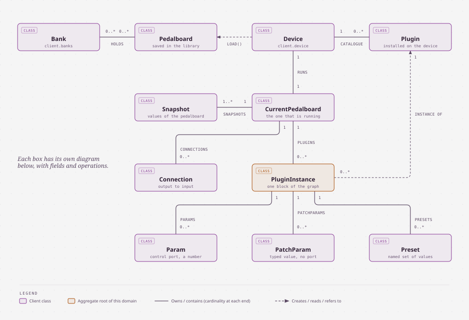

| Concept | What it is | Reached from | Detail |
|---|---|---|---|
| **Bank** | An ordered list of pedalboards, used by the hardware to navigate them | `client.banks` | [4.10](#410-banks) |
| **Pedalboard** | A pedalboard saved in the library (`PedalboardReference`) | `client.pedalboards` | [4.2](#42-pedalboard-library), [4.3](#43-pedalboard-bundle) |
| **Device** | What is running and installed, and what the device reports | `client.device` | [4.4](#44-device) |
| **CurrentPedalboard** | The pedalboard that is running, edited live | `client.device.currentPedalboard` | [4.5](#45-current-pedalboard) |
| **Connection** | A link from an output port to an input port of the running pedalboard | `currentPedalboard.connections` | [4.5](#45-current-pedalboard) |
| **Plugin** | An installed LV2 plugin (the catalogue) | `client.device.plugins` | [4.6](#46-plugin-and-plugin-instance) |
| **PluginInstance** | One plugin block of the running pedalboard | `currentPedalboard.plugins` | [4.6](#46-plugin-and-plugin-instance) |
| **Param** | A control port of an instance: a number | `instance.params` | [4.6](#46-plugin-and-plugin-instance) |
| **PatchParam** | A typed value of an instance that is not a port (string, path, URI, ...) | `instance.patchParams` | [4.7](#47-patch-parameters) |
| **Preset** | A named set of the port values of one plugin | `instance.presets` | [4.8](#48-plugin-presets) |
| **Snapshot** | A saved set of values of the whole pedalboard | `currentPedalboard.snapshots` | [4.9](#49-pedalboard-snapshots) |
| **SystemApi** | The device itself; its operations that need a person are in `SystemDanger` | `client.system`, `client.system.danger` | [4.13](#413-system) |
| **ConfigApi** | The preferences: mod-ui's (`ModConfig`) and your application's (`AppConfig`) | `client.config` | [4.14](#414-configuration) |

Read it as sentences: a *bank* holds *pedalboards*; the *device* loads a pedalboard, lists the installed *plugins* and runs the *current pedalboard*;
the current pedalboard has *snapshots*, *connections* and *plugin instances*; an instance is an instance of a *plugin* and has *params*, *patch params* and *presets*.
A **saved** pedalboard and the **running** one are different objects on purpose: loading copies the first into the second (see 5.1), saving writes the second back (5.2).

### 4.2 Pedalboard library

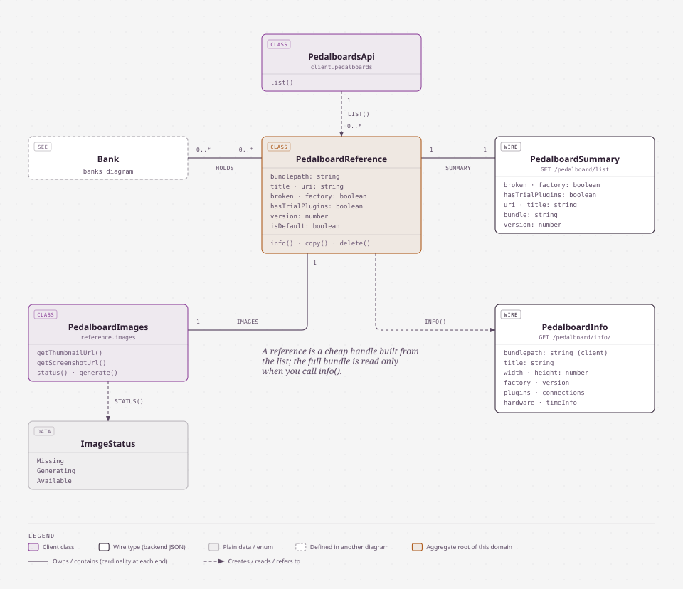

`PedalboardReference` is a lightweight handle built from a list entry (`PedalboardSummary`); `PedalboardInfo` is the full bundle content (next section).
Both carry `bundlepath`, so both can be passed to `Device.load()` (type `PedalboardTarget`). The images belong to the **saved bundle**, never to the running
state (5.4).

### 4.3 Pedalboard bundle

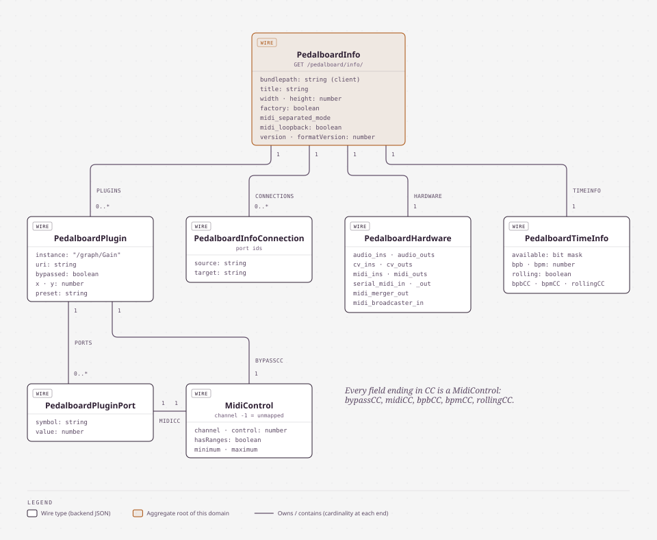

What `GET /pedalboard/info/` returns for a saved pedalboard. The server sends no bundle path, so the client adds `bundlepath` itself (section 9). This is the
**stored** content: the running pedalboard is not described by it but rebuilt from the WebSocket (4.5 and 5.6).

### 4.4 Device

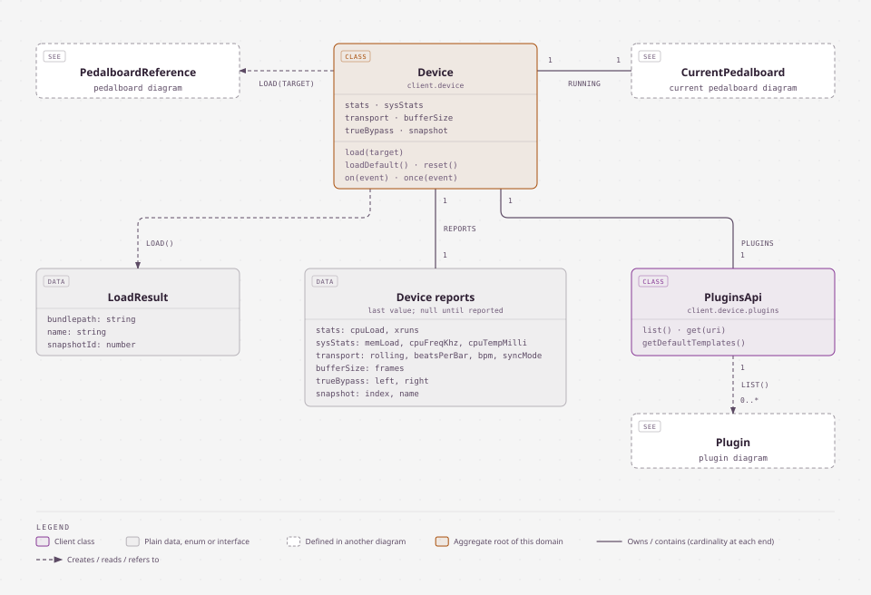

`Device` is the root of everything that is *running*, and holds the writes of the audio engine next to the values it reports (`setBufferSize(BufferSize)`, `setTrueBypass`, `resetXruns`, `switchCpuFrequency`: 1.19). `load()` resolves with a `LoadResult` once the backend confirmed it (5.1). The reports (`stats`, `transport`, ...)
are periodic or change-driven, are kept as last values, and are seeded by the state replay, so a late subscriber can read them (1.14). Every operation that changes the
running pedalboard goes through the device's queue (section 6).

### 4.5 Current pedalboard

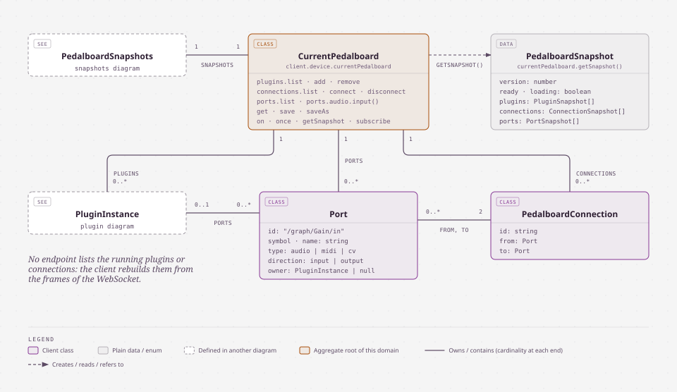

The pedalboard's own ports (capture, playback, MIDI) have no owner (`port.owner === null`); the ports of a plugin belong to its instance. A connection always goes
from an output to an input of the same type. `get()` reads `GET /pedalboard/current` (`bundlepath`, `title`, `modified`; empty `bundlepath` = never saved).
`getSnapshot()` is the **immutable state** for UI frameworks (1.12), not a pedalboard snapshot (4.9).

### 4.6 Plugin and plugin instance

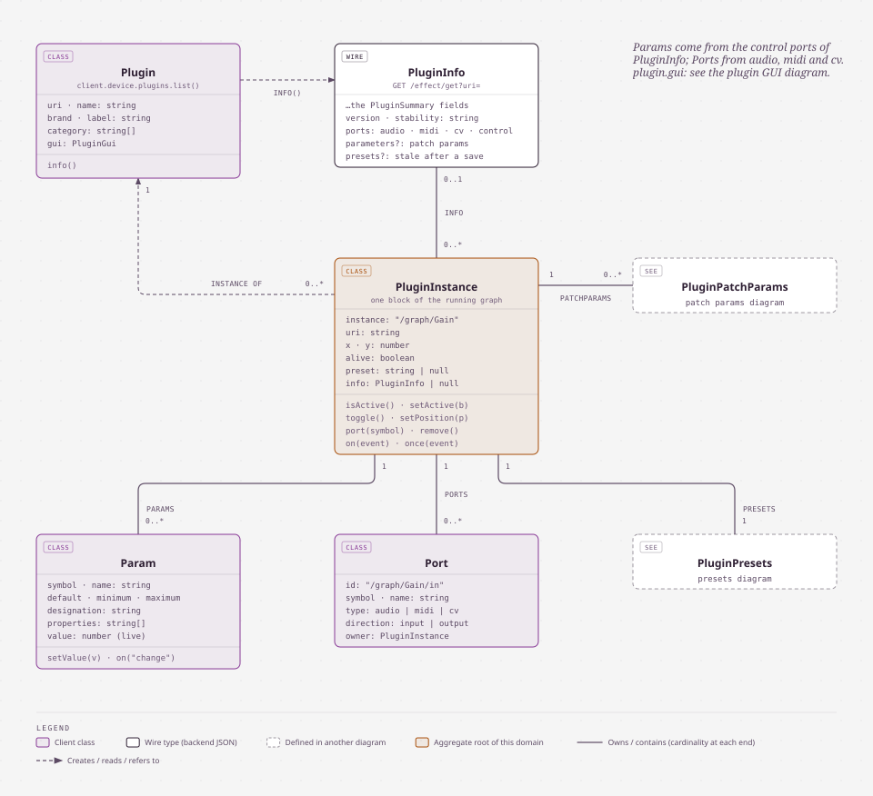

A `Plugin` is what is *installed*; a `PluginInstance` is one block of the running pedalboard, found by its path (`/graph/Gain`). Control ports are `Param`s, not `Port`s
(a `Port` is audio, MIDI or CV, the only kinds you can connect). The description (`PluginInfo`) is read once per URI and cached; an instance whose description is
still unknown has `info === null`. `plugin.gui` (`PluginGui`) gives the URLs and the text of the plugin's thumbnail and modgui files (1.18). When the plugin is removed, the pedalboard is reset or another one is loaded, the object stops standing for a plugin (`alive === false`).

### 4.7 Patch parameters

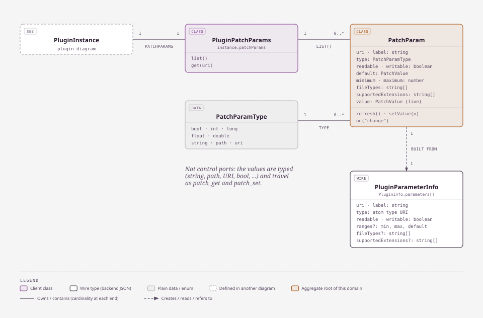

Typed values that are not control ports: strings, file paths, URIs, booleans, integers (1.8). `setValue()` is validated by type and is fire-and-forget (`patch_set`);
`refresh()` asks the plugin (`patch_get`) and waits for its answer (1.22).

### 4.8 Plugin presets

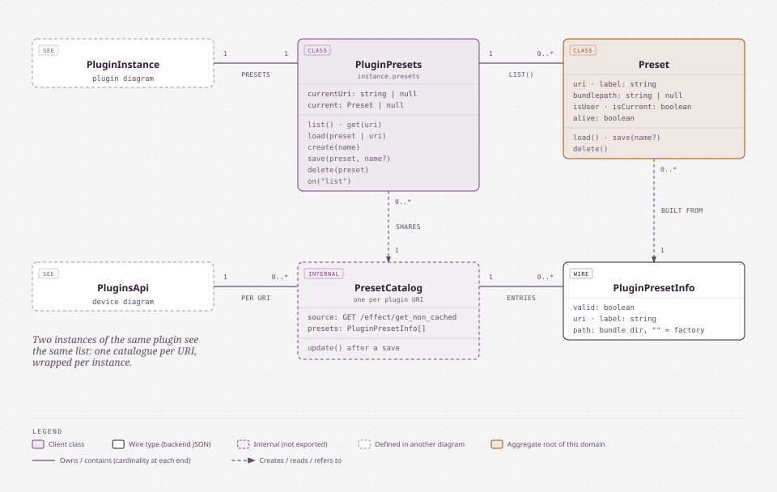

A preset belongs to the **plugin**, so two instances of the same plugin see the same list: one `PresetCatalog` per URI (owned by `PluginsApi`), wrapped per instance
so `preset.load()` acts on the instance it was listed from. `save()` and `delete()` only work on the instance's current user preset (1.17, 5.11).

### 4.9 Pedalboard snapshots

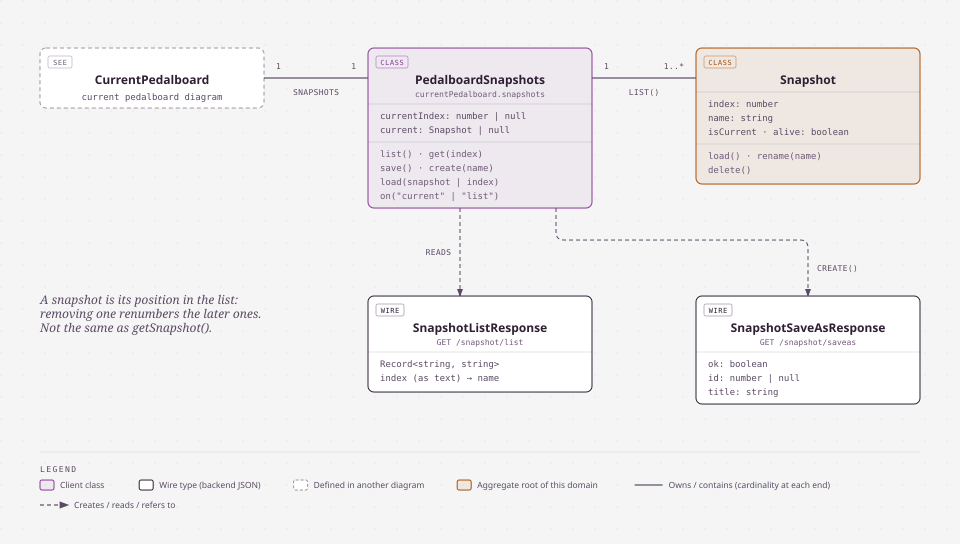

The backend identifies a snapshot by its **position**, so removing one renumbers the later ones; the client tells `Snapshot` objects apart by name and reads the names
only in `list()` (1.15, 5.9).

### 4.10 Banks

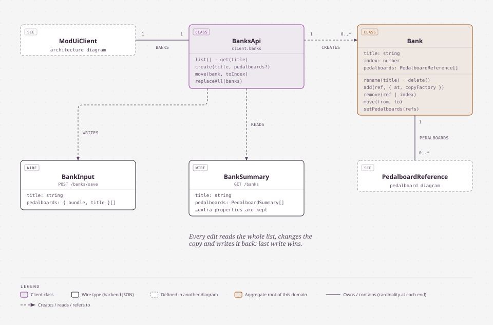

A `Bank` is a **value**: it does not follow changes made by others. The backend stores one list of banks and `POST /banks/save` replaces it, so each edit reads the list,
changes the copy and writes it all back (1.16, 5.10).

### 4.11 Plugin GUI files

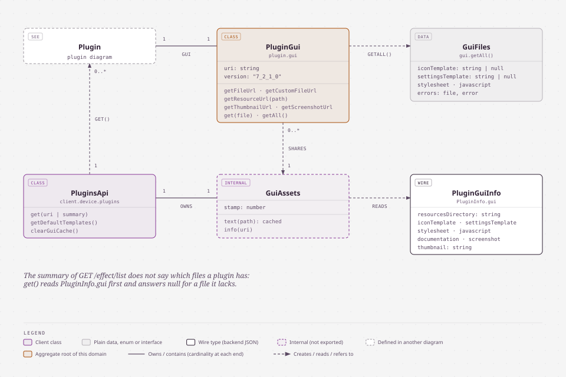

`plugin.gui` is built from the summary of `GET /effect/list` (it carries the version fields), so the URLs need no request. The texts are read through `GuiAssets`, the cache
that `PluginsApi` owns and every `PluginGui` shares; `get()` consults the (cached) `PluginInfo.gui` first, because the summary does not say which files exist (1.18).

### 4.12 User files

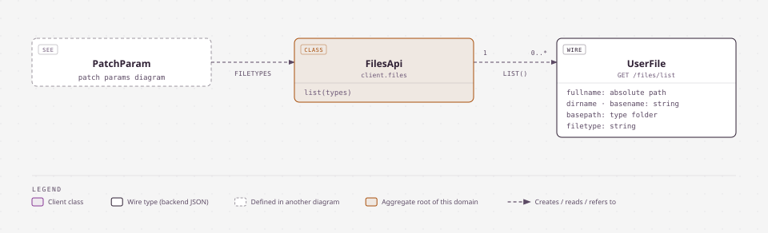

Samples, impulse responses and models the user put on the device. `client.files.list(types)` is never cached; the types of a path parameter are its `fileTypes` (1.18).

### 4.13 System

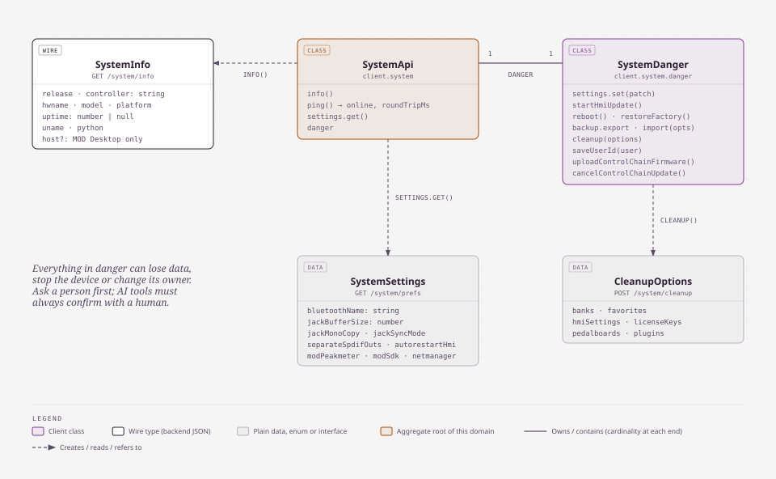

`SystemApi` only reads (`info()`, `ping()`, `settings.get()`). Everything that writes to the system, deletes data or flashes firmware is one level down, in `SystemDanger` (`client.system.danger`),
so that using it is always a visible decision (1.19, and read the warning there). The audio engine's writes (`setBufferSize`, `setTrueBypass`, `resetXruns`, `switchCpuFrequency`) are in `Device`, next to the values they change (4.4).

### 4.14 Configuration

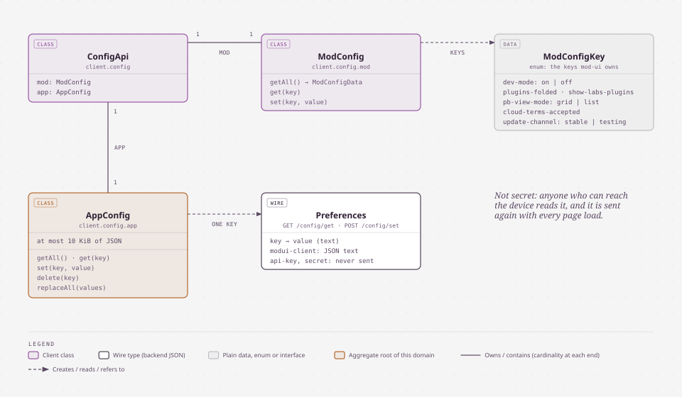

`ModConfig` is what mod-ui itself reads (the keys of the `ModConfigKey` enum); `AppConfig` is what the application keeps, stored as JSON text in the single preference `modui-client` and limited to 10 KiB (1.20).

---

## 5. Key flows

### 5.1 Loading a pedalboard (`device.load`)

The backend pushes `loading_start … loading_end` on the WebSocket **during** the `load_bundle` request, i.e.
usually *before* the HTTP response. The client therefore registers the wait first, then sends the request.
`load_bundle` does not clear the running graph, so a reset always comes first (same sequence as the classic UI).

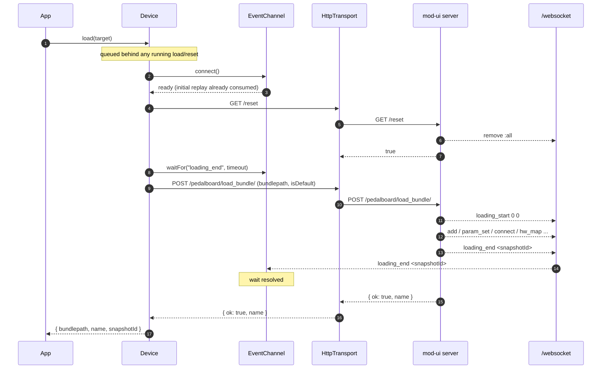

Failure paths:

| Situation | Result |
|-----------|--------|
| `/reset` answers `false` | `ModUiError("…refused to reset…")`; `load_bundle` is not called |
| `load_bundle` answers `{ ok: false }` (bundle missing) | wait cancelled, `ModUiError("…could not load…")` |
| non-2xx HTTP status | wait cancelled, `ModUiHttpError` (status, url, body) |
| no `loading_end` within `timeoutMs` (default 60 s) | `ModUiTimeoutError` |
| socket closes or the server sends `stop` | `ModUiError("WebSocket closed" / "backend stopped")` |

`device.loadDefault()` is the same flow, after picking the list entry whose bundle ends in
`/default.pedalboard`, and with `isDefault=1` (the backend then clears the current title and path).

### 5.2 Saving the running pedalboard (`currentPedalboard.save` / `saveAs`)

`POST /pedalboard/save` always needs a `title` and an `asNew` flag (see `savePedalboard` in `docs/openapi.yml` for
the exact rules). The client hides both: `save()` means `asNew=0` and reads the current title when you do not pass
one; `saveAs()` means `asNew=1`. Both return the saved pedalboard as a `PedalboardReference` found in the list.

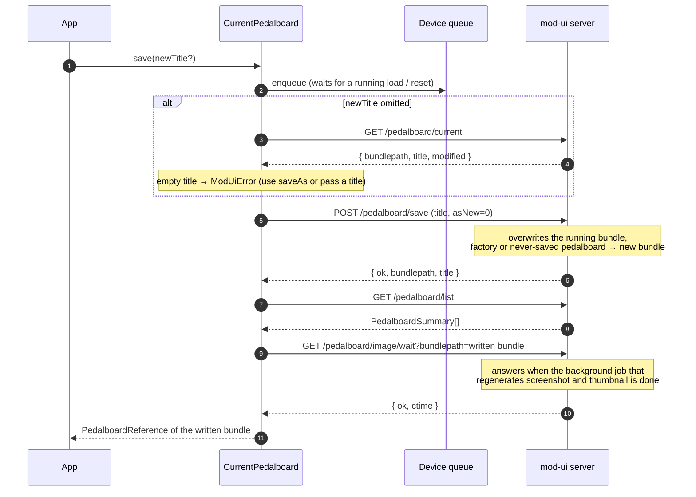

What the backend does with `asNew`:

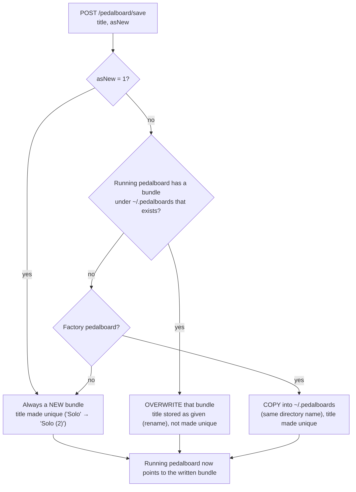

The promise of `save()` / `saveAs()` resolves only after `GET /pedalboard/image/wait` answered, i.e. when the
screenshot and the thumbnail that the save regenerates in the background are ready. The pedalboard is already
saved at that point, so if the wait fails (or nothing could be rendered) the save is **not** reported as failed.

`currentPedalboard.get()` returns `null` for an untitled pedalboard (after `reset()` or `loadDefault()`), because it
has no bundle. It needs the backend endpoint `GET /pedalboard/current`.

### 5.3 Copying a pedalboard (`reference.copy`)

`GET /pedalboard/factorycopy/` is the only copy resource. Despite its name it copies **any** bundle (not only factory
ones) and never touches the running pedalboard. The server chooses the new title (the old one made unique:
`"Rock"` → `"Rock (2)"`, unchanged if free) and renames the copy by running `sed` through a shell with the title
pasted in, so the title must be the one **stored in the bundle** and must not contain characters that break the
shell or `sed`. The client therefore reads the stored title first and refuses unsafe ones before copying.
`copy()` takes no title: the title of the copy cannot be chosen without changing the backend (see the plan).

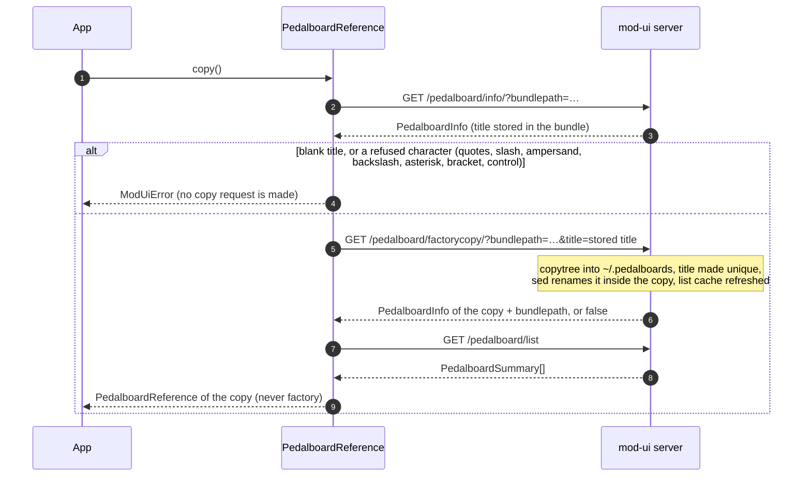

Pedalboards whose title has a refused character can only be duplicated with `device.load(ref)` followed by
`device.currentPedalboard.saveAs(title)`, which **replaces** the running pedalboard.

### 5.4 Pedalboard images (`reference.images`)

The files `screenshot.png` / `thumbnail.png` live inside each bundle. They are rendered by a background process
from the **saved bundle** (so never from the running state), after a save that changed the graph or on demand.
The endpoints work for **any** bundle, not only the running pedalboard. Image URLs are cached for a year by the
server, so the client adds `v=<pedalboard version>` and, once known, `tstamp=<creation time>`.

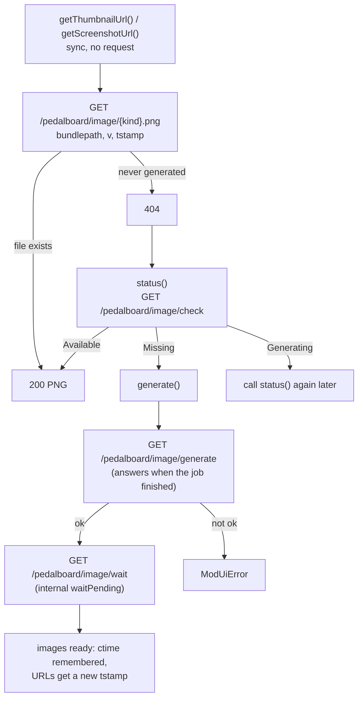

`generate()` replaces the files, so it fails for factory pedalboards on a device (read-only filesystem) with a `ModUiError`.

`waitPending()` is private to `PedalboardImages`. `generate()` always ends with it, and so do `currentPedalboard.save()`
and `saveAs()` (see 5.2), through an internal helper that the package does not export.

### 5.5 Connecting and flow control (`events.connect`)

A new socket first receives a replay of the whole current state, which ends with `loading_end`. `connect()`
resolves only after it, so that replay is never mistaken for the end of a load requested later.

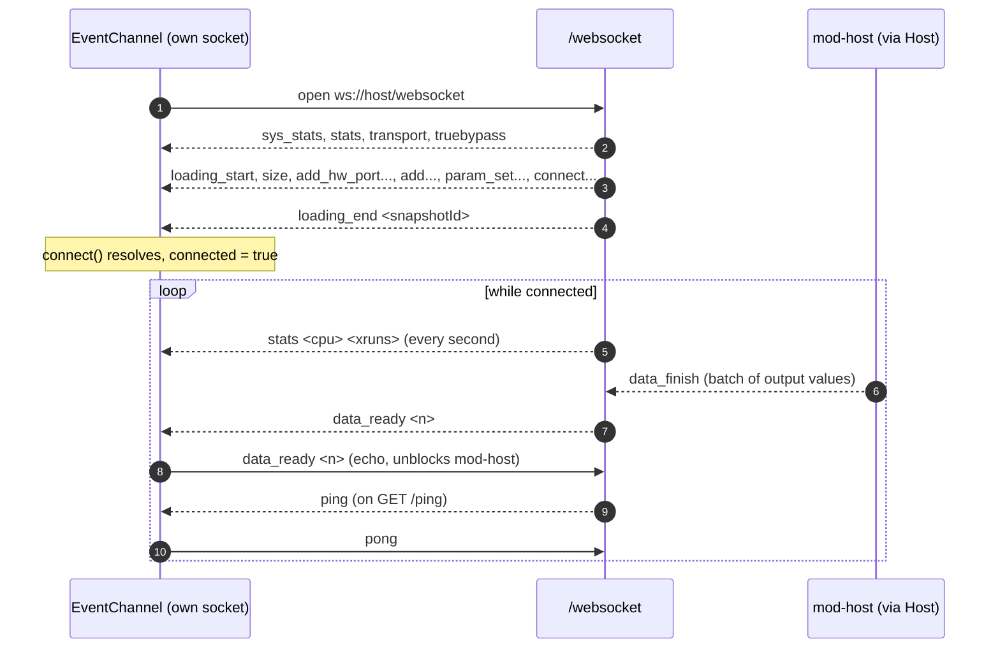

With a **shared** socket (`options.webSocket`), `connect()` resolves as soon as the socket is open and the
client never answers `ping` / `data_ready`, because the socket's owner (the classic UI's `host.js`) already does.

### 5.6 Live editing: the graph model, `plugins.add`, `connections.connect`

No HTTP endpoint lists the plugins or the connections of the running pedalboard, so `GraphState` registers `on(...)`
handlers **before** the socket is opened and builds a model from the frames: the state replay of a new socket
(`add_hw_port`, `add`, `connect`, ...) and the live ones after it. `loading_start` and `remove :all` clear the
plugins and connections (the pedalboard's own ports stay: a load does not send them again).
With a shared socket the replay has already passed, so `ready()` reads one snapshot through a short-lived second
socket (frames that arrive meanwhile are applied on top of it).

Port ids come from two places: plugin ports from `PluginInfo.ports` (`audio`, `midi`, `cv`; control ports are not
connectable), fetched with one `POST /effect/bulk/` for the plugins not seen yet; the pedalboard's own ports from
`add_hw_port`, where the backend's "input of the device" (`direction 0`) is a *source* for the graph.

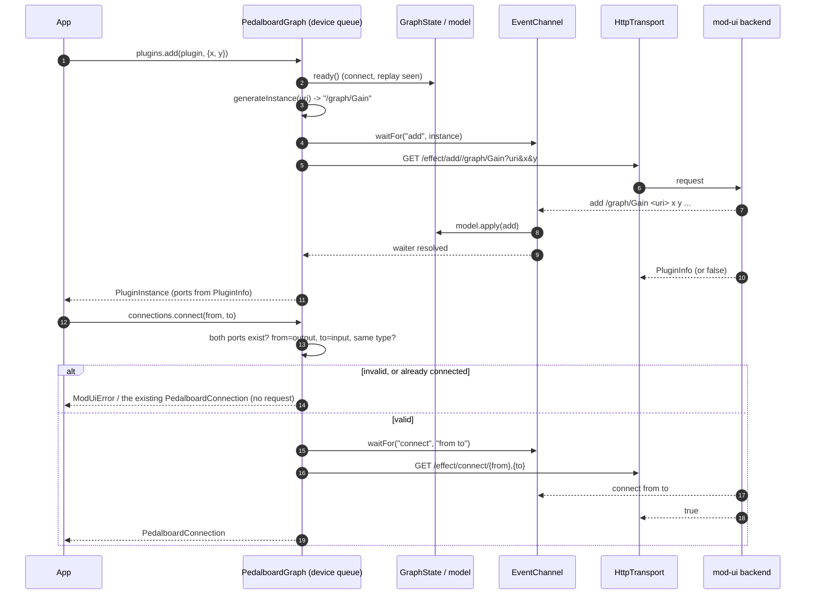

### 5.7 EventChannel lifecycle

`client.state` (`EventChannel.state`) and the `state` event follow this machine. `reconnecting` exists only for an own socket
with the `reconnect` option; a shared socket that closes ends in `closed`.

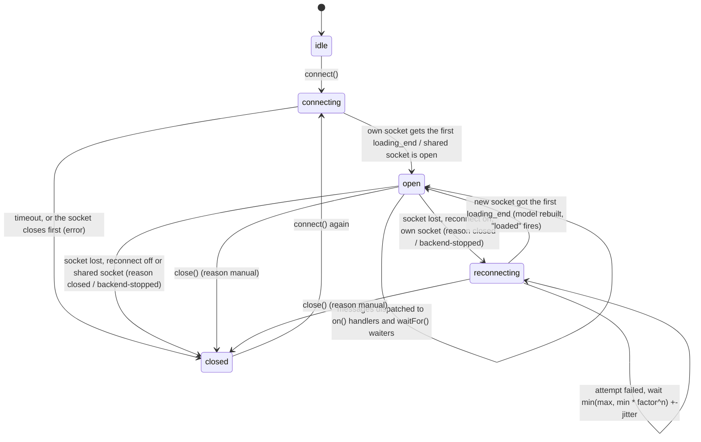

When the state replay of a new own socket begins (its **first frame**, not the moment the socket is created) the `GraphModel` is
emptied (plugins, connections **and** the pedalboard's own ports) and the same bracket as a load starts: one `loading` (with the
values of the `loading_start` frame), the replay, one `loaded`. So an attempt that fails before the backend answers changes nothing
of what the application shows: during an outage the last known state stays, with `client.state === 'reconnecting'` telling it is
stale. Waiters of the lost socket are rejected; `connect()` during `reconnecting` joins the attempt in progress. `close()` ends
every attempt, including one that is still being awaited: a `close()` followed at once by `connect()` starts a clean new attempt.

### 5.8 Events: from a frame to a subscriber

`GraphModel.apply()` returns a list of `GraphChange` (it returns nothing for a frame that changes nothing: a repeated value,
a connection that exists). `GraphState` hands the list to the `PedalboardStore`, which handles the changes **in order** and
emits on one `Emitter`. Changes this client makes itself take the same path: the operation sends its message and then calls
`applyLocal()` with the frame the others would receive, tagged with the `source`; operations confirmed by a frame
(`add`, `remove`, `connect`, `disconnect`, `load`, `reset`) register an *expectation* before the request, so the frame that
confirms them is tagged `'local'` as well.

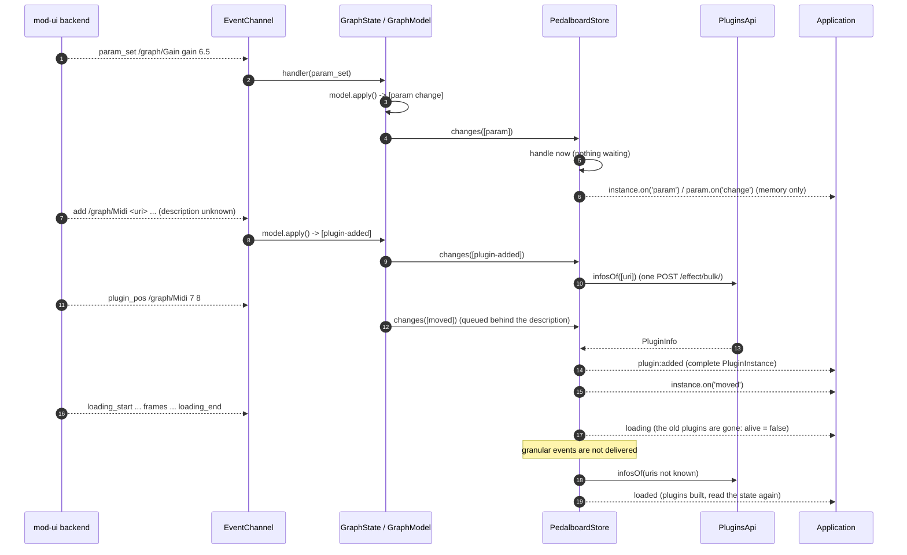

The `SnapshotStore` is fed by the same handling (`note(change)` marks what is out of date, in the order of the frames) and rebuilds
only that when `getSnapshot()` is called; `subscribe()` listeners are called once per `schedule` tick. The device's own frames
(`stats`, `transport`, `bufsize`, `truebypass`, `pedal_snapshot`) go straight from `EventChannel` to `DeviceState`, which keeps the
last value of each and has its own `Emitter`.

The `Emitter` delivers in order and never nested (an event caused by a handler is queued), isolates handlers (an error is
rethrown with `queueMicrotask`) and applies `ignoreSource` / `ignoreLocal` / `signal`. Per-plugin subscriptions are filters
on the same emitter, dropped after the plugin's `removed` event.

### 5.9 Snapshots (`currentPedalboard.snapshots`)

The list of names is read by `list()` only; everything else keeps it up to date from what the client itself writes and from the
device's reports. The backend identifies a snapshot by position and sends **one** frame about them, `pedal_snapshot`, only when a
snapshot is *loaded*; `saveas` and `remove` change the current index silently, so the client applies the backend's own rules locally.
`load` holds an *expectation* for the value changes (`param`, `patch`, `active`, `preset`) while its request is in flight, so the
events of the values it sets are `'local'` with the caller's `source`.

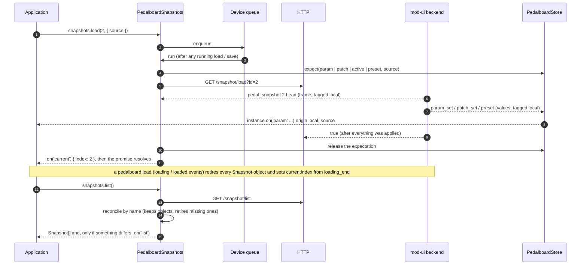

### 5.10 Banks (`client.banks`, `bank.add(...)`)

The backend stores one list of banks and `POST /banks/save` replaces it. Each editing method therefore reads the list again, edits
that fresh copy and writes it back, inside a queue private to the client, and then updates the `Bank` object it was called on.

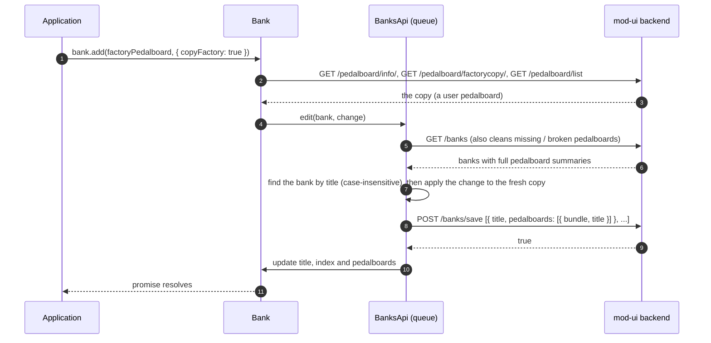

### 5.11 Plugin presets (`instance.presets`)

The presets of a plugin are shared by all its instances (one `PresetCatalog` per plugin URI, owned by `PluginsApi`); each instance wraps the
entries in its own `Preset` objects, so `preset.load()` acts on the instance it was listed from. A user preset is told apart by its bundle
directory, which survives a save (the URI and label change), a factory preset by its URI. The backend sends the `preset` frame only for a
load and a delete; a save changes the current preset silently, so the client records it with `applyLocal`.

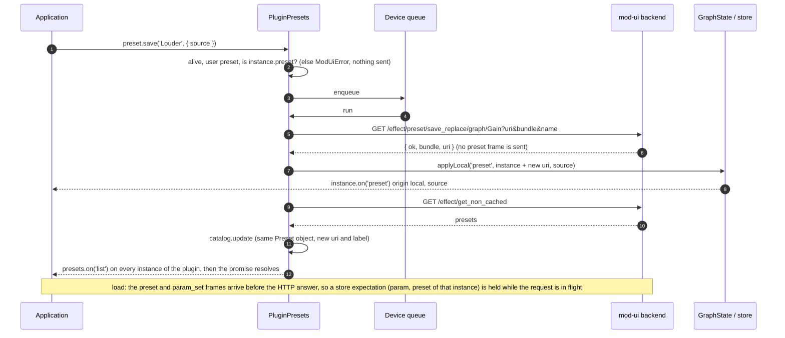

---

## 6. Design rules

- **Classes per feature area**, reachable from `ModUiClient` (`client.pedalboards`, `client.device`,
  `client.events`, `client.banks`). New areas follow the same shape.
- **All HTTP goes through `HttpTransport`**: `fetch` with `cache: 'no-store'`, JSON decoding, non-2xx →
  `ModUiHttpError`. Use `getJson` for `GET` and `postForm` for form posts; add a method there if a new body
  type is needed (e.g. JSON or binary). `getText` is the exception to `no-store`: it is for files whose URL carries a
  version (modgui files, shared resources), so the browser may keep them.
- **The client owns every URL and file of the backend**, packages that build on it (`modui-plugin-view`) do not build
  URLs or call `fetch` for the backend themselves.
- **Never use globals directly**: `fetch` and `WebSocket` are injected through `ModUiClientOptions`, which is
  what makes the tests possible.
- **Await the backend's confirmation** when it arrives over the WebSocket: register `events.waitFor()` *before*
  the HTTP call and cancel it on failure.
- **Serialize operations that change the running pedalboard** through `Device`'s internal queue (`load`, `reset`, and everything in `currentPedalboard`).
- **Dangerous operations go in `client.system.danger`** (anything that reboots, deletes, flashes, overwrites or starts and stops services). A new one never lands in `client.system` or `client.device`.
  Its TSDoc says "Danger: ask a person to confirm first", and the guide, the README and `docs/openapi.yml` say that AI tools must always confirm with a human and applications with the user.
- **Free-form values are enums**: where the backend accepts a closed set (`BufferSize`, `ModConfigKey` and its values), the client takes the enum and checks it again at run time for JavaScript callers.
- **Reject, do not throw**: public methods return rejected promises for bad arguments, never synchronous exceptions.
- **Guard destructive calls in the client** (`PedalboardReference.delete()` refuses factory and default pedalboards) because the backend does not validate paths.
- **Remember the backend conventions** (see `docs/openapi.yml`): many handlers answer `200` with a bare
  `false` on failure; turn that into a `ModUiError`. Trailing slashes in paths matter.
- **No runtime dependencies.** The output is one IIFE file (ES2018) loaded by a `<script>` tag, or an ES module when installed from npm.
- **Documentation**: every public symbol has TSDoc in English, naming the backend calls and their
  `operationId`, the errors thrown, and an `@example`.

---

## 7. Adding an endpoint or a feature area

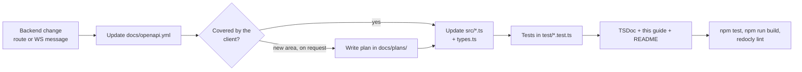

Checklist for a new area (example: banks, `src/banks.ts`):

1. Wire types in `src/types.ts`, copied from the matching schemas in `docs/openapi.yml`.
2. A class in its own module (`src/banks.ts`) taking `HttpTransport` (and `EventChannel` if it waits for
   WebSocket confirmations) in its constructor.
3. Wire it in `ModUiClient` (`client.banks`), export it from `src/index.ts` and add it to `window.ModUi` (`src/browser.ts`).
4. A test file `test/banks.test.ts` using the helpers: `makeClient(routes)` fakes HTTP routes as
   `"METHOD /path"` → JSON, `connected(client)` opens the fake socket and plays the initial replay, and
   `socket.emit('...')` pushes server messages.
5. Update this guide (diagrams included), the README section and the plan.

---

## 8. Build and test

```sh
cd modui-client
npm install
npm test          # tsc --noEmit (strict, no unused locals) + vitest
npm run build     # esbuild src/browser.ts → ../html/js/lib/modui-client.js (IIFE, ES2018, not minified)
npm run watch     # rebuild on change, inline source map
npm run build:lib # the publication build, into dist/ (see below)
```

### Installing the package
The package is an ES module (`dist/index.js`) with its type declarations; importing it has no side effect. It is not on the npm registry: every build
of the repository is a GitHub pre-release with the tarball (`.github/workflows/modui-packages.yml`), installed by its link:

```sh
npm install https://github.com/mod-audio/mod-ui/releases/download/<tag>/modui-client-<version>.tgz
```

The tag is the UTC date, time and commit of the build (`20261013-225031-abc1234`) and the version in the tarball carries the same stamp
(`0.1.0-20261013225031.gabc1234`). The links of the releases are in the README of the repository.

```ts
import { ModUiClient } from 'modui-client';
const client = new ModUiClient({ baseUrl: 'http://modduo.local' });
```

For a page without a bundler, `modui-client/global` is the same IIFE as the classic UI's (`window.ModUiClient`, `window.ModUi`).
`npm run build:lib` writes `dist/` (`index.js`, `modui-client.global.js`, one `.d.ts` per module, source maps) and `npm pack --dry-run` lists
what a tarball contains (only `dist/`, `package.json`, the README and the license). `tools/pack-modui-packages.sh <outdir>` does what the workflow does:
test, build and pack both packages with the stamped version. Plan: `docs/plans/2026-10-modui-publishing.md`.

Requires Node.js 22.12 or newer to develop, with npm 11.6 or newer: the npm of Node.js 22 (10.9) crashes on `npm install` of vitest 5 (`Cannot read properties of null (reading 'edgesOut')`; npm 11.0 too). Node.js 24 bundles a good one; on 22 run `npm install -g npm@11`. The generated `html/js/lib/modui-client.js` is git-ignored; release builds
must run the build before installing `html/` (`setup.py` and `mod-deploy.sh` pick it up from `html/js/lib/*.js`).

---

## 9. Known limitations

- Loading a pedalboard through the client while the classic UI is open reloads the canvas (WebSocket), but the
  title kept by the classic UI is not updated: it only learns titles from its own HTTP responses.
- If another client or the HMI loads a pedalboard at the same moment, its `loading_end` may resolve this
  client's wait; the backend gives no way to correlate them.
- `PedalboardInfo` has no bundle path on the wire; the client adds `bundlepath` itself.
- The classic UI keeps its own title / bundle (learned from its own HTTP responses). Saving through the client
  does not update them, so after `currentPedalboard.save*()` the classic UI may still show the old name until reload.
- `currentPedalboard.get()` / `save()` rely on `GET /pedalboard/current`, added together with this API; they do not
  work against older mod-ui servers.
- `currentPedalboard.save()` / `saveAs()` wait for the thumbnail regeneration, which can take a few seconds on a device (the renderer runs at low priority); a failure of that wait is ignored.
- Plugins and connections come from the WebSocket, not from an endpoint. Every new own socket (first connection or reconnection) starts from an empty model and rebuilds it from the state replay, so nothing that vanished in between stays. A socket shared through `options.webSocket` is never reopened by the client.
- The first `connect()` is not retried by `reconnect` (it rejects and the state is `closed`); only a connection that was `open` and got lost is. Reconnection never gives up by itself: call `client.close()`. Calls that were waiting for a frame when the connection was lost fail with `ModUiError('WebSocket closed')` and are not retried (a write may have reached the backend).
- `origin: 'local'` is best effort: a change is local when this client had a matching request in flight when the frame arrived. A pedalboard load or reset by someone else at the same moment cannot be told apart (same as the note on `device.load()`).
- Events cover what the model knows (plugins, connections, the pedalboard's own ports, control values, bypass, position, patch parameters, presets, loading) and what the device reports (`stats`, `sysStats`, `transport`, `bufferSize`, `trueBypass`, `snapshot`). Meters (`output_set`), addressings (`hw_map`, `midi_map`, `cv_map`), `log` and `progress` frames are not events yet; the pedalboard's `size` frame is not exposed.
- `setValue()`, `setActive()`, `toggle()` and `setPosition()` cannot confirm anything: the backend does not answer the sender of `param_set` / `plugin_pos`. They resolve when the message is sent; if the backend refuses a value (it only refuses ports with a host designation, which the client already blocks), nothing tells the caller.
- `PatchParam.setValue()` cannot confirm anything either (the sender of `patch_set` gets no frame). Only `"` is escaped on the way to mod-host, so a backslash in a string reaches the plugin as it is. Empty strings are refused by the client. Only parameters the host tracks (atom types Bool, Int, Long, Float, Double, String, Path, URI, with ranges) report values; vectors are not supported. Whether `refresh()` gets an answer depends on the plugin.
- `plugins.add()` always generates the instance name (like the classic UI). If the backend creates the plugin but cannot read its description, it answers `404` and the plugin stays in the pedalboard.
- `connections.disconnect()` checks the model first because the backend answers `true` and announces `disconnect` even when nothing was connected. A connection made by another client a moment ago is known as soon as its `connect` frame arrives.
- Connections to plugins that are not installed are left out of `connections.list()` (their ports are unknown).
- Snapshots are identified by position, and the backend sends no frame for `saveas`, `rename` or `remove`: other clients' changes to the list are found only by calling `list()` again, and a rename made elsewhere looks like "removed + added" (the objects are matched by name). Removing a snapshot **before** the current one leaves the backend's current index unchanged (it then points at the next snapshot); `currentIndex` mirrors that number. Nothing reads the content of a snapshot, and when the snapshot selector is addressed to a hardware actuator the classic UI refuses to add, delete or load snapshots while the client cannot see addressings and does not refuse. `GET /snapshot/name` is not used because it answers `Default` for any index. `snapshots.load()` tags the value events of every client with `'local'` while its request is in flight.
- Banks: only user banks exist for the web (factory banks are the HMI's). `client.banks.list()` is not read-only on the device: pedalboards that are missing or broken are dropped from the banks for good. Every edit rewrites the whole list, so two writers at the same moment are last-write-wins; a bank is found by its title (unique ignoring case). Properties of a bank pedalboard entry other than `bundle` and `title` are not preserved (the read replaces them with the library summary). Whether an HMI that is already running sees a bank saved from the web was not verified on a device.
- Presets: the backend sends no `preset` frame for a save, only for a load and a delete; `save()` and `delete()` work only on the instance's current user preset and fail silently otherwise (the client checks first); `save()` overwrites the preset with the live values (there is no rename-only call) and a failed one can delete the preset's bundle (the list is read again, so `alive` tells the truth). `load()` answers `false` on the 10 s hardware timeout although the preset was applied. Names with a control character or a backslash are refused because only `"` is escaped on the way to mod-host. Changes other clients make to the list are found only by calling `list()` again. Whether a preset holds patch-parameter values (and so whether `patch_set` frames follow a load) was not verified on a device.
- `reference.copy()` cannot choose the title of the copy and refuses titles with quotes, `/`, `&`, `\`, `*`, `[` or control characters, because of how the backend renames the copy.
- The GUI file URLs use the same `v` as the classic UI; for a plugin without `buildEnvironment` it ends in the time the client was created, so a page that stays open
  while such a plugin is rebuilt keeps the old files until the client is created again (or the plugin version changes). `plugins.clearGuiCache()` forgets the texts, not the browser's copies.
- `plugin.gui.get()` / `getAll()` need the plugin to be installed (they read its description first) and ask for the file names there: the summary of `GET /effect/list` does not say which files a plugin has.
- A thumbnail URL is a snapshot: after another client regenerates the images, call `status()` (or `generate()`) on a reference to learn the new creation time, otherwise the URL may still hit the browser's one-year cache.
- System: `setBufferSize` and `setTrueBypass` apply the backend's answer without waiting for the `bufsize` / `truebypass` frame (it is not guaranteed when nothing changed). `settings.set` is one `exechange` request per key, so a failure in the middle leaves the earlier keys applied; most settings only act at the next boot. `exechange` and `cleanup` write to `/data` and run `systemctl`: do not run them against a development host. The classic page also sends `cmd=poweroff`, which the backend answers with `false`; it is not exposed. Nothing in `client.system.danger` was checked against a real device.
- Configuration: `config.app` is last-write-wins across browsers (read, change, write whole), has no change event, is not secret and is limited to 10 KiB by the client only (the backend does not enforce it). `config.mod` exposes six keys; the preferences the hardware keeps in the same file are not readable through it. `saveUserId` has no read: the backend only embeds the name and e-mail in the HTML of `/`.
