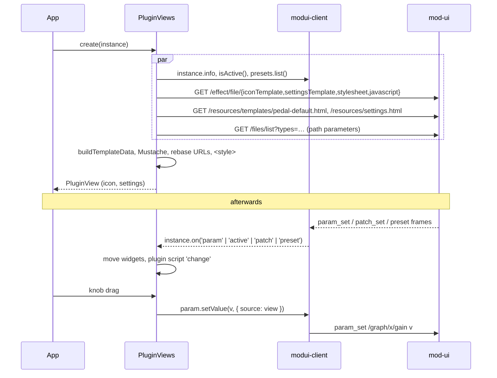

# modui-plugin-view — developer guide

`modui-plugin-view/` renders the GUI of MOD plugins (their **modgui**: the pedal and the settings panel) in any web page, and makes it
live, on top of [`modui-client`](modui-client.md). With the two libraries a frontend (a React / Vue / Svelte SPA, a kiosk page, a small
control surface) can show and drive the plugins of a MOD device without loading the classic UI.

Plan and decisions: [`docs/plans/2026-10-modui-plugin-view.md`](plans/2026-10-modui-plugin-view.md).

## 1. Quick start

```ts
import { ModUiClient } from 'modui-client';
import { PluginViews } from 'modui-plugin-view';

const client = new ModUiClient();                                   // same origin as mod-ui, see "Serving" below
const views = new PluginViews(client, { jQuery: window.jQuery });   // once per client; jQuery only for the plugins' own scripts

// Live: a plugin of the running pedalboard
const [instance] = await client.device.currentPedalboard.plugins.list();
const view = await views.create(instance);
pedalBox.append(view.icon);          // <div class="mod-pedal" mod-instance="/graph/…">
overlay.append(view.settings);       // <div class="mod-settings">: the settings panel (a full-window overlay in mod-ui's CSS)

view.on('change', ({ symbol, value, origin }) => console.log(symbol, value, origin));   // origin: user | script | api | external
view.on('active', ({ active }) => …);
view.on('output', ({ symbol, value }) => meter.set(value));
view.on('close', () => overlay.hidden = true);                                        // the panel's "Close" button

await view.setValue('gain', 3);      // like a gesture: clamped, written, shown, passed to the plugin script
await view.setActive(false);         // bypass
view.destroy();                      // also happens by itself when the plugin leaves the pedalboard

// Preview: a catalogue plugin, values kept locally, nothing is sent
const preview = await views.create('http://moddevices.com/plugins/mod-devel/BigMuffPi', { values: { Tone: 0.8 } });
const thumbnail = views.thumbnailUrl(preview.uri);
```

In a plain page (no bundler), load the two builds after jQuery:

```html
<script src="/js/lib/jquery-1.9.1.min.js"></script>   <!-- optional, for plugin scripts; jquery.svg.js too for x42 plugins -->
<script src="/js/lib/modui-client.js"></script>       <!-- window.ModUi -->
<script src="/js/lib/modui-plugin-view.js"></script>  <!-- window.ModUiPluginView -->
```

A working example, a page served **outside** mod-ui: [`modui-plugin-view/examples/`](../modui-plugin-view/examples/)
(`node examples/serve.mjs --target http://localhost:8888`, then open `http://localhost:9000/`; `--port <n>` picks another port).

### React

```tsx
function PluginIcon({ instance }: { instance: PluginInstance }) {
  const box = useRef<HTMLDivElement>(null);
  useEffect(() => {
    let view: PluginView | undefined;
    let cancelled = false;
    views.create(instance).then((created) => {
      if (cancelled) return created.destroy();
      view = created;
      box.current!.append(created.icon);
    });
    return () => { cancelled = true; view?.destroy(); };
  }, [instance]);
  return <div ref={box} />;
}
```

The view owns its elements: React renders the container, the view fills it. `instance` objects are stable (`plugins.get()`), so the
effect does not run again on every render.

## 2. Serving: same origin

mod-ui sends no CORS headers for the modgui files, and Tornado refuses a WebSocket whose `Origin` is not its own host. The page must be
served **from mod-ui's origin**, or through a proxy that makes it look so. With Vite:

```ts
// vite.config.ts
const target = 'http://modduo.local';
const proxy = {
  target,
  changeOrigin: true,   // rewrites Host
  ws: true,
  configure: (p) => p.on('proxyReqWs', (req) => req.setHeader('origin', target)),   // and Origin, for the WebSocket
};
export default defineConfig({
  server: {
    proxy: Object.fromEntries(['/websocket', '/effect', '/resources', '/files', '/pedalboard', '/snapshot', '/banks', '/css', '/fonts',
      '/img', '/js', '/reset', '/sdk'].map((path) => [path, proxy])),
  },
});
```

`examples/serve.mjs` does the same with Node's built-ins (it proxies every path the page does not have).

## 3. What a view does



- **Rendering** is the classic one (`html/js/modgui.js`): same template data (`effect`, `ns`, `cns`, `brand`, `controls`, `presets`, port
  flags, `steps`, port groups), same Mustache semantics, same widgets (`film` knobs from filmstrips or `mod-widget-rotation`, `switch`,
  `bypass`, `select`, `custom-select`, `custom-select-path`, `string`), same value fields, min / max labels and bypass lights. Root-relative
  URLs (`/resources/…`, `/effect/…`) are made absolute on `client.baseUrl`.
- **Live values**: writes carry `{ source: view }` and the view's subscriptions ignore that source, so a view never hears its own change
  back while every other change (classic UI, HMI, other clients, presets, other code) reaches it with `origin: 'external'`.
- **Plugin scripts** (`modgui:javascript`, `api_version` 3) get `start`, `change` (inputs, outputs, patch parameters) and `end`, and
  `funcs.set_port_value`, `patch_get`, `patch_set`, `get_custom_resource_filename` (absolute URL), `get_port_index_for_symbol`,
  `get_port_symbol_for_index`. They need jQuery (`event.icon.find(…)`), and some need the jQuery plugins the classic page loads
  (`jquery.svg.js` for the x42 plugins). A script that throws is disabled for that view; `error` says so.
- **Outputs**: `modui-client` does not model `output_set`; `PluginViews` listens from its creation and keeps the last value per port.
- **Styles**: `PluginViews` links `css/pedals.css`, `resources/pedals/default.css`, `css/fonts.css`, adds the `@font-face` rules of
  `css/main.css` and a scoped `box-sizing: border-box` (what Bootstrap gives the classic page, and many pedals are laid out with). It does
  **not** link `main.css` itself: it would restyle the whole page. `styles: false` adds nothing; `styles: { extra: [...] }` adds more.

## 4. Layout of the sources

| Module | What |
|--------|------|
| `views.ts` | `PluginViews`: loading, caches (files per plugin version, compiled scripts), outputs, styles, errors |
| `view.ts` | `PluginView`: rendering, controls, value fields, preset panel, file lists, script bridge, lifecycle |
| `binding.ts` | `LiveBackend` (a `PluginInstance`) and `PreviewBackend` (local memory) behind one interface |
| `widgets.ts` | the widgets and `StepModel` (the step arithmetic of `baseWidget`) |
| `template-data.ts` | `buildTemplateData`, `resolvePortGroups`, `fileEntries`, `shouldSkipPort` (pure) |
| `assets.ts`, `styles.ts`, `script.ts` | modgui files, stylesheets, plugin scripts |
| `urls.ts`, `mustache.ts`, `sprintf.ts` | URL helpers and `ns` / `cns`, the template and number-format engines (no dependencies) |

The library imports **only types** from `modui-client` (`tsconfig.json` `paths`), so the application's client is the only copy: no second
socket, `instanceof` keeps working. The tests use the real client from its sources (`vitest.config.ts` alias) over a fake socket and a
fake `fetch`, with the real default templates of `html/resources/`.

## 5. Build and test

```sh
cd modui-plugin-view
npm install
npm test          # tsc --noEmit + vitest (happy-dom)
npm run build     # writes html/js/lib/modui-plugin-view.js (generated, git-ignored)
```

## 6. Known limitations

- Hardware **addressing** is not supported: the `mod-address` buttons and "Assign" preset buttons are hidden.
- No canvas features: `mod-role=drag-handle` does nothing (use `instance.setPosition`), the jacks are drawn but not wired.
- T3K browsing and tablet pinch gestures of the classic UI are not ported.
- `sampleRate` ports show their plain range (the classic UI multiplies it by the sample rate; `Param.setValue` accepts the plain range).
- Pedals that rely on other rules of `css/main.css` may look slightly different (seen: the bottom row of x42 fil4 overflows its panel).
- The settings panel uses the classic CSS, made for a full-window overlay without Bootstrap: give it a sized, positioned container; its
  buttons are unstyled unless the page brings Bootstrap-like `.btn` styles.
- Plugin scripts run with the page's privileges, as in the classic UI: render only plugins you trust.
