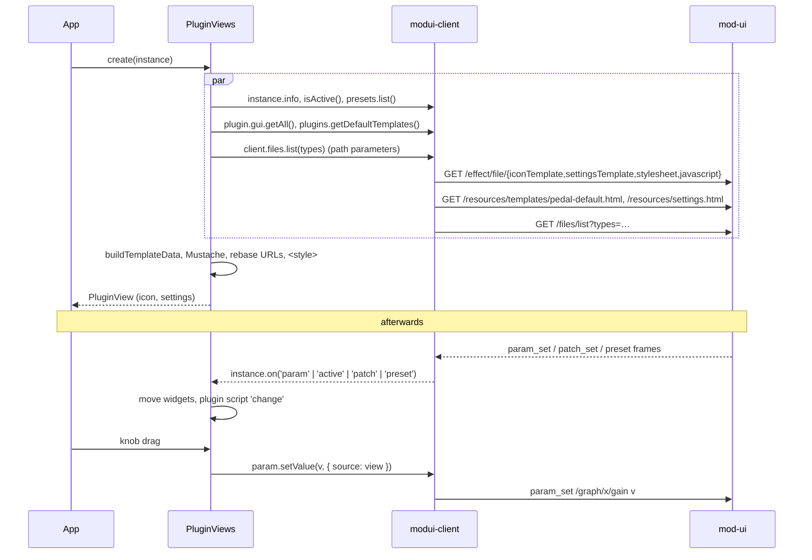
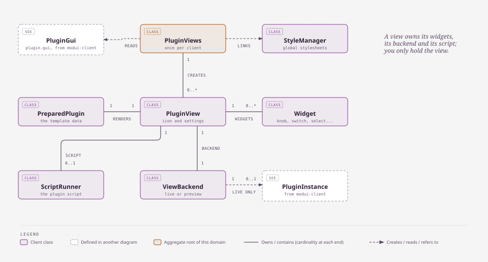
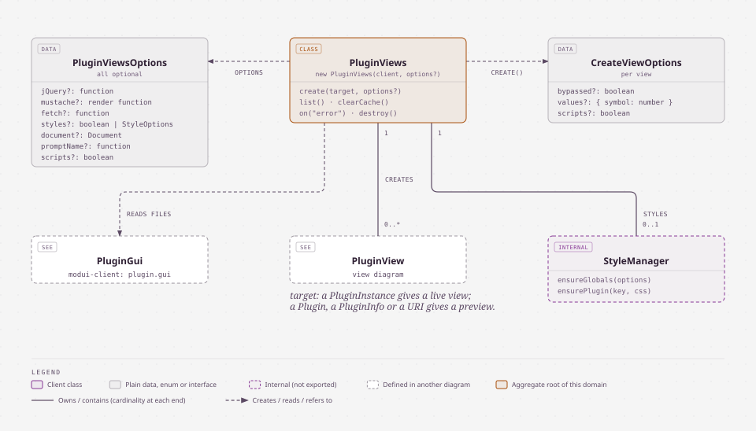
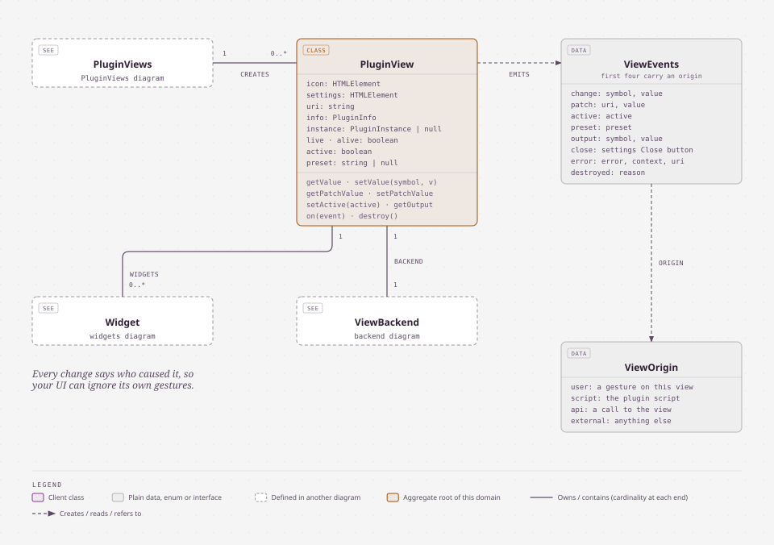
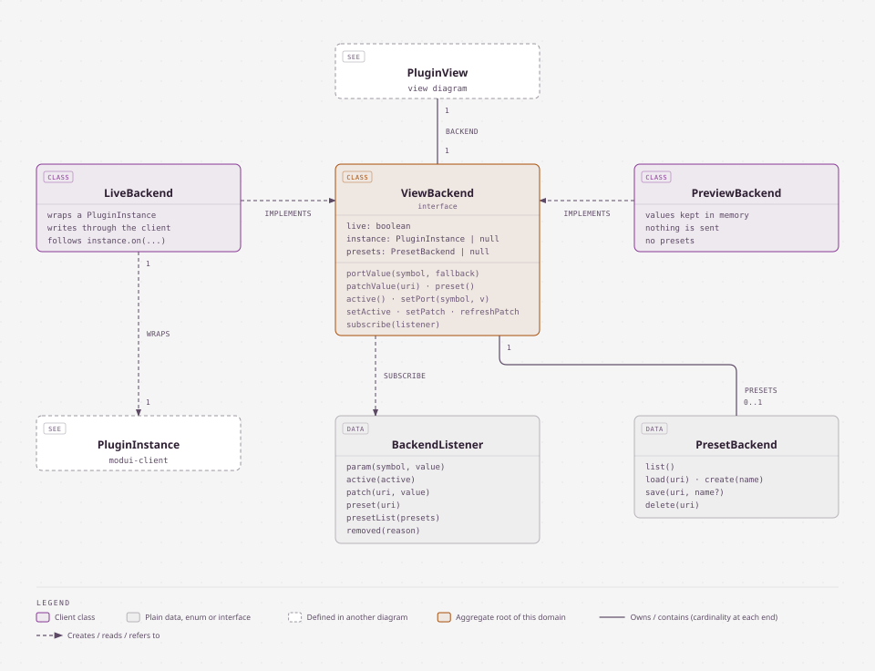
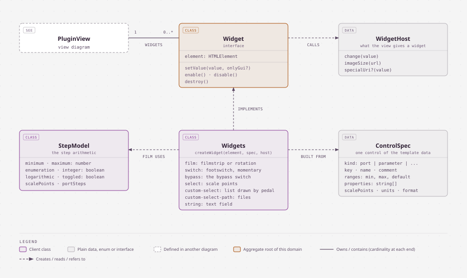
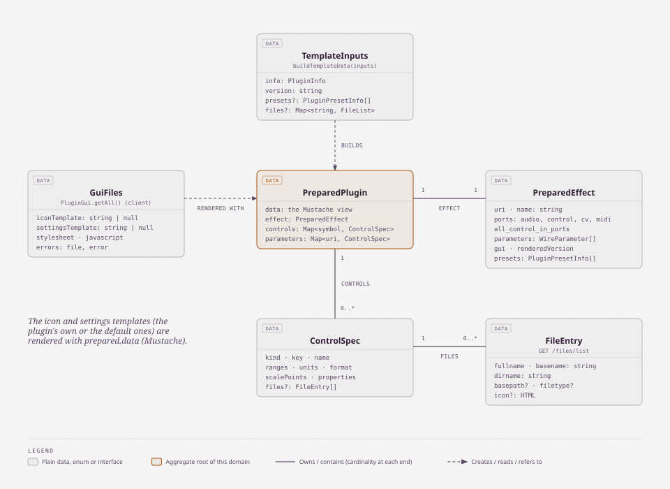
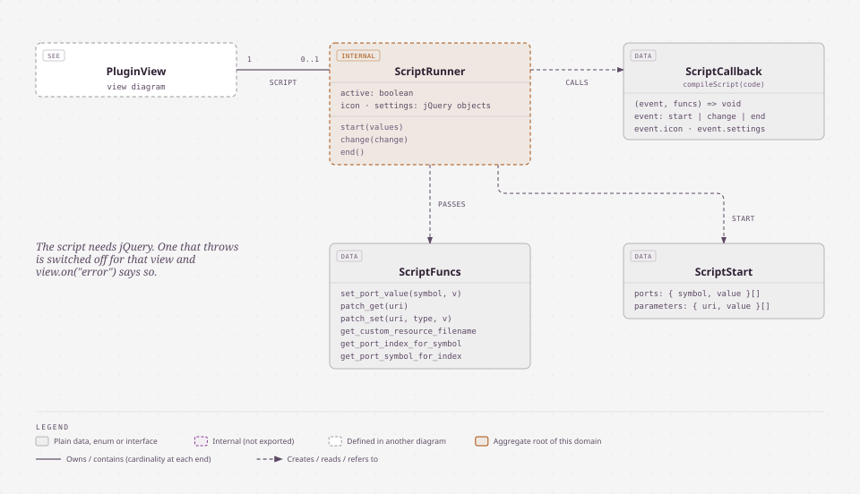

# modui-plugin-view — developer guide

`modui-plugin-view/` renders the GUI of MOD plugins (their **modgui**: the pedal and the settings panel) in any web page, and makes it
live, on top of [`modui-client`](modui-client.md). With the two libraries a frontend (a React / Vue / Svelte SPA, a kiosk page, a small
control surface) can show and drive the plugins of a MOD device without loading the classic UI.

- **Source**: [`modui-plugin-view/src/`](../modui-plugin-view/src/)
- **Tests**: [`modui-plugin-view/test/`](../modui-plugin-view/test/)
- **Example** (a page served outside mod-ui): [`modui-plugin-view/examples/`](../modui-plugin-view/examples/)
- **Build output** (generated, not versioned): `html/js/lib/modui-plugin-view.js`
- **Plan and decisions**: [`docs/plans/2026-10-modui-plugin-view.md`](plans/2026-10-modui-plugin-view.md)
- **Diagrams**: [`docs/modui-plugin-view/diagrams/`](modui-plugin-view/diagrams/) (architecture and data model: one generated SVG each, defined in `diagrams/src/specs.py`; `index.html` shows them all)

Contents: 1 Quick start · 2 Serving: same origin · 3 Where it sits · 4 What a view does · 5 Options and events · 6 Data model ·
7 Layout of the sources · 8 Keeping the port in step · 9 Build and test · 10 Troubleshooting · 11 Known limitations.

## 1. Quick start

```ts
import { ModUiClient } from 'modui-client';
import { PluginViews } from 'modui-plugin-view';

const client = new ModUiClient();                                   // same origin as mod-ui, see "Serving" below
const views = new PluginViews(client, { jQuery: window.jQuery });   // once per client; jQuery only for the plugins' own scripts

// Live: a plugin of the running pedalboard
const [instance] = await client.device.currentPedalboard.plugins.list();
const view = await views.create(instance);
pedalBox.append(view.icon);          // <div class="mod-pedal" mod-instance="/graph/…">
overlay.append(view.settings);       // <div class="mod-settings">: the settings panel (a full-window overlay in mod-ui's CSS)

view.on('change', ({ symbol, value, origin }) => console.log(symbol, value, origin));   // origin: user | script | api | external
view.on('active', ({ active }) => …);
view.on('output', ({ symbol, value }) => meter.set(value));
view.on('close', () => overlay.hidden = true);                                        // the panel's "Close" button

await view.setValue('gain', 3);      // like a gesture: clamped, written, shown, passed to the plugin script
await view.setActive(false);         // bypass
view.destroy();                      // also happens by itself when the plugin leaves the pedalboard

// Preview: a catalogue plugin, values kept locally, nothing is sent
const preview = await views.create('http://moddevices.com/plugins/mod-devel/BigMuffPi', { values: { Tone: 0.8 } });
const thumbnail = (await client.device.plugins.get(preview.uri)).gui.getThumbnailUrl();   // images and files: modui-client's `plugin.gui`
```

In a plain page (no bundler), load the two builds after jQuery:

```html
<script src="/js/lib/jquery-1.9.1.min.js"></script>   <!-- optional, for plugin scripts; jquery.svg.js too for x42 plugins -->
<script src="/js/lib/modui-client.js"></script>       <!-- window.ModUi -->
<script src="/js/lib/modui-plugin-view.js"></script>  <!-- window.ModUiPluginView -->
```

A working example, a page served **outside** mod-ui: [`modui-plugin-view/examples/`](../modui-plugin-view/examples/)
(`node examples/serve.mjs --target http://localhost:8888`, then open `http://localhost:9000/`; `--port <n>` picks another port).

### React

```tsx
function PluginIcon({ instance }: { instance: PluginInstance }) {
  const box = useRef<HTMLDivElement>(null);
  useEffect(() => {
    let view: PluginView | undefined;
    let cancelled = false;
    views.create(instance).then((created) => {
      if (cancelled) return created.destroy();
      view = created;
      box.current!.append(created.icon);
    });
    return () => { cancelled = true; view?.destroy(); };
  }, [instance]);
  return <div ref={box} />;
}
```

The view owns its elements: React renders the container, the view fills it. `instance` objects are stable (`plugins.get()`), so the
effect does not run again on every render.

## 2. Serving: same origin

mod-ui sends no CORS headers for the modgui files, and Tornado refuses a WebSocket whose `Origin` is not its own host. The page must be
served **from mod-ui's origin**, or through a proxy that makes it look so. With Vite:

```ts
// vite.config.ts
const target = 'http://modduo.local';
const proxy = {
  target,
  changeOrigin: true,   // rewrites Host
  ws: true,
  configure: (p) => p.on('proxyReqWs', (req) => req.setHeader('origin', target)),   // and Origin, for the WebSocket
};
export default defineConfig({
  server: {
    proxy: Object.fromEntries(['/websocket', '/effect', '/resources', '/files', '/pedalboard', '/snapshot', '/banks', '/css', '/fonts',
      '/img', '/js', '/reset', '/sdk'].map((path) => [path, proxy])),
  },
});
```

`examples/serve.mjs` does the same with Node's built-ins (it proxies every path the page does not have).

## 3. Where it sits


- **Your application** holds a `PluginViews` (one per client) and the `PluginView`s it creates, and places their two elements, `icon` and `settings`.
- **`PluginViews`** gets the plugin's files from the client (`plugin.gui`: templates, stylesheet, script; `client.files` for the file lists), links the
  global stylesheets once, and keeps the last value of every output port, which `modui-client` does not model. It builds no URL for the backend.
- **`PluginView`** renders the templates, builds the widgets and runs the plugin script. It never talks to the device itself: it writes and listens
  through a **backend**: a live one wraps a `PluginInstance` of `modui-client`, a preview one keeps the values in memory.
- **The library imports only types from `modui-client`** (section 7), so the client of your application is the only copy: one socket, `instanceof` keeps working.

## 4. What a view does



- **Rendering** is the classic one (`html/js/modgui.js`): same template data (`effect`, `ns`, `cns`, `brand`, `controls`, `presets`, port
  flags, `steps`, port groups), same Mustache semantics, same widgets (`film` knobs from filmstrips or `mod-widget-rotation`, `switch`,
  `bypass`, `select`, `custom-select`, `custom-select-path`, `string`), same value fields, min / max labels and bypass lights. Root-relative
  URLs (`/resources/…`, `/effect/…`) are made absolute on `client.baseUrl`.
- **Live values**: writes carry `{ source: view }` and the view's subscriptions ignore that source, so a view never hears its own change
  back while every other change (classic UI, HMI, other clients, presets, other code) reaches it with `origin: 'external'`.
- **Plugin scripts** (`modgui:javascript`, `api_version` 3) get `start`, `change` (inputs, outputs, patch parameters) and `end`, and
  `funcs.set_port_value`, `patch_get`, `patch_set`, `get_custom_resource_filename` (absolute URL, `plugin.gui.getCustomFileUrl`), `get_port_index_for_symbol`,
  `get_port_symbol_for_index`. They need jQuery (`event.icon.find(…)`), and some need the jQuery plugins the classic page loads
  (`jquery.svg.js` for the x42 plugins). A script that throws is disabled for that view; `error` says so.
- **Outputs**: `modui-client` does not model `output_set`; `PluginViews` listens from its creation and keeps the last value per port.
- **Styles**: `PluginViews` links `css/pedals.css`, `resources/pedals/default.css`, `css/fonts.css`, adds the `@font-face` rules of
  `css/main.css` and a scoped `box-sizing: border-box` (what Bootstrap gives the classic page, and many pedals are laid out with). It does
  **not** link `main.css` itself: it would restyle the whole page. `styles: false` adds nothing; `styles: { extra: [...] }` adds more.

## 5. Options and events

### 5.1 Options

`new PluginViews(client, options?)`; all optional.

| Option | Default | What it does |
|---|---|---|
| `jQuery` | `window.jQuery` when the page has it | jQuery (or a compatible function) for the plugins' own JavaScript, whose contract hands them jQuery objects. Without it the scripts are skipped and `error` (`context: 'script'`) is emitted once per view |
| `mustache` | built-in | A Mustache renderer, e.g. `Mustache.render`, for exotic templates |
| `fetch` | global `fetch` | `fetch` used for `css/main.css` of the classic page (its `@font-face` rules); the plugins' files go through the client |
| `styles` | all | `false` adds no global stylesheet (the page brings its own); `{ base, fonts, extra }` picks them: `base` = `css/pedals.css` and `resources/pedals/default.css`, `fonts` = `css/fonts.css` and the `@font-face` rules of `css/main.css`, `extra` = more URLs |
| `document` | global `document` | The document the elements and styles are created in |
| `promptName` | `window.prompt` | Asks for a preset name ("Save as", "Rename"): resolves with the name, or `null` to cancel |
| `scripts` | `true` | Run the plugins' JavaScript (when jQuery is available) |

`views.create(target, options?)`: `target` is a `PluginInstance` (a **live** view), or a `Plugin`, a `PluginInfo` or a plugin URI (a **preview**).

| Per-view option | For | What it does |
|---|---|---|
| `bypassed` | preview | The bypass state shown (`true`: bypassed) |
| `values` | preview | Initial values of the control ports, by symbol |
| `scripts` | both | Run this plugin's JavaScript; default: the `scripts` option of `PluginViews` |

### 5.2 The view

| Member | What |
|---|---|
| `icon`, `settings` | The two elements to place (`div.mod-pedal`, `div.mod-settings`) |
| `uri`, `info`, `instance` | The plugin, its description, and its `PluginInstance` (`null` for a preview) |
| `live`, `alive`, `active`, `preset`, `scriptActive` | State: live or preview, not destroyed, not bypassed, current preset URI, the plugin script is running |
| `getValue(symbol)` · `setValue(symbol, value)` | A control port. `setValue` acts like a gesture: clamped, written, shown, passed to the plugin script |
| `getPatchValue(uri)` · `setPatchValue(uri, value)` | A patch parameter |
| `getOutput(symbol)` | The last value of an output port |
| `setActive(active)` | Bypass |
| `on(event, handler)` | Subscribes; returns the function that unsubscribes |
| `destroy()` | Unsubscribes, sends `end` to the plugin script, removes the elements. A live view also destroys itself when its plugin leaves the pedalboard |

`PluginViews` also has `list()` (the views that exist), `clearCache()` (the modgui texts of the client and the compiled scripts), `destroy()` and `on('error')`. The thumbnail, screenshot and resource URLs of a plugin are `plugin.gui.getThumbnailUrl()`, `getScreenshotUrl()` and `getResourceUrl(path)` of `modui-client`.

### 5.3 Events

| Event | Payload | When |
|---|---|---|
| `change` | `{ symbol, value, origin }` | A control port changed |
| `patch` | `{ uri, value, origin }` | A patch parameter changed |
| `active` | `{ active, origin }` | The plugin was switched on or bypassed |
| `preset` | `{ preset, origin }` | The current preset changed (`null`: none) |
| `output` | `{ symbol, value }` | An output port reported a value (meters, tuners) |
| `close` | `{}` | The "Close" button of the settings panel was clicked: hide the panel |
| `error` | `{ error, context, uri }` | Something failed in the background and the view goes on. `context`: `write` (the client refused or failed a write), `script` (threw, did not compile, or needs jQuery), `preset`, `files` (a modgui file or a file list could not be read) |
| `destroyed` | `{ reason }` | `'destroyed'` (`destroy()` was called), or the plugin left the pedalboard: `'removed'`, `'cleared'`, `'reloaded'` |

`origin` says who caused a change, so a UI can ignore its own gestures:

| `origin` | Cause |
|---|---|
| `'user'` | A gesture on this view: a knob, a footswitch, a value field, the preset panel |
| `'script'` | The plugin's own JavaScript (`set_port_value`, `patch_set`) |
| `'api'` | A call to the view's methods (`view.setValue(...)`) |
| `'external'` | Anything that arrived through `modui-client`: the classic UI, the HMI, other clients, a preset load, other code of the page that wrote through the client |

## 6. Data model

The objects of the library, one diagram per domain; the notation is the one of [`modui-client`](modui-client.md#4-data-model) (purple: a class of the
library, grey: plain data, an enum or an interface, dashed border: internal or defined in another diagram, terracotta: the root of the domain). The diagrams
are generated SVG files ([how to change them](modui-plugin-view/diagrams/README.md)); open [`index.html`](modui-plugin-view/diagrams/index.html) to see them all.

### 6.1 Overview



You hold `PluginViews` and the views it creates; everything else is behind a view: its prepared template data, its widgets, its backend and its script.

### 6.2 PluginViews



One `PluginViews` per client. It caches the compiled plugin scripts and the last value of each output port (the modgui files are cached by the client, per plugin
version), and links the global stylesheets once per document (section 4). `StyleManager` is internal.

### 6.3 PluginView



What you place (`icon`, `settings`) and what you listen to (`on(event)`). The first four events carry an `origin` (5.3). After `destroyed`, `alive` is `false` and the
elements are removed.

### 6.4 Backends



The view is written against one interface. `LiveBackend` wraps a `PluginInstance`: writes carry `{ source: view }` and its subscriptions ignore that source, so a view
never hears its own change back (4). `PreviewBackend` keeps everything in memory, sends nothing and has no presets.

### 6.5 Widgets



`createWidget(element, spec, host)` picks the widget from the `mod-widget` attribute of the element in the template (`film`, the knob, when it has none). `StepModel`
holds the step arithmetic of the classic `baseWidget`; the film widget uses it.

### 6.6 Template data



`buildTemplateData` is a pure function: the plugin description, its presets and its file lists in, the data the Mustache templates are rendered with, and one `ControlSpec`
per control, out. It is also what the tests exercise most.

### 6.7 Plugin script



The script (modgui `api_version` 3) receives `start`, `change` and `end` and the `funcs` it can call (4). `ScriptRunner` is internal; the script runs with the page's
privileges (section 11).

## 7. Layout of the sources

| Module | What |
|--------|------|
| `views.ts` | `PluginViews`: loading (through `plugin.gui` and `client.files`), compiled scripts, outputs, styles, errors |
| `view.ts` | `PluginView`: rendering, controls, value fields, preset panel, file lists, script bridge, lifecycle |
| `binding.ts` | `LiveBackend` (a `PluginInstance`) and `PreviewBackend` (local memory) behind one interface |
| `widgets.ts` | the widgets and `StepModel` (the step arithmetic of `baseWidget`) |
| `template-data.ts` | `buildTemplateData`, `resolvePortGroups`, `fileEntries`, `shouldSkipPort` (pure) |
| `styles.ts`, `image.ts`, `script.ts` | stylesheets, image size, plugin scripts |
| `urls.ts`, `mustache.ts`, `sprintf.ts` | `ns` / `cns` and URL rebasing, the template and number-format engines (no dependencies) |

The library imports **only types** from `modui-client` (`tsconfig.json` `paths`), so the application's client is the only copy: no second
socket, `instanceof` keeps working. The tests use the real client from its sources (`vitest.config.ts` alias) over a fake socket and a
fake `fetch`, with the real default templates of `html/resources/`.

## 8. Keeping the port in step

The library ports the rendering of the classic UI (`html/js/modgui.js`, and the port groups of `html/js/host.js`) to plain TypeScript. When `html/js/modgui.js`
changes (template data, widgets, the script API), check the port:

| In the classic UI | In the library |
|---|---|
| The template data (`effect`, `ns`, `cns`, `controls`, `presets`, port flags, `steps`, port groups) | `template-data.ts` and `test/template-data.test.ts` |
| The widgets (`film`, `switch`, `bypass`, `select`, `custom-select`, `custom-select-path`, `string`) and their step arithmetic | `widgets.ts` and `test/widgets.test.ts` |
| The plugin script API (`start` / `change` / `end`, `funcs`) | `script.ts` and `test/script.test.ts` |
| The modgui file URLs (`/effect/file/…`, `/resources/…`), their version and `ns` / `cns` | URLs and files: `plugin.gui` in `modui-client` (`src/plugin-gui.ts`); `ns` / `cns`: `urls.ts` (it takes `plugin.gui.version`) |
| The global stylesheets | `styles.ts` |

Then run `npm test` in `modui-plugin-view/`, and update this guide and the diagrams of section 6 when a class, a field or a relation changed: edit
`docs/modui-plugin-view/diagrams/src/specs.py` and run `python3 docs/modui-plugin-view/diagrams/src/build.py`.

## 9. Build and test

```sh
cd modui-plugin-view
npm install
npm test          # tsc --noEmit + vitest (happy-dom)
npm run build     # writes html/js/lib/modui-plugin-view.js (generated, git-ignored)
```

## 10. Troubleshooting

| Symptom | Likely cause | What to do |
|---|---|---|
| The socket closes at once, or the templates are blocked by CORS | The page is not served from mod-ui's origin | Serve it from there or through a proxy (section 2) |
| `create()` rejects with "There is no plugin … in the running pedalboard" | The instance left the pedalboard (another pedalboard was loaded, the plugin was removed) | Create the views again from `loaded` of `currentPedalboard` |
| A live view disappeared | It destroys itself when its plugin leaves the pedalboard: `view.on('destroyed')` has the `reason` (`removed`, `cleared`, `reloaded`) | Create it again |
| The icon has no pedal look | `styles: false`, or the stylesheets are blocked | Let `PluginViews` link them, or add `css/pedals.css` and `resources/pedals/default.css` yourself |
| The plugin's own behaviour (animations, extra displays) is missing; `error` with `context: 'script'` | No jQuery (`options.jQuery`), or the plugin needs a jQuery plugin of the classic page (`jquery.svg.js` for the x42 plugins) | Load jQuery (and the plugin) before creating the view |
| The meters start empty | `PluginViews` only knows the output values it heard | Create `PluginViews` right after the client, before `client.connect()`, so it also hears the state replay |
| The settings panel covers the page, or its buttons are unstyled | The classic CSS makes it a full-window overlay without Bootstrap | Give it a sized, positioned container and Bootstrap-like `.btn` styles (section 11) |

## 11. Known limitations

- Hardware **addressing** is not supported: the `mod-address` buttons and "Assign" preset buttons are hidden.
- No canvas features: `mod-role=drag-handle` does nothing (use `instance.setPosition`), the jacks are drawn but not wired.
- T3K browsing and tablet pinch gestures of the classic UI are not ported.
- `sampleRate` ports show their plain range (the classic UI multiplies it by the sample rate; `Param.setValue` accepts the plain range).
- Pedals that rely on other rules of `css/main.css` may look slightly different (seen: the bottom row of x42 fil4 overflows its panel).
- The settings panel uses the classic CSS, made for a full-window overlay without Bootstrap: give it a sized, positioned container; its
  buttons are unstyled unless the page brings Bootstrap-like `.btn` styles.
- Plugin scripts run with the page's privileges, as in the classic UI: render only plugins you trust.
